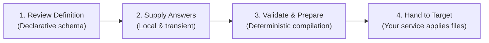

# Configurator Documentation Hub

Welcome to the ISLAMU Configurator documentation. Configurator is an offline, deployment-neutral utility that turns declarative setup definitions and local user answers into production-ready configuration files (`.env`, JSON, YAML).

Documentation is organized into two parallel tracks:
- **`public/` (Adopters & Integrators):** User guides, interface walkthroughs, command references, and tutorials.
- **`internal/` (Contributors, Maintainers & AI Agents):** Core vision, rejected alternatives, architecture diagrams, engineering contracts, and invariant policies.

---

## Start with Your Task

| I want to… | Start here |
|---|---|
| Understand what Configurator is and how it works | 📖 [Overview & Mental Model](public/overview.md) |
| Look up terms, definitions, and concepts | 📖 [Glossary](public/glossary.md) |
| Try a 5-minute offline walkthrough with sample data | 🚀 [Quickstart Guide](public/getting-started.md) |
| Automate configuration or run headless in CI/CD | 💻 [CLI Reference](public/cli.md) |
| Fill in a form interactively | ⌨️ [Terminal TUI](public/terminal.md) · 🖥️ [Desktop GUI](public/desktop.md) · 🌐 [Web Browser](public/browser.md) |
| Add configuration support to my own application | 🛠️ [Integrate Your Tool](public/integrate-your-tool.md) |
| Inspect definition syntax and field types | 🧩 [Definitions Guide](public/definitions.md) |
| Configure JSON Schema validation in your IDE | 📐 [Schema Catalog & IDE Setup](../schemas/README.md) |
| Recover from a failed or interrupted save | 🛡️ [Native Output & Recovery](public/native-output.md) |
| Troubleshoot exit codes, save failures, or UI issues | 🔧 [Troubleshooting Guide](public/troubleshooting.md) |
| Compare with RunTipi, Backstage, Umbrel, Portainer, or Helm | ⚖️ [Architectural Comparison](public/comparison.md) |
| Build from source or run standalone binaries | 📦 [Standalone Packaging](public/packaging.md) |
| Deep-link an application directly into Configurator | 🔗 [Launch Integration](public/launch-integration.md) |
| Browse or contribute to the public catalog | 🏪 [Definition Store](public/definition-store.md) |
| Inspect historical architecture reviews & reports | 📑 [Historical Reports Index](internal/reports/README.md) |
| Contribute code or understand architecture | 🏗️ [Architecture](internal/ARCHITECTURE.md) · [Vision & Approach](internal/VISION_AND_APPROACH.md) · [Project Map](../PROJECTS.md) |

---

## Understand the Workflow

1. **Review a Definition:** Upstream authors declare questions, validation constraints, and output file projections. Definitions are pure data and contain no executable scripts.
2. **Supply Local Answers:** Enter your answers in the CLI, Terminal, Desktop, or Browser. Real credentials stay in private, local memory.
3. **Validate and Prepare:** Configurator checks all constraints and deterministically compiles output files. On Linux, files are written with owner-only, create-only protection.
4. **Hand Files to the Target:** You apply the generated files to your target application (e.g., via Docker Compose, systemd, or Kubernetes). Configurator never modifies running services on your behalf.

> [!IMPORTANT]
> **Filesystem Protection Boundaries:** The native protected writer enforces create-only, owner-only (`0600`) file permissions verified on Linux. On macOS and Windows, protected saves reject without an ordinary-file fallback. Browser downloads are deliberate user-initiated exports, not native protected saves. See [Platform Boundaries](public/packaging.md#cli-operating-system-boundaries).

---

## User Guides and Technical References

Each public guide corresponds to an authoritative internal technical reference:

| Domain | User Guide (`public/`) | Technical Source Anchor (`internal/`) |
|---|---|---|
| **Architecture & Vision** | [Overview](public/overview.md) · [Glossary](public/glossary.md) | [Vision & Approach](internal/VISION_AND_APPROACH.md) · [Architecture](internal/ARCHITECTURE.md) · [Design Alternatives](internal/DESIGN_ALTERNATIVES.md) |
| **Definitions & Validation** | [Definitions](public/definitions.md) · [Schemas](../schemas/README.md) | [Core Definition Contract](internal/CORE_DEFINITION_CONTRACT.md) |
| **Tool Authoring & Revisions** | [Integrate Your Tool](public/integrate-your-tool.md) | [Maintainer Authoring](internal/MAINTAINER_AUTHORING.md) |
| **CLI & Machine Envelopes** | [CLI](public/cli.md) | [CLI Contract](internal/CLI_CONTRACT.md) |
| **Interactive Terminal** | [Terminal](public/terminal.md) | [Terminal Client](internal/TERMINAL_CLIENT.md) · [Presentation State](internal/PRESENTATION_STATE.md) |
| **Desktop Application** | [Desktop](public/desktop.md) | [Desktop Client](internal/DESKTOP_CLIENT.md) · [Presentation State](internal/PRESENTATION_STATE.md) |
| **Browser WASM & Privacy** | [Browser](public/browser.md) | [Launch Contract](internal/LAUNCH_CONTRACT.md) · [Presentation State](internal/PRESENTATION_STATE.md) · [Browser UI](internal/BROWSER_UI.md) |
| **Protected Output & Recovery** | [Native Output](public/native-output.md) | [Protected Artifacts](internal/PROTECTED_ARTIFACTS.md) |
| **Troubleshooting & Diagnostics** | [Troubleshooting](public/troubleshooting.md) | [Operations Guide](internal/OPERATIONS.md) · [Historical Reports Index](internal/reports/README.md) |
| **Platform Comparison** | [Comparison Matrix](public/comparison.md) | [Vision & Approach](internal/VISION_AND_APPROACH.md) · [Universal Configurator Strategy](internal/universal-configurator.md) |
| **Target Handoff & Launch** | [Launch Integration](public/launch-integration.md) | [Launch Contract](internal/LAUNCH_CONTRACT.md) · [ADR: Definition Boundary](internal/adr/ADR-definition-runtime-boundary.md) |
| **Standalone Packaging** | [Packaging](public/packaging.md) | [Packaging Contract](internal/PACKAGING.md) |
| **Definition Store** | [Definition Store](public/definition-store.md) | [Store Contract](internal/DEFINITION_STORE.md) · [ADR: Optional Store](internal/adr/ADR-optional-definition-store.md) |

---

## Contributor Reading Paths

| If you want to… | Follow this reading order |
|---|---|
| **Understand project vision, goals & rejected attempts** | [Vision & Approach](internal/VISION_AND_APPROACH.md) → [Design Alternatives](internal/DESIGN_ALTERNATIVES.md) → [Architecture Overview](internal/ARCHITECTURE.md) |
| **Make a code change** | [Project Map](../PROJECTS.md) → [Quick Reference](internal/QUICK_REFERENCE.md) → affected technical reference above → [Testing Guide](internal/TESTING.md) |
| **Understand governance & standards** | [Governance](internal/GOVERNANCE.md) → [Documentation Architecture](internal/DOCUMENTATION_ARCHITECTURE.md) |
| **Explore architectural decisions** | [ADR Index](internal/adr/) (12 Architecture Decision Records) |
| **Reproduce verification & package checks** | [Operations Guide](internal/OPERATIONS.md) → [Packaging Contract](internal/PACKAGING.md) |
| **Work on releases & provenance** | [Release Runbook](internal/RELEASE_RUNBOOK.md) → [Release Tooling](../eng/release/README.md) → [IP Governance](internal/legal/IP_GOVERNANCE.md) |
| **Work as an AI coding agent** | [AGENTS.md](../AGENTS.md) → matching intent in `.agents/contract/intents.yaml` |
