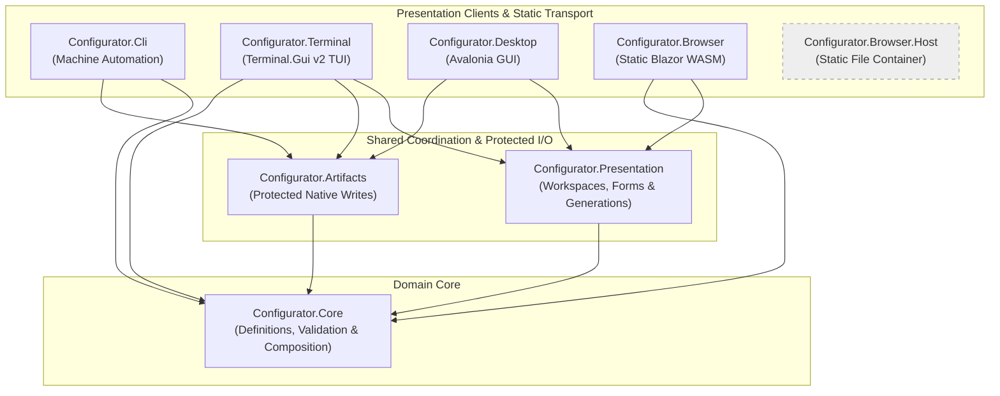
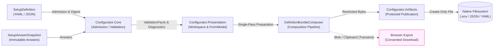

# Architecture Overview

> **Audience:** Contributors | AI agents
> **Status:** Implemented
> **Owner:** Contributor Experience
> **Last Verified:** 2026-10-27
> **Source Anchors:** `PROJECTS.md`, `src/`, `docs/internal/CORE_DEFINITION_CONTRACT.md`, `docs/internal/PRESENTATION_STATE.md`

ISLAMU Configurator is a layered, offline-first configuration runtime. It transforms declarative setup definitions into verified, native configuration artifacts across multiple user surfaces while enforcing strict boundaries around secret custody and target authority.

## Component Architecture

The codebase is organized into eight primary projects under `src/`. Dependencies strictly flow downward from presentation and client adapters toward the domain engine:

> [!NOTE]
> `Configurator.Browser.Host` is an optional, decoupled static file server. It has zero product dependencies, contains no answer-processing logic, and serves only compiled public assets.

## Data Flow Pipeline

The runtime processes configuration through a single-pass, deterministic pipeline:

1. **Definition Admission:** `SetupDefinitionCodec` parses JSON/YAML, computes the canonical SHA-256 digest, and snapshots metadata into an immutable `SetupDefinition`.
2. **Answer Snapshotting:** `SetupAnswerSnapshot` captures user inputs into an immutable, clone-isolated structure.
3. **Core Validation:** `DefinitionValidator` evaluates requirements, constraints, and activation conditions, emitting value-free `Diagnostics`.
4. **Presentation Coordination:** `DefinitionFormModel` manages transaction gates, edit revisions, and section projections.
5. **Single-Pass Composition:** `DefinitionBundleComposer` prepares all active artifacts in declared order from one validated snapshot.
6. **Protected Publication:** `ProtectedArtifactBundlePublisher` executes create-only Linux writes, recording per-file outcomes in an immutable receipt.

## Key Abstractions

| Abstraction | Owning Project | Role & Responsibility |
|---|---|---|
| `SetupDefinition` | `Configurator.Core` | Immutable admitted definition containing fields, conditions, artifact projections, and canonical digest. |
| `SetupAnswerSnapshot` | `Configurator.Core` | Thread-safe, immutable snapshot of user answers; isolates business logic from UI state. |
| `DefinitionValidator` | `Configurator.Core` | Pure evaluation engine returning readiness, field states, and value-free diagnostics. |
| `DefinitionArtifactComposer` | `Configurator.Core` | Generates deterministic native artifact bytes (`.env`, JSON, YAML) from validated answers. |
| `DefinitionDraftArtifactComposer` | `Configurator.Core` | Prepares secret-deferred draft artifacts with explicit completion pointers for local manual completion. |
| `DefinitionFormModel` | `Configurator.Presentation` | Form facade managing edit revisions, typed presence, and section projections under a mutation gate. |
| `SetupPresentationWorkspace` | `Configurator.Presentation` | Manages atomic operation settlement, generation fencing, and subscriber notifications across operations. |
| `ProtectedArtifactBundlePublisher` | `Configurator.Artifacts` | Executes Linux create-only, no-replace file writes with per-file status recording and receipt generation. |
| `BoundedFileInput` | `Configurator.Artifacts` | Asynchronous file reader isolated from UI dispatchers with strict size limits and buffer disposal. |
| `SetupCliApplication` | `Configurator.Cli` | Spectre-based CLI command runner emitting pre-sized JSON receipts with sanitized view digests. |

## Layer Rules & Dependency Constraints

Contributors and automated agents must adhere to strict architectural dependency rules:

- **`Configurator.Core` is Pure:** It has zero project dependencies and zero platform/system dependencies. It performs no I/O, makes no network calls, and accesses no ambient environment variables.
- **`Configurator.Presentation` is Browser-Safe:** It depends only on `Core`. It coordinates in-memory UI state, form indexes, and workspace generations. It must **never** reference `Artifacts` or perform filesystem I/O.
- **`Configurator.Artifacts` Owns Native File Access:** It depends only on `Core`. It contains native file operations and enforces Linux create-only permissions.
- **`Configurator.Browser` Never Touches `Artifacts`:** It references `Presentation` and `Core`. File export occurs via deliberate browser downloads and Blob URLs; it has no access to native file protection.
- **Native Clients Coordinate Shared Layers:** `Configurator.Terminal` and `Configurator.Desktop` reference `Presentation`, `Artifacts`, and `Core` to provide native experiences. `Configurator.Cli` references `Artifacts` and `Core`.
- **`Configurator.Browser.Host` is Standalone:** It has zero project references to any `Configurator.*` library, serving purely as a static asset container.

> [!CAUTION]
> Never introduce circular references, invert layer boundaries, or import target application assemblies (such as Event or Keycloak) into Configurator.

## Build and Verification

For exact build preconditions, targeted test commands, and package validation procedures across all projects, consult [PROJECTS.md](../../PROJECTS.md).
