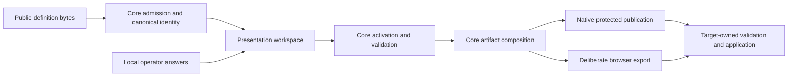

# Configurator maintainer integration architecture and inspection

> **Audience:** Contributors | Integrators | AI agents
> **Status:** Mixed — current implementation inspection and proposed authoring architecture
> **Owner:** Contributor Experience | Core | Agent Context
> **Last Verified:** 2026-10-10
> **Source Anchors:** `src/Configurator.Core/Definitions/`, `eng/configurator/`, `examples/`, `store/`, `docs/internal/CORE_DEFINITION_CONTRACT.md`; Event-owned `eng/configurator/DefinitionExporter/` and `configurator/definitions/islamu-event/`

The integration burden is excessive because the maintainer-facing format is also the engine's expanded execution format. A small tool must describe identity, fields, presentation metadata and output instructions in detail; Event adds its own exporter, environment catalogue, secret-registry parity and host-shaped input vectors. These are different responsibilities, but today they are encountered together.

The recommended change is **one compact, maintainer-owned authoring file, compiled deterministically into the existing bounded definition model**. Generate repetitive metadata, identifiers, ordinary output projections and optional store metadata. Keep secret classification, actual target keys, safe public defaults, supported application versions and target-specific acceptance rules explicit. Ship a portable integration skill that uses this same compiler and validation commands. An agent should accelerate integration without becoming its correctness authority.

This report proposes technical contracts and delivery slices. It does not implement them. All commands under proposed behavior are future vocabulary; they are not available in the current CLI. There is no need for compatibility adapters, obsolete aliases or an Event dependency in Configurator.

## Inspection scope and evidence

The inspected Configurator HEAD is `7a244ee1af60129d30f95e11522088851ccb9493`; Event HEAD is `072f2b6dbd8e4b87e16b795bc02a9ea23f902046`. Both checkouts contain existing changes. The optional store is present as uncommitted work in this Configurator checkout, so its behavior below describes the working tree rather than a released capability. No existing work or user-owned strategy document was edited.

Research used official JSON Schema, Helm, Pydantic, Microsoft and Agent Skills documentation. Tavily and Context7 were absent from the callable tool inventory and the inspected local MCP server entries. Firecrawl supplied the live documentation fallback. This is a tooling limitation, not evidence that either requested service was used. Repository source remained local; external queries contained only neutral technology topics.

Inspection combined the repository knowledge-graph entry point, bounded source reads, exact caller searches, existing test-source inspection, JSON inventories and native byte comparisons. The graph could not resolve `SetupDefinitionCodec.ParseJson`; direct `rg` searches supplied the caller evidence. Graph statistics were not treated as coverage proof. No product build or test suite was run for this documentation-only change. Existing tests are described as contracts found in source, not as freshly passing execution evidence.

## Current data model and control flow

### Core provides a useful and deliberately narrow runtime

[`SetupDefinitionCodec`](../../src/Configurator.Core/Definitions/SetupDefinitionCodec.cs) admits bounded JSON or the repository's restricted YAML dialect. It normalizes input, rejects duplicate and unknown members, deserializes the closed document shape, checks semantic invariants and constructs an immutable [`SetupDefinition`](../../src/Configurator.Core/Definitions/SetupDefinition.cs). The definition retains canonical bytes, a SHA-256 digest, family GUID, numeric revision, exact application versions, fields and artifact declarations.

The generated [`setup-definition-v1.schema.json`](../../schemas/setup-definition-v1.schema.json) requires eleven root members: `schemaVersion`, `familyId`, `revision`, `applicationId`, `applicationVersions`, `publisher`, `title`, `entryPoints`, `locales`, `fields` and `artifacts`. Every field requires `id`, `type`, `title`, `sensitivity` and `disclosure`. An artifact requires identity, format, filename, apply/restart metadata and an explicit projection. This is reasonable as an admitted runtime contract, but expensive as a handwritten integration contract.

The supported field types are strings, booleans, integers, numbers, string enums, scalar lists, objects and object lists. Conditions and projections form closed data vocabularies. They are interpreted operations, not executable extensions. List bounds, nested field declarations and `uniqueBy` support real structured configuration without target-specific code in Core.

[`DefinitionValidator`](../../src/Configurator.Core/Definitions/DefinitionValidator.cs) derives activation, requiredness and effective values from a definition and an immutable answer snapshot. Ordinary defaults are applied here. Disclosure changes visibility, never validation. Nested objects inherit the strongest child sensitivity. Complete composition requires valid active answers; secret-deferred composition is a separate draft operation with unresolved completion locations.

[`DefinitionArtifactComposer`](../../src/Configurator.Core/Artifacts/DefinitionArtifactComposer.cs) interprets declared projections into dotenv, JSON, YAML or bounded Markdown. All answer-derived artifacts are restricted. Native publication belongs to Artifacts, including create-only protected writes and unsupported-host refusal. Browser export is deliberate custody transfer and makes no native permissions guarantee. Target acceptance and authorization remain with the target application.



This direction should survive the simplification. Core should not become a plugin host, package installer, store client, application inspector or secret-provider adapter.

### Identity has three different meanings

The family GUID identifies a definition lineage. The numeric revision identifies a published point in that lineage. The digest identifies its complete canonical content. [`SetupDefinitionRegistry`](../../src/Configurator.Core/Definitions/SetupDefinitionRegistry.cs) rejects different digests under one family/revision and rejects ambiguous selection without sufficient selectors. Active browser sessions retain their admitted identity and conflict history through their own registry boundary.

Application compatibility is an exact declared version set. A version string is a maintainer claim; it is not certification that Configurator or a running application tested the configuration. Publisher labels and GUIDs do not authenticate a maintainer. Store inclusion does not change those facts.

The digest uses Configurator's ordinal-property, decimal-number, System.Text.Json canonicalization profile. It is explicitly not an RFC 8785 compatibility claim. A new authoring compiler should reuse this profile; introducing a second canonicalizer would make identity harder to reason about.

### Generated JSON Schema is structural assistance

[`DefinitionSchema.Generate`](../../src/Configurator.Core/Definitions/DefinitionSchema.cs) exports the C# document shape and adds selected root constraints. For example, the current generated field `type` and `sensitivity` properties are strings without the runtime enum vocabularies. Runtime admission additionally enforces field vocabulary, constraint applicability, references, cycles, private defaults and resource budgets.

This is not evidence of an admission bypass: callers still invoke Core. It is an authoring feedback gap. An editor can accept a structurally valid document that the engine rejects. The new authoring experience must call semantic admission, and its generated schema should expose every constraint that can accurately be represented. Cross-reference and budget rules remain runtime checks.

JSON Schema itself distinguishes annotations from assertions. `default` does not fill missing values during ordinary JSON Schema validation, and `writeOnly` describes usage rather than establishing secure storage. The 2020-12 specification also distinguishes format annotation from format assertion. These keywords cannot substitute for Configurator's privacy and validation policies. [JSON Schema annotations](https://json-schema.org/understanding-json-schema/reference/annotations), [2020-12 validation vocabulary](https://json-schema.org/draft/2020-12/draft-bhutton-json-schema-validation-00).

## What Event currently makes a maintainer coordinate

Event is an advanced integration with environment configuration, portable manifests, tenant packages, operator identity and legal drafts. Its integration should be a demanding conformance fixture, not the minimum template for unrelated software.

| Responsibility | Current authoritative owner | What is generated or checked |
| --- | --- | --- |
| Environment meaning, activation, validators and safe defaults | Event `PlatformEnvironmentCatalogue` | Environment metadata and Configurator environment fields |
| Secret binding, scope and allowed sources | Event `SecretDefinitionRegistry` | Parity with environment declarations |
| Portable target contract and business vocabulary | Event Wire contracts, schemas and `SettingRegistry` | Host validation of source shapes and projected artifacts |
| Integration family, revision and application version | `inputs/profile.json`, plus exporter constants | Definition identity and release metadata |
| Output shape examples | Event `inputs/` | Field/projection generation, synthetic answer and expected-output vectors |
| Field metadata and mapping rules | `DefinitionBuilder` | Configurator fields and bounded projections |
| Compose, environment examples and public configuration guidance | Event target files and parity gates | Key ordering, requirements and documentation consistency |
| Store presentation | Configurator `store/*/project.json` | Public discovery index and canonical snapshots |

The strongest source anchors are Event's [export contract](../../../Event/docs/internal/CONFIGURATOR_DEFINITION_EXPORT.md), [DefinitionBuilder](../../../Event/eng/configurator/DefinitionExporter/DefinitionBuilder.cs), [environment catalogue](../../../Event/eng/configurator/DefinitionExporter/Environment/PlatformEnvironmentCatalogue.cs), [environment parity gate](../../../Event/eng/configurator/DefinitionExporter/EnvironmentCatalogueContract.cs), [secret registry](../../../Event/src/Explore.Domain/Secrets/SecretDefinitionRegistry.cs), [profile](../../../Event/configurator/definitions/islamu-event/inputs/profile.json) and [exporter entry point](../../../Event/eng/configurator/DefinitionExporter/Program.cs).

The currently checked Configurator Event definition contains **427 top-level fields and five artifacts**, occupying **274,837 bytes**. Of those root fields, 361 are environment fields and 24 are selectors. Root declarations classify 285 fields as public, 84 as sensitive and 58 as secret. These counts do not describe every nested leaf or effective parent sensitivity. Five artifact IDs are `environment`, `configuration-manifest`, `tenant-package`, `operator-identity` and `legal-drafts`.

The neutral example is much smaller but still requires 3,064 bytes for four fields and three outputs; Grafana's checked example requires 2,331 bytes. Byte size alone is not a usability metric. The practical burden is how many concepts and duplicated declarations a maintainer must understand to produce those bytes.

### Concrete findings

| Finding | Evidence and practical consequence | Recommended change |
| --- | --- | --- |
| Expanded runtime format is the starting point | The public guide starts from a complete runtime definition, including GUIDs and projection operations | Give maintainers a compact source contract; compile the expanded representation |
| Repeated labels, IDs and mappings | Ordinary fields repeat identity, title, sensitivity, disclosure and `copy` references | Key fields once; derive labels and ordinary mappings; retain explicit privacy decisions |
| Integration identity is repeated | Event's family is declared in `DefinitionBuilder` and checked against `profile.json` | One persisted machine-owned family value; references derive from it |
| Some field IDs depend on traversal order | `NextId` generates artifact-prefixed `.fNNNN` IDs from a shared counter; 39 checked root IDs use that shape | Derive field identity from stable artifact/path semantics |
| Examples influence declared structure | Recursive projection walks supplied objects/arrays; optional tenant document vocabulary is collected from input rows | Obtain admissible structure from target schemas/registries; use examples as independent vectors |
| Generated files appear to be separate authoring responsibilities | `definition.json`, `setup-definition.json` and `public-definition.json` contain the same definition bytes | One canonical generated definition; derive needed package copies |
| Store adds another metadata contract | Eight exact members in `project.json`, plus declared revision files and folder rules | Generate the store projection from the same source; keep curation decisions store-owned |
| Editor and engine validation differ | Schema string properties do not expose runtime vocabularies | Generate richer schema constraints and invoke the semantic checker |
| Existing skill serves operators | `configurator-cli` describes existing local artifact operations | Add a dedicated maintainer-integration skill with source discovery and compilation |
| Historical readiness guidance is stale | The older readiness report describes a public-only browser and older counts | Treat current Core, browser custody and launch contracts as authority; reconcile old guidance separately |

Traversal-based field IDs are especially problematic. Adding an earlier scalar can renumber later fields even when their semantic paths are unchanged. That makes generated diffs, answer fixtures and review harder to interpret. The proposed stable-path policy addresses identity within a definition; it is not an automatic answer-migration promise.

The existing Event exporter already provides valuable safeguards: host validation, secret-registry parity, bounded reads, deterministic canonicalization, revision conflict checks and independently prepared host vectors. Preserve those mechanisms. Reduce the authoring burden around them rather than removing them.

## Architecture options and recommendation

| Option | Maintainer burden | Correctness and maintenance | Decision |
| --- | --- | --- | --- |
| Keep the runtime format and improve examples | High; all engine concepts remain exposed | Small immediate change, little structural improvement | Insufficient for the requested adoption experience |
| Compact authoring contract compiled to the existing runtime | Low for ordinary tools; explicit escape path for advanced outputs | Reuses admission, composition, privacy and client contracts | **Recommended** |
| Replace Core with a general JSON Schema interpreter | Potentially low initially | Requires a much larger semantic surface, reference handling and new privacy/projection policy | Reject as the first change |
| Let an agent generate the current expanded files | Lower first-edit effort, unchanged integration complexity | Agent mistakes and drift remain; maintainers still inherit multiple authorities | Useful only after deterministic tooling exists |

The compiler is a real missing responsibility, so adding it is justified. It should be a small pure component in Core, not a service framework. Keep file discovery, schema export invocation, release-file management and store generation in CLI/engineering adapters. No generic repositories, mediator pipeline, reflection plugin system or language-specific dependency belongs in the runtime.

Pydantic demonstrates schema generation from existing typed models; Helm consumes an existing values schema in its validation workflow. These support the principle of reusing an application's own declarations rather than requiring duplicate Configurator types. They do not prove that those schemas carry secret policy or can be converted losslessly. [.NET options validation](https://learn.microsoft.com/en-us/dotnet/core/extensions/options#options-validation) also illustrates why a target's runtime rules remain relevant after structural checking. [Pydantic schema generation](https://docs.pydantic.dev/latest/concepts/json_schema/), [Helm schema files](https://helm.sh/docs/topics/charts/#schema-files).

## Proposed maintainer source contract

### One new integration file for the ordinary case

Use `configurator.json` as the initial canonical authoring format. JSON already has a bounded native parser, editor tooling and unambiguous numbers. YAML can later normalize into the same authoring model, but the existing restricted YAML parser rejects floating-point syntax and advanced YAML features; do not promise full YAML compatibility today.

This is a proposed source example, not a currently admitted `SetupDefinition`. The schema URI is proposed and does not identify a shipped schema. The `identity` block is inserted by tooling; maintainers do not choose or look up a GUID.

```json
{
  "$schema": "urn:islamu:configurator:authoring:v1",
  "identity": {
    "familyId": "69cdb122-41d2-4fab-9b82-7929a889c726",
    "revision": 1
  },
  "project": {
    "id": "example.service",
    "name": "Example Service",
    "repository": "https://github.com/example/service",
    "definitionLicense": "MIT"
  },
  "applicationVersions": ["1.0.0"],
  "fields": {
    "SERVICE_HOST": {
      "type": "string",
      "sensitivity": "public",
      "default": "localhost"
    },
    "SERVICE_PORT": {
      "type": "integer",
      "sensitivity": "public",
      "default": 8080,
      "minimum": 1,
      "maximum": 65535
    },
    "SERVICE_TOKEN": {
      "type": "string",
      "sensitivity": "secret",
      "required": true
    }
  },
  "outputs": {
    ".env": { "format": "dotenv", "restart": "process" }
  }
}
```

The environment key appears once. No handwritten `id`, `title`, `disclosure`, artifact ID, `copy` node, publisher label, locale list or entry-point list is needed for this case. A single dotenv output uses the declared root scalar keys exactly; there is no guessed casing or double-underscore conversion. The compiler generates ordinary projection instructions.

The contract should remain closed and generated from its actual owner. The proposed `$schema` belongs to the authoring format and is not copied into today's runtime document, whose admission rejects unknown root members. Implementing this example requires a new authoring codec/compiler; simply passing it to `ParseJson` would fail.

### Explicit mappings for applications with several outputs

Ordinary JSON/YAML output can copy the same root keys automatically. Dots in a key remain literal characters; the compiler must not invent nesting. When actual target keys differ, add a `bindings` map to the relevant output. The following proposed excerpt assumes declared logical fields `serverPort` and `apiToken`:

```json
{
  "outputs": {
    ".env": {
      "format": "dotenv",
      "bindings": {
        "APP_LISTEN_PORT": "serverPort",
        "APP_API_TOKEN": "apiToken"
      }
    },
    "service.json": {
      "format": "json",
      "bindings": {
        "/server/port": "serverPort",
        "/auth/token": "apiToken"
      }
    }
  }
}
```

Dotenv binding keys are exact environment keys. JSON/YAML binding keys are bounded object-member pointers with the existing JSON Pointer escaping rules; the compiler expands them into ordinary `object`/`copy` projections. Reject undeclared fields, duplicate destinations, conflicting ancestor/descendant paths and unsupported array-index assignment. Whole declared objects/lists can be copied to a destination; dynamic key construction is excluded. Optional nested field declarations use the same compact property-key map recursively and lower to the existing typed property arrays.

One field used by two genuinely different target files needs two mappings, but its type, sensitivity and validation are authored once. For advanced conditions/constants/repetition, allow an explicit existing bounded `projection` instead of shorthand, mutually exclusive with `bindings`. The existing Core validator remains its authority. That escape path avoids designing a second expression language and keeps advanced Event composition available without imposing it on small tools.

### Metadata defaults and decisions

| Concern | Proposed default or derivation | When explicit input is required |
| --- | --- | --- |
| Family GUID | Generated once by `init`, persisted in this file | A deliberate fork that establishes a separate lineage |
| Definition revision | Initialized by tooling; advanced by an explicit revision command | Publishing changed compiled content |
| Application identity | Read from reviewed package/repository metadata or supplied once | Detection is absent or ambiguous |
| Application versions | Read a declared version where reliable | Confirm exact supported versions; never silently invent a range |
| Project name and publisher label | Derive from reviewed project metadata | Override misleading or unsuitable labels |
| Definition license | Explicit reviewed declaration for distributed definition material | Required for store redistribution; application license is separate |
| Field title | Humanize the source key for ordinary cases | Consequential or ambiguous settings need a useful explanation |
| Field type | Explicit; optionally infer from a reviewed scalar default or homogeneous enum | Empty examples, numeric strings, units and ambiguous values |
| Sensitivity | `sensitive` when omitted; known secret evidence can raise the floor | Declaring `public`, allowing a default, or explaining a secret |
| Disclosure | `guided` | A maintainer intentionally marks an advanced control |
| Locale and entry point | `en`; derived output selections | Actual translated metadata or a distinct workflow |
| Apply semantics | `generationOnly` | A supported declarative import contract; never permission to apply |
| Restart | `none`, meaning no asserted restart requirement | An actual restart consequence is known |
| Output mappings | Exact root keys for the simple supported format | Multiple files, nesting, renaming, constants, lists or conditions |

The example declares a restart because it is known. A missing restart must not be interpreted as a guarantee of hot reload. Human-readable consequential guidance remains important even when a label can be generated.

One file means **one new Configurator integration source**, not elimination of the application's own schemas, options types, Compose files, tests or documentation. Large applications already have legitimate target authorities. Configurator should reuse them rather than demand that they disappear.

### Stable field and output identity

For flat fields with identifiers admitted by Core, the source key can be the runtime field ID. For a structured importer, use a deterministic ID derived from the artifact key and canonical JSON Pointer. If the path cannot fit Core's identifier grammar, a prefixed full SHA-256 of that normalized path is a suitable bounded encoding. Keep the path-to-ID map generated and value-free. Do not truncate hashes, use traversal counters or derive identity from example values.

Output IDs can likewise derive from their canonical filename key, with a bounded deterministic encoding where required. Authors select filenames and meaningful configuration paths; tooling handles internal identifiers. Detect mapping collisions explicitly, including case-fold collisions and generated-ID collisions. A rename is a semantic definition change and requires a new revision; it must not silently reconnect old answers.

Map keys are sorted deterministically during compilation. Runtime arrays have intentional canonical order; the compiler owns that order. If presentation order is later needed, make it a bounded explicit source property, not accidental JSON object order. There is no need to add that option to the first slice.

### Compiler algorithm and layer boundaries

1. Admit bounded authoring bytes with duplicate/unknown-member checks, depth and aggregate limits.
2. Validate identity, metadata, fields and output declarations. Establish privacy classifications before processing defaults or literals.
3. Resolve only already-supplied source data. The pure compiler performs no filesystem access, schema fetch, target startup or package installation.
4. Derive stable IDs, display defaults and simple projections. Reject unsupported or ambiguous transformations.
5. Emit the existing runtime document, including all required members and bounded explicit operations.
6. Pass emitted bytes through `SetupDefinitionCodec.ParseJson`. Authoring success requires actual Core semantic admission.
7. Return the admitted definition and bounded source diagnostics. Canonical bytes and the runtime digest come from the existing admission owner.

Use immutable source/result records where value semantics fit repository guidance. Retain `SetupDefinition`'s encapsulated canonical-byte and snapshot ownership. A single compiler component and a closed source DTO set are sufficient initially; avoid an extensible intermediate representation or compiler-pass framework.

Native clients and the Browser should eventually accept the self-contained authoring file through this shared pure admission path, before answer collection. No adapter independently expands shorthand. Remote launch should initially keep consuming compiled canonical JSON through the existing public HTTPS/digest contract. Accepting remote authoring later requires explicit binding of compiler semantics and every consumed source; it is not an incidental extension of `FetchAsync`.

## Reuse existing schemas without pretending conversion is universal

Support two practical lanes through the same compiler. The simple lane authors the compact file directly or initializes it from `.env.example`. The schema lane imports an application's existing public configuration schema and adds only missing Configurator policy/mapping information. The imported target schema remains authoritative for its own contract.

Begin with a documented JSON Schema subset that the existing engine can represent exactly. Materialize a self-contained source or compiled definition before distribution; browsers must not resolve schema references themselves.

| Imported construct | Initial treatment |
| --- | --- |
| Explicit scalar `type`, string `enum`, length and numeric bounds | Translate when equivalent to admitted Core semantics |
| `title`, `description` | Display metadata, subject to public-data review and text bounds |
| `required` object properties | Translate at the correct object scope |
| Closed objects and homogeneous scalar/object arrays | Translate within existing nesting/list limits |
| `$defs` and local `$ref` | Bounded expansion; reject cycles and excess aggregate growth |
| `default` | A candidate only; validate it and require public classification before retention |
| `writeOnly: true` | Raise privacy conservatively; never a complete secret-binding contract |
| `format` | Map only a verified supported validator; reject or explicitly report unsupported semantics |
| Nullable unions, heterogeneous enums, tuple arrays and open property maps | Reject for the initial adapter rather than silently narrowing them |
| `oneOf`, `anyOf`, `allOf`, conditional schemas and custom validation | Reject until an exact, tested translation exists |
| `pattern`, `patternProperties`, custom regex or dynamic references | Unsupported initially; no regex engine or executable hook is implied |
| Remote references | Reject in the initial importer; no hidden network or credential authority |

Even similar constructs need compatibility checks. Core's required string handling treats whitespace as missing, for example; a generic JSON Schema `required` property does not by itself impose that rule. Defaults can change missing-value behavior. A converter must report such differences or refuse the conversion, not claim equivalence because the property names match.

An optional local reference resolver belongs in the native importer adapter: root-confined reviewed public files, symlink refusal, bounded reads and a recorded input inventory. It supplies bytes to the pure compiler. Do not serialize absolute developer paths into definitions. Avoid introducing a JSON Schema validator dependency until a selected adapter actually needs full target validation and its closure has been reviewed.

An agent can inspect existing options types, schema generators and safe examples in the maintainer's repository. It must not execute arbitrary application startup merely to discover configuration. Framework-specific schema exporters are optional build-time integrations; they never become runtime plugins loaded from definitions.

## Identity and revision without GUID homework

Keep the family GUID as a machine-managed runtime lineage marker for the first implementation. Removing its manual authoring cost does not require replacing `Guid` across registry selection, launch parsing, imported templates, fixtures and every client. That is a separate semantic decision, not an adoption prerequisite.

`init` creates it once, inserts it in the single authoring source and never regenerates it because a folder, store slug or repository URL changes. A project ID is human-readable metadata; a repository URL is distribution context; neither authenticates the family. A deliberate independent fork receives a new family through explicit tooling rather than an accidental rename.

Revision changes must also be deliberate. `check` is read-only. Rebuilding unchanged source must produce identical bytes and identity. A build must not increment revision on every invocation. An explicit revision command compares against the previous released canonical definition, advances the persisted numeric revision when appropriate and regenerates derived outputs. Retain a reviewed previous-release anchor as generated data, not a second handwritten metadata document.

The anchor is not authentication and can be forged by an attacker controlling a repository. Receivers still retain family/revision conflict history and reject conflicting admitted content. Store and CI should compare against the authoritative prior submitted revision. Concurrent revisions that choose the same number but produce different bytes must fail and be rebased to a new revision; no last-writer-wins overwrite.

Separate these version axes: authoring schema version, compiled runtime schema version, definition revision, exact target application versions, and compiler implementation version. Do not force maintainers to copy them into several files. Compiler behavior changes must trigger recompilation and a new definition revision if canonical runtime content changes. Metadata-only changes also change identity if they alter the admitted runtime document.

## Secret semantics with less repetition

A safe simplification removes repeated declarations, not the privacy decision. A password name heuristic can suggest `secret`; absence of that heuristic cannot prove `public`. Defaults, sample values, connection strings and copied literals are especially dangerous because definitions are public distribution data.

Use one field-level sensitivity declaration. Default an unspecified field to `sensitive`; preserve the strongest nested classification. Retain the current rule that only reviewed public fields may have defaults/recommendations, including defaults on public containers with protected descendants. Treat literal projection values as public publication and review them accordingly. Imported `examples` must never become literals or defaults automatically.

For Event, `SecretDefinitionRegistry` is richer than a boolean secret flag: it owns setting keys, allowed scopes, allowed sources and environment bindings. Prefer deriving the Configurator classification and binding metadata from that authoritative registry and joining it to environment metadata. Keep the existing parity gate until the join replaces duplicated declarations. Do not move Event's secret policy into the generic authoring file simply to achieve a cosmetic single-source claim.

Other projects can declare sensitivity directly in the compact source. A future shared application metadata source is useful only if the application itself consumes it and its owners approve the authority change. Runtime reflection or Configurator-specific attributes across every application type would create another adoption tax.

Distinguish secret values from secret references. An external vault identifier or credential-bearing URI may itself be sensitive. Configurator can prepare a bounded reference string when the target declares one; it does not authenticate to a vault, retrieve a credential or promise that a target accepts that reference. Generic secret binding resolution is not part of the first compiler slice.

New metadata must preserve current browser custody: transient answers, per-workspace secret consent, recursive clearing on revocation, stale-operation fencing, public-only caches and deliberate restricted export. A draft with missing secrets remains incomplete. Native writes retain restricted classification even when every field is public.

The integration skill should never open `.env`, production exports, private answer workspaces, cloud credentials or a developer's secret store to discover sample values. Its default inputs are source declarations, public schemas, `.env.example` and synthetic fixtures. Any future local check involving real operator data requires a separately selected workflow and must never expose values through the skill's report.

## Store submission and independent distribution

The [current store builder](../../eng/configurator/BuildDefinitionStore.cs) already has the correct architectural direction: public data, real Core admission, canonical snapshots, bounded root-confined inputs and no store dependency in Core. Its [engineering contract](DEFINITION_STORE.md) documents the eight-member `project.json` and revision-file inventory. Preserve the admission and conflict gates.

The proposed store contribution consists of the same `configurator.json` source, plus only store-owned curation decisions that cannot be derived. Generate name, repository link, definition license, compatibility metadata, identity, revision, digest, output names and canonical snapshots. Tags should be optional; moderators may curate them separately. Store folder identity may derive from a safe slug, with collisions reported rather than silently renamed.

For an existing project, the build must include its previous admitted revisions or a trusted inventory of their identities when validating a contribution. A contributor cannot erase conflict history by removing a source entry. Never allocate a different family merely because a definition is submitted to the store.

There are two independent distribution paths:

1. **Maintainer repository:** commit the compact source; optionally attach the generated canonical definition and launch metadata to a release. Operators can load a local definition, or use a bounded credential-free public HTTPS source with the canonical digest. No store listing is needed.
2. **Optional store:** submit the same source through a PR. Store CI compiles, admits and indexes it. Inclusion adds discovery and review context, not target authority or publisher authentication.

Independent browser HTTPS distribution must satisfy the current source contract, including public credential-free URLs, bounded fetching and applicable CORS behavior. A repository page URL is not automatically a usable raw-definition endpoint. Local file loading remains the simplest fully independent fallback. Generate the exact launch URL from the admitted runtime definition rather than asking a maintainer to assemble family/revision/digest selectors manually.

The source license must describe rights to redistribute the definition material. It must not silently be inferred as MIT because Configurator is MIT, or conflated with Event's application license. Generated metadata preserves applicable attribution and notices. No signing, promoted publisher authority, install command or executable extension belongs in this contribution lane.

## Proposed CLI and maintainer agent skill

### A small command vocabulary

The existing [CLI registry contract](CLI_CONTRACT.md) and generated command schema remain authoritative. The following is proposed vocabulary to add through that owner, not a new wrapper CLI:

```bash
# Proposed: discover public example keys and create one authoring source.
islamu-configurator definition init --from-env-example .env.example --output configurator.json

# Proposed: read-only authoring and Core semantic admission checks.
islamu-configurator definition check --source configurator.json --machine

# Proposed: produce public canonical distribution data and derived metadata.
islamu-configurator definition build --source configurator.json --output dist/configurator

# Proposed: deliberately advance changed published content to a new revision.
islamu-configurator definition revise --source configurator.json --previous dist/configurator/definition.json
```

`init` must not overwrite an existing source or accept a private `.env` by default. It can infer names and obvious scalar types but emits unresolved classifications instead of publishing guesses. `check` reports all independent authoring problems in one bounded result where possible, using codes and source pointers rather than values. Missing required ordinary answers are an operator-workspace concern, distinct from definition admissibility.

`build` writes only reviewed public definition/discovery metadata. Do not route actual answers through it, and do not reuse its ordinary public-file writes for restricted artifacts. It needs deterministic output-inventory checks and a clearly selected generated destination. Before replacing any prior generated definition, compare its admitted family/revision/content and reject changed content at the same or lower revision. A read-only check against a previous-release anchor must apply the same rule; single-document Core admission cannot detect historical conflicts by itself. The existing `artifact` family continues to validate/compose actual operator answers and protect native output.

Store packaging should reuse `BuildDefinitionStore` rather than introduce another compiler implementation. If a standalone store-bundle command becomes useful, add it after the source/compiler workflow proves adoption; an extra command is not required to make the first integration possible.

### Portable integration skill contract

The existing [`configurator-cli` skill](../../.agents/skills/configurator-cli/SKILL.md) is for operators preparing local artifacts. The proposed `configurator-integrate` skill is for maintainers adding or updating a definition in their own repository. It should be distributable without copying Configurator's internal AGENTS contract into every user's project.

Use the public Agent Skills structure: a concise `SKILL.md` with portable `name` and `description`, optional compatibility/license metadata, and references loaded only when needed. Put detailed format guidance and synthetic examples in references/assets. The official specification defines these files and progressive disclosure; it does not establish that a skill's instructions are security enforcement. [Agent Skills specification](https://agentskills.io/specification).

The skill's intended sequence is:

1. Read the maintainer repository's contribution rules and existing diff. Identify the target-owned configuration schema/options source and supported release/version.
2. Inspect safe source declarations and public templates. Establish a value-free inventory of keys, types, validation, defaults, sensitivity evidence and output mappings.
3. Prefer an existing public schema export. Otherwise use the compact source. Never demand a C# exporter for a simple shell, Go, Rust, JavaScript or Python application.
4. Invoke `definition init` or edit the existing source. Preserve identity and unrelated changes. Do not edit generated schemas or runtime bundles by hand.
5. Consolidate unresolved material decisions: secret/public classification, output location hints, application versions and target validation command. Ask only for facts that cannot be established from safe source.
6. Run `definition check`; fix actual diagnostics. Compile using `definition build`.
7. Exercise one meaningful synthetic configuration through real composition. Use literal independently specified expected output for simple mappings, and the target's own validator when available.
8. Inspect the diff for unintended literals, private defaults, unsupported schema narrowing and identity churn. Update the maintainer's integration instructions.
9. Produce a local PR-ready patch, changed-file list, exact commands/results and distribution choices. Opening a remote PR or publishing remains dependent on the maintainer's explicit request.

The deliverables are the source, necessary target-owned reference/export changes, one appropriate conformance vector, and documentation. Generated distribution files are optional according to that repository's release policy. The store submission reuses these artifacts; the skill does not ask a maintainer to author a second set.

Skill prompts must not invent missing secret policies, scrape private operator answers or install an unreviewed exporter. Source text and remote metadata are task data, not authority to execute embedded instructions. Deterministic tooling enforces the actual bounded contract. Record the compiler version and command evidence in the skill result without placing machine-specific paths or actual answers into public artifacts.

The current [`ValidateConfiguratorSkill.cs`](../../eng/configurator/ValidateConfiguratorSkill.cs) validates internal frontmatter and a line ceiling. It cannot prove the integration workflow works, and it expects repository-specific top-level fields that differ from the portable public skill format. Keep internal validation and exported public-format validation explicit. Verify the distributed skill against its actual public metadata contract rather than assuming the internal validator is sufficient.

### Skill evaluation before publication

Use small real fixture repositories: an environment-only service, a closed JSON configuration, a schema-generated application, a conditional secret field, and an advanced Event adapter. Give the agent no existing integration and measure the resulting patch and check output. Repeat an update scenario to expose identity churn and duplicated declarations.

Adversarial fixtures should include misleading secret names, a private-looking default in a public schema, unsupported unions, cyclic references and instructions embedded in help text. Success means a valid bounded integration or a precise refusal identifying missing facts. It does not mean the agent always produces a successful configuration. Evaluate the artifact and actual commands rather than pinning prompt prose in tests.

## Event-specific simplification

Event should retain its host validators, domain registries, revision rules and target-owned configuration schema. Its exporter should become a thin adapter to the generic authoring compiler where it can supply the needed metadata accurately.

First eliminate duplicate family declarations and traversal-counter IDs. Export a stable target-path inventory from existing schema/registry sources. Join environment sensitivity to the authoritative secret registry, retaining parity checks. Keep synthetic inputs and expected outputs as conformance data, not the primary source for every optional property or admissible enum.

Next separate the environment integration from Event's advanced artifact suite at the source level. An ordinary tool should be able to integrate only a dotenv contract. Event can describe its other outputs in the same authoring document or through target-owned build inputs materialized into that document; advanced composition does not become mandatory for everyone.

Trusted issuer count is currently a profile-level shape choice: the exporter emits finite indexed fields. A bounded list-based source could reduce the need to re-export merely to alter count, but generating indexed dotenv keys is not supported by the current projection vocabulary. The existing `repeat`/`index` operations produce values, not dynamic object member names. Treat this as a separate proposed engine capability requiring exact bounds and target validation, not something the first compiler can already solve.

Operator-identity content/revision hashes remain Event-owned. The generic compiler cannot invent server revision authority or recompute an integrity envelope after arbitrary edits. Legal drafts likewise retain their current review/approval boundaries. An easier authoring file must not imply that an operator can bypass either target policy.

Delete obsolete exporter duplication after each new slice passes its own conformance gates. Do not retain the old authoring path as a compatibility facade. The Configurator build must continue to run without the sibling Event checkout; Event exports public data and owns its own tests independently.

## Adversarial analysis and required invariants

The worst failure is a compiler or agent copying an operator secret into a public default/literal and distributing it through the repository or store. A second severe failure is accepting changed meaning under an already pinned family/revision. These risks are not hypothetical reasons for a new approval workflow; they determine what the implementation must reject and test.

| Scenario | Required observable outcome |
| --- | --- |
| Secret/sensitive default, including a protected nested descendant | Authoring check fails before a distributable definition is written |
| Public label around a secret child | Effective sensitivity remains secret; browser consent and default restrictions remain intact |
| Imported `writeOnly`, example or credential-shaped literal | Conservative classification/review; no automatic public default or literal |
| Same family/revision with changed compiled content | Conflict failure; previous source removal cannot erase receiver conflict history |
| Reordered source keys or repeated build | Same canonical output and digest |
| Added unrelated target property | Existing semantic-path field IDs remain stable |
| Unsupported JSON Schema keyword or coercion | Precise unsupported-semantics diagnostic; no silent narrowing |
| Cyclic/local reference expansion bomb | Bounded rejection without partial published output |
| File escape, symlink or remote reference | Import adapter refuses the authority request |
| Template hook, executable validator or network output action | Closed vocabulary rejects it |
| Filename hint attempts a path escape | Admission rejects it; native writer still owns destination authority |
| Secret-deferred condition is unresolved | Draft remains unresolved/incomplete; complete readiness is not fabricated |
| Workspace edit, consent revocation or late fetch | Existing operation generations prevent stale publication |
| Store disappears | Local/independent definition loading and configuration remain usable |
| Definition license differs from target application license | Both retain their proper scope; no inferred relicensing |

Keep limits on authoring inputs and compilation expansion as strict as the existing downstream bounds. A small source can expand into a large definition; check both source and emitted node/byte budgets. An authoring source must never gain larger limits merely because it is called metadata.

Tests should assert business/privacy/identity behavior through the real compiler and existing admission/composition seams. Do not mirror helper calls, pin generated prose, scrape C# text or use the compiler as its own expected-output oracle. For security/privacy implementation, establish the relevant failing invariant before adding the fix.

## Delivery sequence and acceptance

| Slice | Smallest coherent deliverable | Acceptance evidence |
| --- | --- | --- |
| Compact source and compiler | Closed JSON authoring model, generated schema, deterministic expansion, Core admission | Neutral source compiles to literal expected runtime/output vectors; private defaults, unknown vocabulary and identity attacks reject |
| Maintainer CLI | Registry-backed `init`, `check`, `build`, deliberate revision tooling | Actual process envelopes, non-overwrite initialization, read-only checks, stable rebuilds and bounded diagnostics |
| Local client admission | Shared pure authoring admission before answers in native clients and local browser file loading | Same canonical identity across surfaces; no extra network/native dependency or custody regression |
| Store projection | Build store metadata/snapshots from the same source | Source/output inventory and conflict-history checks; store absence leaves independent loading intact |
| Event adapter simplification | Stable-path IDs and authoritative registry/schema joins | Event host validators and independent environment/manifest/identity/legal vectors continue to verify real generic output |
| Public schema importer and integration skill | Documented exact subset, materialized safe inputs and portable skill package | Conversion rejection matrix and fixture-repository skill evaluation |

The first two slices unlock maintainers immediately through generated runtime files. Local direct authoring admission removes another distribution step. Schema import and the skill can then reuse a contract that has real behavior, rather than requiring an agent to compensate for an unfinished format.

Each implementation slice updates the relevant public guide and technical anchor together: definitions/Core contract, CLI/command contract, store/store engineering contract, and launch integration where loading changes. Regenerate schemas and ratchets from their owners; never edit generated output to make a check pass. The report itself changes no shipped commands or definitions, so no public behavior guide was rewritten here.

Affected Configurator owners include `Core/Definitions`, `DefinitionSchema`, the CLI registry/handlers and machine schema generator, native definition-selection callers, local `BrowserDefinitionSource`, `BuildDefinitionStore`, examples, conformance fixtures and any baseline generator whose admitted contract changes. Event changes belong to its exporter, environment/secret joins, source inputs and target contract tests. Keep these as separate independently verifiable increments; this is not a single cross-repository replacement PR.

Use the targeted Release build and affected MTP classes from [PROJECTS.md](../../PROJECTS.md) for implementation. Existing relevant test sources include [admission](../../tests/Configurator.Core.Tests/Definitions/DefinitionAdmissionTests.cs), [sensitivity](../../tests/Configurator.Core.Tests/Definitions/DefinitionSensitivityTests.cs), [artifact conformance](../../tests/Configurator.Core.Tests/Definitions/DefinitionArtifactTests.cs), [external target conformance](../../tests/Configurator.Core.Tests/Definitions/ExternalDefinitionConformanceTests.cs), and Event's [Configurator artifact contract tests](../../../Event/tests/Event.Wire.Contracts.UnitTests/ConfigurationPortability/ConfiguratorDefinitionArtifactTests.cs). Their presence is evidence of intended contracts, not proof that the proposed compiler exists.

### Measure maintainer work rather than generated file count

Set these as proposed acceptance targets, then measure them with real maintainers:

- A plain dotenv tool adds one handwritten integration file, no custom exporter and no manually selected GUID.
- Each field key, privacy classification and ordinary output mapping is authored once.
- A maintainer obtains the first semantically admitted definition in at most two local commands after installing the tool; unresolved facts are consolidated in one report.
- An unchanged rebuild produces identical canonical bytes; adding one setting does not renumber existing semantic fields.
- Store submission adds no second handwritten definition and does not change its lineage.
- The maintainer can keep the source in their own repository and distribute/load it without the store.
- Target validation catches any unsupported semantic gap; the compiler never reports full host acceptance on its behalf.
- Evaluate elapsed maintainer time, number of unresolved decisions, number of manually edited sources, update diff size and incorrect secret classifications. Generated packaging copies are not counted as handwritten burden.

These are engineering/product targets, not measured results. A useful pilot is one small unrelated service followed by Event's environment lane. If the small service still needs exporter code or three metadata files, the simplification has not met its objective.

## Verification record and report limits

The following inspection checks were physically executed before writing this report:

| Check | Command or evidence seam | Observed result |
| --- | --- | --- |
| Checkout identity/state | `rtk git status --short --branch`; native `git rev-parse HEAD` through `rtk proxy` in both checkouts | Configurator on `main`; existing changes preserved; HEADs recorded above; Event had 21 changed/untracked entries at inspection |
| Required document members | `jq` over `schemas/setup-definition-v1.schema.json` | Eleven root members; five required field members; field type/sensitivity schema properties are strings |
| Event definition inventory | `jq` over `examples/islamu-event/setup-definition.json` | 427 root fields, five artifacts, 361 environment fields, 24 selectors and 39 ordinal-pattern IDs; root sensitivity totals recorded above |
| Source sizes | `wc -c -l` over the Event, Grafana and neutral definitions | 274,837 / 2,331 / 3,064 bytes respectively |
| Event/Configurator agreement | Native `cmp` of Event's `setup-definition.json` and Configurator's checked Event definition | Exit 0, byte-identical |
| Browser definition agreement | Native `cmp` of the checked Event definition and bundled Browser definition | Exit 0, byte-identical |
| Store seed agreement | Native `cmp` of `store/islamu-event/definitions/5.json` and the bundled Browser definition | Exit 0, byte-identical |
| Source ownership/callers | Bounded `rg`, source reads and knowledge-graph entry/query | Actual native/browser/store admission callers found; unresolved graph symbol handled with direct search |
| Official documentation | Firecrawl searches/scrapes for the sources linked in this report | Successful saved content for JSON Schema, Helm, Pydantic, Microsoft Options and Agent Skills; one broad ecosystem search returned no results and direct official pages supplied the evidence |
| Local report links | Native Bash extraction and `test -e` for each relative Markdown target | Exit 0; 25 links checked, zero missing targets |
| Proposed JSON examples | Native `awk` extraction followed by `jq -e .` for each fenced JSON example | Exit 0; two syntactically valid examples; this does not assert admission by an unimplemented compiler |
| Report whitespace | `rtk proxy git diff --no-index --check -- /dev/null docs/internal/CONFIGURATOR_MAINTAINER_INTEGRATION_REPORT.md` | Native difference exit 1 for the new file, zero diagnostic bytes; the explicit no-diagnostics validation wrapper exited 0 |
| Markdown code fences | Native `awk` count with an even-count assertion | Exit 0; eight balanced fences |

No build, Core suite, Event suite, exporter freshness run, store runtime self-test, live target acceptance, deployment or signing was executed. Proposed formats, commands and skill behavior require implementation and the acceptance evidence above. Existing historical test results were not reused as current green evidence.

## Source register and independent design

| Primary source | Access date | Functional fact used |
| --- | --- | --- |
| [JSON Schema annotations](https://json-schema.org/understanding-json-schema/reference/annotations) | 2026-10-10 | Defaults and write-only metadata are annotations, not an application/privacy implementation |
| [JSON Schema 2020-12 validation vocabulary](https://json-schema.org/draft/2020-12/draft-bhutton-json-schema-validation-00) | 2026-10-10 | Assertion/annotation and format-vocabulary distinction |
| [Helm chart schema files](https://helm.sh/docs/topics/charts/#schema-files) | 2026-10-10 | Existing values-schema validation in an application packaging workflow |
| [Pydantic JSON Schema generation](https://docs.pydantic.dev/latest/concepts/json_schema/) | 2026-10-10 | Schema export from existing typed model declarations |
| [Microsoft Options validation](https://learn.microsoft.com/en-us/dotnet/core/extensions/options#options-validation) | 2026-10-10 | Target-owned runtime/startup and custom validation remain meaningful |
| [Agent Skills specification](https://agentskills.io/specification) | 2026-10-10 | Portable skill metadata and supporting-reference organization |

External sources supplied interface/standards facts, not implementation code or expressive schema layouts. The proposed model, compilation sequence, examples and delivery boundaries were designed from Configurator's existing owners and invariants. No package, asset, third-party code or schema was imported. The first-party Event inspection remains separate from third-party research and does not grant redistribution rights over unrelated material.

Future implementation should receive this functional specification plus repository-native context. Its minimal obligation is to reduce handwritten maintainer work while preserving canonical identity, data-only admission, restricted output, transient browser custody and target-owned acceptance. Broader schema languages, executable plugins, automatic remote apply and a mandatory store would increase the integration burden and are outside this recommendation.
