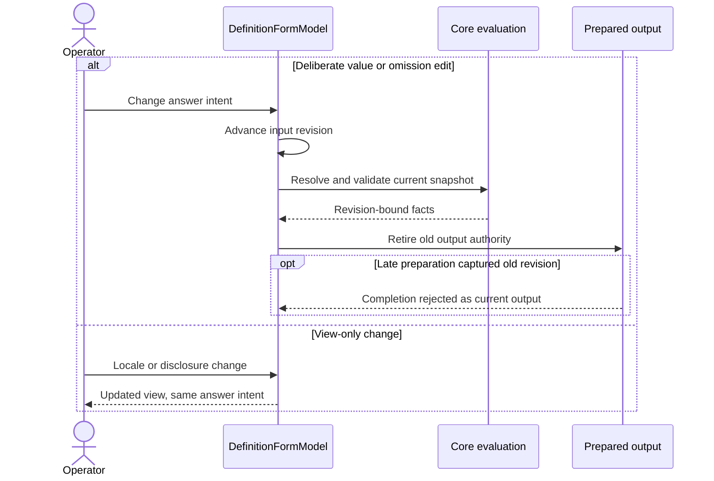
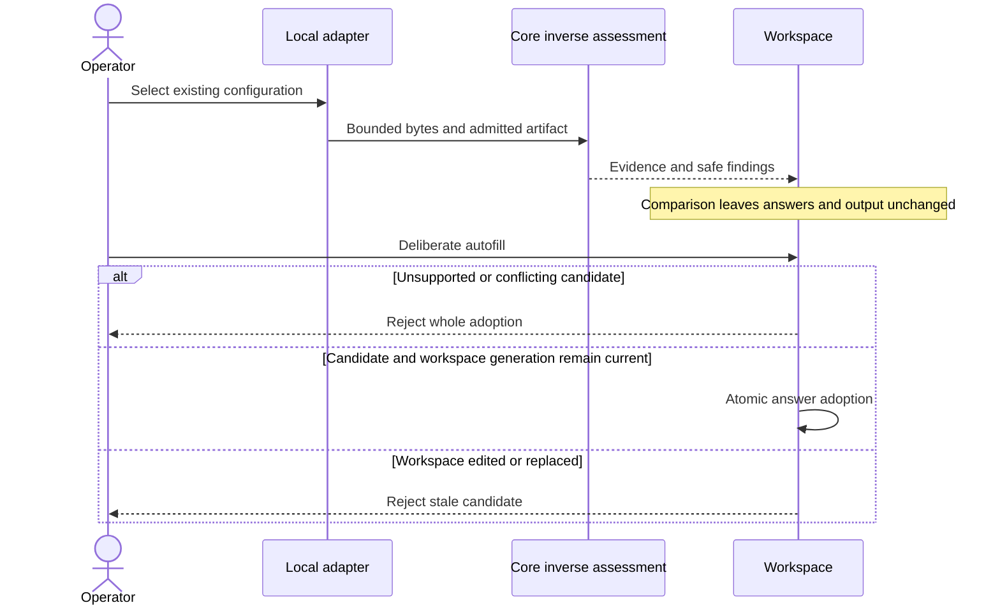
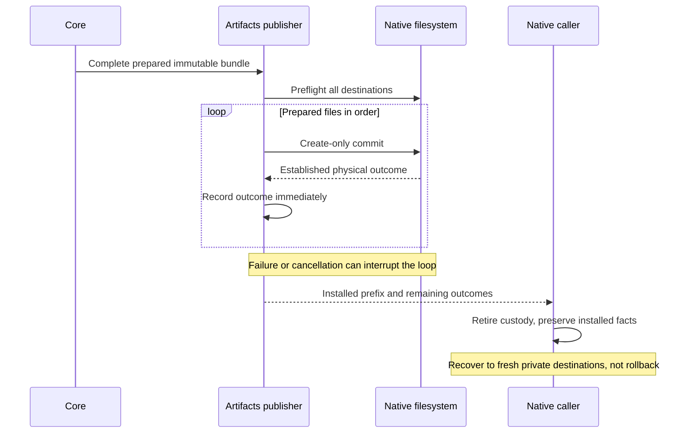
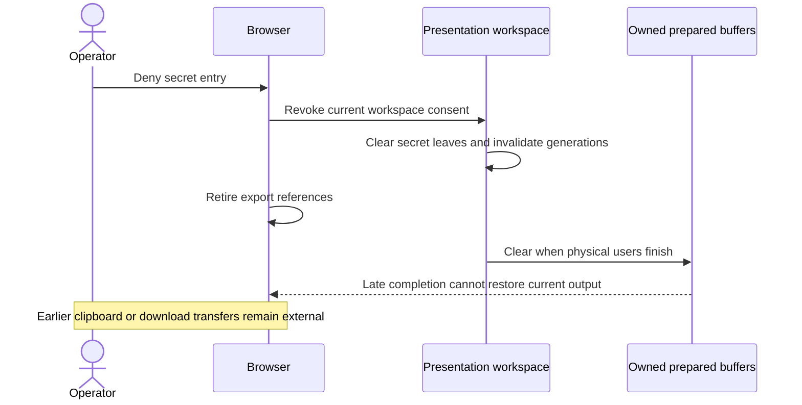

# Core definitions: portable adoption mechanisms

> **Audience:** Contributors | Integrators | AI agents
> **Owner:** Core
> **Status:** Qualified pre-release adoption map; target and other-host acceptance remain separate
> **Last Verified:** 2026-10-28
> **Source Anchors:** `src/Configurator.Core/Definitions/`, `src/Configurator.Presentation/Presentation/`, `docs/internal/OPERATIONS.md`

This is the technical companion to [portable adoption](../public/integrating.md)
and the [cookbook](../public/definition-cookbook.md). Preserve the detailed API,
budgets, canonicalization, Event handoff and composition rules in
[CORE_DEFINITION_CONTRACT.md](CORE_DEFINITION_CONTRACT.md). The
[conformance profile](DEFINITION_CONFORMANCE_PROFILE.md) separates normative
requirements from evidence. This map records mechanisms, not a test receipt,
target certification or I-VSD closure.

## One source, one admission and evaluation authority

| Stage | Owning source | Mechanism and result |
|---|---|---|
| Select source or runtime | `SetupDefinitionSourceCodec` in `src/Configurator.Core/Definitions/` | Exact authoring-v2 discriminator or runtime schemaVersion 2; conflicting/unknown contracts reject without parser fallback |
| Compile public source | `Authoring/DefinitionAuthoringCodec.cs`, `Authoring/DefinitionAuthoringCompiler.cs` | Snapshot bounded exact-key JSON/YAML, expand declared output mappings, construct runtime and re-enter runtime admission |
| Admit canonical runtime | `SetupDefinitionCodec.cs`, `DefinitionProfile.cs`, `DefinitionJson.cs` | Check `bounded-v2`, recursive contextual rules and computed sorted mandatory capabilities; own canonical bytes/digest |
| Bind identity | `SetupDefinitionRegistry.cs` | Resolve exact declared application version and optional digest; reject conflicting admitted family/revision even after removal; never guess newest across ambiguous revisions |
| Snapshot private input | `SetupAnswerSnapshotCodec.cs`, `SetupDefinition.cs` | Independent private answer v1, exact `values` tree and concrete `omitted` paths; caller mutation cannot alter the snapshot |
| Resolve and validate | `DefinitionValidator.cs` | One effective-value policy, typed predicates, relationships, constraints and safe revision-bound correction coordinates |
| Compose outputs | `src/Configurator.Core/Artifacts/` | Complete/draft/bundle composition consumes admitted schema and snapshot; restricted disposable results bind definition/input revisions |
| Edit and adopt | `src/Configurator.Presentation/Presentation/` | Existing immutable workspace ownership, typed editing and operation generations; stale results cannot acquire current output authority |

The [version reference](../public/definition-reference.md#which-document-are-you-editing)
distinguishes authoring/runtime, command and private-answer contracts.
Family revision, exact application versions and locale are independent
selectors. Publisher/family labels are not authentication. The public definition
contains neither private answers nor an execution/remote-apply extension point.

### Exact data identity and value intent

`DefinitionPath` preserves ordinal RFC6901 segments: empty pointer is root,
`/` is an empty-name property, `~0` and `~1` decode once. Dots and asterisks
are literal. Array tokens are canonical decimal indices, not persistent IDs.
`SetupFieldDefinition.Name` remains the exact data key. `DefinitionProfile.FieldId`
derives bounded metadata IDs, reserving `f-`; metadata never replaces answer keys.

Core distinguishes supplied null from missing, and omission from reset.
Supplied values validate as typed values; omission suppresses initialization;
reset removes both override and suppression. `initialValue` resolves only at
eligible never-supplied locations. `suggestedValue` is inert until adoption and
`default` is descriptive. Requiredness does not synthesize containers. Private
metadata cannot be laundered through a public child or ancestor label.

### Recursive profile, not general JSON Schema

Closed objects, typed maps, recursive arrays, typed scalar enums/null, exact
numeric assertions, cardinality and uniqueness share one node model. Typed map
diagnostics use entry ordinals, not private entry keys. Discriminated `oneOf`
selects among 2-16 closed object branches using one common required scalar const
selector; nullable presence sits outside selection. General unions and arbitrary
conditional subschemas are not implied.

Root/item predicates use the effective snapshot. Row-local controllers cannot
activate another row's fields. Missing controllers are false; invalid or
secret-deferred controllers remain unknown, including under `not`. Local
`dependentRequired` and const/enum/presence `if` guards with required-set
consequences lower into the same kernel. Relationship edges do not impose
activation ordering; mutual presence requirements are valid.

Configuration-root `$defs`/`$ref` expansion is bounded and acyclic, rejects
remote/dynamic/percent-encoded references, checks unused declarations and
preserves sensitivity floors. `format` is annotation unless `assertFormat` is
true for the closed hostname/email-address/uri/http-url registry. Assertions
are lexical, never a network or target-acceptance check.

These mechanisms have maintained source fixtures in
[`DefinitionProfileConformanceTests`](../../tests/Configurator.Core.Tests/Definitions/DefinitionProfileConformanceTests.cs);
the class includes row relationships, map privacy, nullable exact assertions,
closed provider selection, local references and opt-in format cases. This
map identifies those fixtures; it does not claim an executed pass.

## Native identity and checked generation

`src/Configurator.Cli/Commands/DefinitionCommands.cs` exposes init, check, lint,
schema, build and revise. `SetupCliDefinitionHandlers` obtains bounded public
source through the injected file adapter before compiling. Schema discovery
returns built-in documents before authoring-file acquisition; it does not
discover private answers. Check/lint do not publish artifacts.

`definition init` allocates a fresh UUID/revision 1. Its `--fork-from` path uses
`DefinitionAuthoringIdentityEditor.Fork`, preserving source format and other
bytes while changing identity. Fork requires a separate create-only output.
`revise` admits the edited source and prior runtime, verifies matching family
and revision plus canonical anchor history, and returns no new revision when
the canonical digest is unchanged. Otherwise it produces a separate next-revision
candidate. Build emits canonical runtime at the revision anchor by default;
it cannot repurpose an existing admitted revision for different content.

The [schema catalog](../../schemas/README.md) records native generator commands.
`eng/configurator/Configurator.DefinitionSchemaGenerator/Program.cs` owns:

- `--write` / `--check`: authoring-v2, runtime-v2, private-answers-v1 schemas
  and retirement of authoring/runtime-v1 schema files.
- `--write-examples` / `--check-examples`: compile or compare the three
  maintained source/runtime pairs by canonical bytes.
- `--renew-example-families`: intentionally fork example sources to new
  revision-1 families before writing source/runtime; not ordinary freshness repair.

Machine-command schema generation is a separate owner. Generated structural schemas
cannot replace semantic admission, capability negotiation, target validation or
actual-host testing. Source maps remain definition-only metadata outside the
canonical digest; bounded source positions and fallback public ancestors must
not expose private values or filesystem paths.

## Adapter and custody boundaries

The machine CLI accepts explicit local definitions and private input, and emits
bounded machine receipts rather than answer/artifact content on stdout. Terminal.Gui
and Avalonia adapt typed Presentation controls over the same Core definition.
Browser uses the same Core/Presentation ownership without native I/O; local
selection may compile source, while remote retrieval admits pinned public
canonical runtime JSON before answer collection.

`DefinitionFormIndex` indexes public schema, including map/variant/item shapes;
it is not another answer store. Core selects branches. `DefinitionFormModel`
owns deliberate typed `SelectChoice`, `SetNull`, `ResetValue`, `ApplySuggestion`
and `SelectVariant` mutations. Branch switching removes the prior payload;
stable row editor identity is workspace state, not application record identity.
Required/error work remains reachable independently of optional detail.

`DefinitionLocalization` resolves existing public text with base fallback.
Locale selection is view-only, not an input revision or preparation invalidation.
Guidance links are inert static credential-free HTTPS metadata without queries,
interpolation, automatic fetch, opener/referrer transfer or answers. Choice
labels never become enum identity. Actual rendering/keyboard/accessibility and
package/host qualification are separate evidence from shared API support.

Native answer-derived writes remain restricted and create-only on supported
verified Linux hosts; unsupported protected-save implementations refuse rather
than fall back. Browser consent is workspace-local and revocation recursively
clears secret leaves and output. Public caches exclude answers/artifacts;
deliberate copy/download transfers custody without native owner-only/create-only
guarantees. See [Presentation state](PRESENTATION_STATE.md),
[protected artifacts](PROTECTED_ARTIFACTS.md) and [launch contract](LAUNCH_CONTRACT.md).

## Preparation and inverse import do not grant apply authority

Complete preparation validates one effective snapshot. Secret-deferred drafts
defer only genuinely missing secret leaves; malformed supplied values and missing
ordinary work still block. Unknown secret-dependent outputs are withheld by
artifact ID. Draft completions indicate unfinished work, never complete readiness.
Bundle failures dispose staged output, and Presentation generations fence late
results after edit, cancellation, replacement or disposal.

Existing-file inverse import is narrower than generation. The
[import/comparison contract](IMPORT_COMPARISON.md) owns the current admitted
inverse algebra and its implementation/qualification status; do not freeze an
older direct-copy-only subset into this mechanism map. Comparison observes
represented data without editing the form. Strict autofill rejects unaccounted
content and nonreplaceable conflicts atomically, then delegates validation to
Core. A prefill candidate is not a workspace mutation, overwrite permission or
readiness certificate. Default-origin replacement never resets explicit omissions.

`targetUpdateMode` and `restartRequirement` are declarative recommendations,
defaulting to `unspecified`. Filename hints do not authorize destination paths.
The target alone validates its application semantics, credentials, connectivity,
identity/revision policy, legal approval and operator permission, then decides
whether/how to apply and restart. Configurator has no target authentication,
installation, live transport or administration authority.

## Evidence use

The [example index](../../examples/README.md) names maintained pairs and
behavioral fixture anchors without duplicating full configurations or private
fixtures. Source inspection establishes the mechanism, not an executed pass.
Native source/runtime freshness, rendered adapters, physical packages, target
acceptance and I-VSD disposition require their own scoped execution records.
Historical Event receipts are provenance, not current v2 compiler or acceptance
receipts. No completion claim transfers across those boundaries.

## Follow a complete operation

These are explanatory traces through current owners, not execution receipts.
Use [STATUS](STATUS.md) for dated qualification and the
[project map](../../PROJECTS.md) for the relevant test command.

### Public source to admitted runtime

1. The CLI public-source adapter acquires bounded input. The source codec
   distinguishes the authoring discriminator from runtime JSON; it does not
   guess a legacy format.
2. `DefinitionAuthoringCompiler` lowers compact source into the runtime shape.
   `SetupDefinitionCodec` admits that result again, including references,
   sensitivity, capabilities and budgets.
3. Canonical bytes and digest bind the family/revision. A registry conflict
   rejects rather than silently replacing a previously admitted definition.
4. Only the admitted definition reaches answer collection. Compiler source maps
   are bounded public diagnostics, not private answers or execution instructions.

The native definition schema generator's `--check-examples` checks maintained
source/runtime agreement. Core conformance fixtures separately exercise behavior;
freshness alone does not prove target acceptance.

### An edit to new validation and retired output

1. A deliberate field action enters `DefinitionFormModel`'s mutation gate.
   It changes supplied values or omission intent and advances the input revision.
2. Core resolves effective values and validation facts for that revision.
   `DefinitionFormFacts` owns those facts without another answer tree.
3. Prepared output and correction coordinates captured for the old revision
   become ineligible. A late preparation may finish, but cannot become current.
4. View-only disclosure, locale and section changes instead publish a view
   update, preserving answer intent and current output.

The Presentation suite owns editing and stale-operation invariants. Rendered
client tests additionally protect callbacks, focus and mount behavior; neither
test layer substitutes for the other.

### Existing-file comparison to deliberate adoption

1. The local adapter acquires selected configuration bytes under its custody
   policy. Core evaluates only the selected admitted artifact's supported inverse.
2. Comparison produces evidence and safe findings without changing answers,
   editor drafts, provenance, omissions or current prepared output.
3. Autofill is a separate deliberate action. Unsupported adoption, unknown
   content or nonreplaceable conflicts reject as a whole.
4. A current-generation successful adoption changes the workspace atomically;
   an edited or replaced workspace rejects a stale candidate.

[IMPORT_COMPARISON](IMPORT_COMPARISON.md) owns the current implementation contract,
supported inverse and qualification limits. This trace does not promote every
adapter or in-progress package to qualified support.

### Native publication and an interrupted bundle

1. Core prepares all selected outputs from one immutable snapshot. Preparation
   failure disposes staged bytes before anything is published.
2. Artifacts preflights all destinations. Publication then commits each prepared
   file in order using create-only writes.
3. If a later commit fails, earlier installed files remain. Each established
   outcome is recorded before subsequent failure can erase that knowledge.
4. The caller retires output custody and reports installed, unattempted and
   unknown outcomes distinctly. Recovery selects a fresh private destination;
   it does not overwrite the old prefix or assume rollback.

[Protected artifacts](PROTECTED_ARTIFACTS.md) owns physical effects and cleanup;
native clients own display and close policy. The Artifacts suite tests the
writer/publisher, while actual-host evidence establishes filesystem behavior.

### Browser consent denial to output retirement

1. The operator denies secret entry for the current workspace.
2. Presentation recursively clears secret leaves and invalidates captured input
   and operation authority. Browser retires prepared export references.
3. Owned byte buffers are cleared when their physical users have finished.
   A late preparation or clipboard completion cannot restore current output or
   a stale success notification.
4. Data already transferred to an external clipboard or download is outside
   application custody. Managed strings and the browser environment cannot
   support a forensic memory-erasure promise.

The [launch contract](LAUNCH_CONTRACT.md) and
[Presentation state](PRESENTATION_STATE.md) specify custody and lifetimes.
Browser component tests cover denial and stale completions; published-browser
network/storage/cache exercises are a separate evidence layer.
