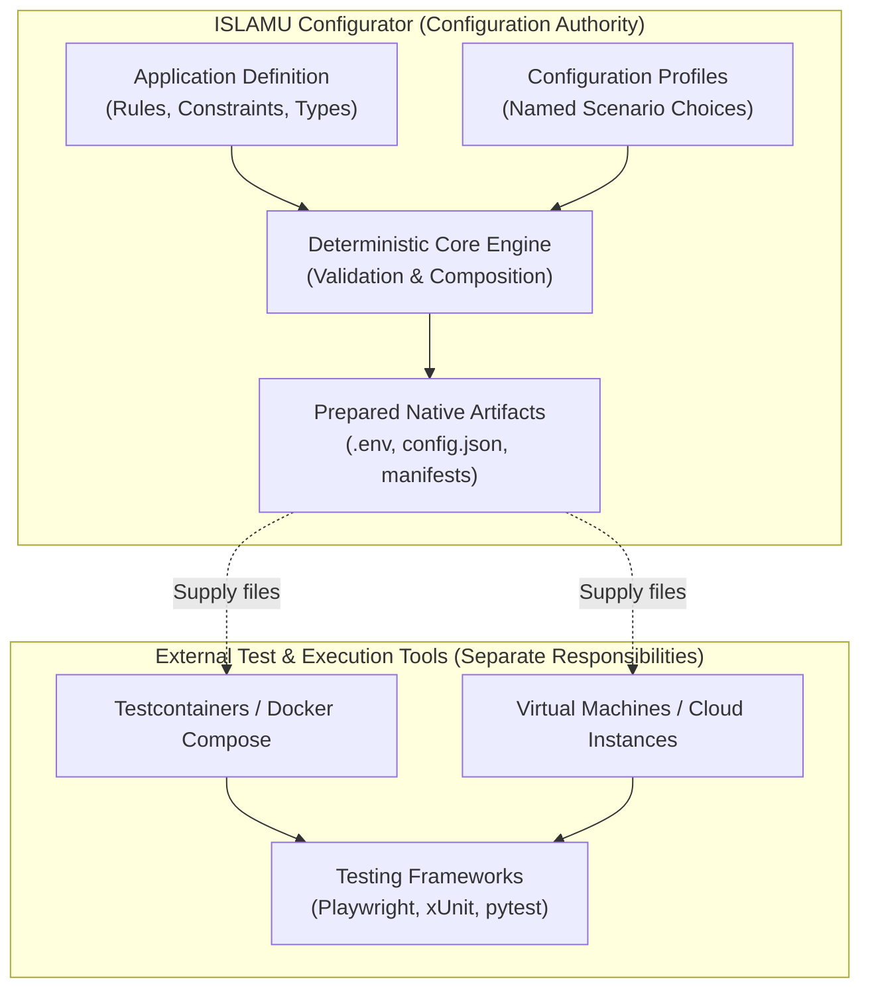
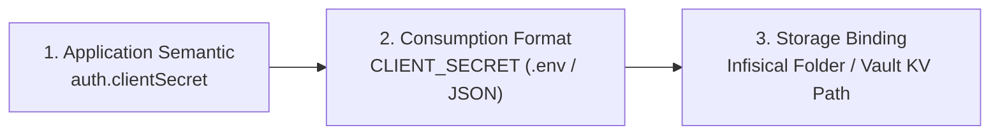

# RFC: Automated Agent Testing, Ephemeral Instances, and Configuration Scenarios

> **Audience:** Contributors | Architects | AI agents  
> **Status:** Proposed / Research  
> **Owner:** Core | Presentation | Agent Context  
> **Last Verified:** 2026-10-27  
> **Source Anchors:** `docs/internal/CORE_DEFINITION_CONTRACT.md`, `docs/internal/CLI_CONTRACT.md`, `docs/internal/VISION_AND_APPROACH.md`, `examples/`

---

## Executive Summary

This Request for Comments (RFC) explores expanding ISLAMU Configurator beyond initial one-time self-hosting setup into recurring lifecycle workflows: **automated testing by AI coding agents**, **ephemeral test environments**, and **reproducible configuration scenarios**.

It analyzes how a declarative, deterministic configuration runtime can provide structured environment preparation for humans and automated agents alike—while strictly preserving Configurator's core architectural boundary as a **configuration preparation engine**, rather than an application runner, container orchestrator, or test framework.

---

## The Motivation: Configuration Friction in Automated Testing

Modern software applications often support numerous runtime configuration dimensions:
- Multiple database engines (PostgreSQL, MySQL, SQLite)
- Multiple authentication providers (Local credentials, OIDC, SAML, LDAP)
- Multiple storage backends (Local disk, S3-compatible object storage)
- Multiple tenancy models (Single-tenant, multi-tenant)
- Diverse feature flags and operational modes

In a matrix with 3 databases, 3 authentication modes, 2 storage options, and 2 tenancy models, there are **36 distinct configurations** before factoring in application versions or deployment environments.

### The Problem Today
When human developers or AI coding agents develop features, run integration tests, or investigate bug reports, they face significant configuration friction:
1. **Ad-hoc Environment Construction:** Testing a single feature (e.g. enterprise SSO) requires hunting down environment variables across scattered READMEs and sample files.
2. **Brittle Test Scripts:** Teams maintain separate, unvalidated `.env.test` or Docker Compose files that drift out of sync with production schemas.
3. **Reproducibility Gaps:** When an integration test fails in CI or in a customer environment, reproducing the exact configuration state locally is time-consuming and prone to human error.
4. **Agent Inefficiency:** AI coding agents frequently get stuck guessing configuration parameters, asking repetitive questions, or generating invalid setting combinations.

---

## Architectural Separation of Concerns

A critical insight of this research is maintaining strict boundaries between **configuration preparation** and **instance execution**:



Configurator does not need to understand container networking, test assertions, browser automation, or teardown lifecycle. Its responsibility is to **understand configuration semantics and deterministically prepare the exact deployment files required for any target scenario**.

---

## Core Abstractions

To support scenario-based testing without corrupting the core engine, five distinct concepts are defined:

| Concept | Responsibility | Owner |
|---|---|---|
| **Application Definition** | Declares available settings, types, constraints, dependencies, and native output projections (`.env`, JSON, YAML). | Application Maintainer (`configurator.yaml`) |
| **Configuration Profile** | Supplies a named set of answers representing a specific operational state (e.g. `single-tenant`, `enterprise-sso`). | Repository / Project |
| **Test Scenario** | Pairs a configuration profile with external test fixtures and behavioral checks. | Test Suite / CI Pipeline |
| **Runner Integration** | Instantiates instances, loads fixtures, applies generated configuration, runs test assertions, and cleans up. | External Tools (Testcontainers, Docker) |
| **Run Record** | Records exact software versions, configuration digest, and execution outcomes for deterministic reproduction. | CI / Audit Systems |

### Illustrative Scenario Declaration

Below is an illustrative format showing how a scenario might be expressed in project test configurations:

```yaml
kind: TestScenario
name: enterprise-sso
version: 1

# Bound to an admitted Configurator definition
definition: ./configurator.yaml

# Explicit scenario choices
answers:
  auth.provider: "oidc"
  auth.local_login: false
  tenancy.mode: "multi"
  storage.backend: "s3"

# References to test-harness fixtures and assertions (executed externally)
fixtures:
  - "seed-tenants"
  - "role-matrix"
checks:
  - "sso-login-succeeds"
  - "local-login-denied"
  - "cross-tenant-isolation-enforced"
```

> [!NOTE]
> Downloading or admitting a test scenario does not grant permission to execute arbitrary shell commands. Fixtures and checks remain registered, trusted test harness code in the host project.

---

## Benefits for AI Coding Agents

For AI coding agents, a machine-readable configuration contract is transformative. Rather than inspecting unstructured documentation, an agent can query Configurator directly via the CLI:

1. **Introspection:** *"Which settings exist for application version 2.4?"*
2. **Dependency Resolution:** *"Which fields become mandatory when `auth.provider` is set to `oidc`?"*
3. **Structured Diagnostics:** *"Why is this combination invalid?"* (Receiving RFC 6901 JSON pointer paths rather than unstructured errors).
4. **Change Impact:** *"Which output artifacts change when I toggle this feature?"*
5. **Deterministic Reproduction:** *"Give me the exact configuration bundle for scenario `restricted-user`."*

```bash
# Agent inspects required fields for a scenario
islamu-configurator artifact validate --definition configurator.yaml \
  --artifact config --input profiles/enterprise-sso.json --machine
```

---

## Combinatorial Coverage & Testing Strategies

When testing complex applications, exhaustive testing of all combinations is often computationally intractable. This RFC proposes structured selection strategies:

| Strategy | Ideal Use Case | Characteristics |
|---|---|---|
| **Named Scenarios** | Core production workflows | High-value, manually curated configurations representing primary user journeys. |
| **Exhaustive Enumeration** | Small, finite configuration spaces | Complete verification when total parameter combinations are small (< 20). |
| **Pairwise Combinatorial** | Large feature matrices | Covers all 2-way parameter interactions based on NIST combinatorial testing methods, drastically reducing test budgets. |
| **Boundary Testing** | Resilience & limit validation | Tests minimum/maximum integers, empty strings, oversized inputs, and collection limits. |
| **Change-Focused Selection** | Pull request verification | Evaluates only scenarios whose inputs intersect with fields modified in a pull request. |
| **Explicit Negative Testing** | Security & error handling | Deliberately violates constraints to verify that validation or startup rejects cleanly. |

---

## Secret Manager Integration & Upgrades

A natural extension of configuration evaluation is validating configuration stored in dedicated secret management engines (such as Infisical, HashiCorp Vault, or Azure Key Vault).

### The Three-Layer Storage Model

To support external secret stores without hardcoding vendor-specific logic into public definitions, three layers must be decoupled:



1. **Application Semantic:** The logical setting defined in `configurator.yaml`.
2. **Consumption Format:** How the target application reads it (`CLIENT_SECRET` in `.env`, or a key in `config.json`).
3. **Storage Binding:** Where the secret lives in the user's infrastructure (e.g. Infisical project `/prod/auth/client-secret`).

### Release Upgrade Assistance
One of the highest-friction moments in self-hosting and DevOps is software upgrades: a new release introduces new mandatory secrets or renames existing configuration keys.

A release-aware configuration engine can:
1. Compare the definition of the currently installed version against the target release.
2. Evaluate which changes apply to the user's active feature set.
3. Inspect the secret manager or `.env` file to identify missing keys.
4. Present actionable guidance:
   > *"This update introduces 4 new settings. 2 do not apply to your setup. 1 uses an acceptable default. 1 new credential (`METRICS_API_KEY`) is required before starting."*

---

## Scope Governance: What Belongs vs. What Does Not

To prevent mission drift, all proposed features must be evaluated against this governance criteria:

> **Governance Principle:**  
> Does this capability help an operator or agent reach a correct, understandable configuration? If yes, it belongs in Configurator. If it manages process lifecycles, containers, or test execution, it belongs in external tooling.

| Feature / Capability | Verdict | Rationale |
|---|---|---|
| Declarative scenario definitions | **In Scope** | Pure data representation of named configuration states. |
| CLI commands for scenario validation | **In Scope** | Reuses the existing deterministic Core validation engine. |
| Upgrade diffing between definition versions | **In Scope** | Evaluates schema deltas and reports missing inputs. |
| Secret manager read-only inspection | **In Scope (Future)** | Verifies key existence and format against schema rules. |
| Spinning up Docker / Testcontainers fleets | **Out of Scope** | Belongs to orchestration tools (Docker, Testcontainers, K8s). |
| Asserting HTTP responses or UI checks | **Out of Scope** | Belongs to test runners (Playwright, Cypress, pytest). |
| Long-lived daemon scheduling test runs | **Out of Scope** | Violates the offline, transient CLI/utility architecture. |

---

## Phased Implementation Roadmap

### Phase 1: Reusable Configuration Profiles (Near Term)
- Support named answer profiles (`--profile <path>`) in the CLI and native clients.
- Add structured profile validation to `islamu-configurator artifact validate`.
- Enable agents to discover available profiles and missing fields deterministically.

### Phase 2: Scenario Hand-off Documentation & Examples (Mid Term)
- Publish reference documentation demonstrating how to use Configurator CLI with Testcontainers in GitHub Actions.
- Provide sample scenario definitions in `examples/` illustrating multi-profile setups.

### Phase 3: Release Delta & Upgrade Analysis (Long Term)
- Implement `islamu-configurator definition diff --old <v1> --new <v2>`.
- Generate clear upgrade reports highlighting required new inputs and deprecated settings.
- Explore read-only process environment and secret-store validation plugins.
