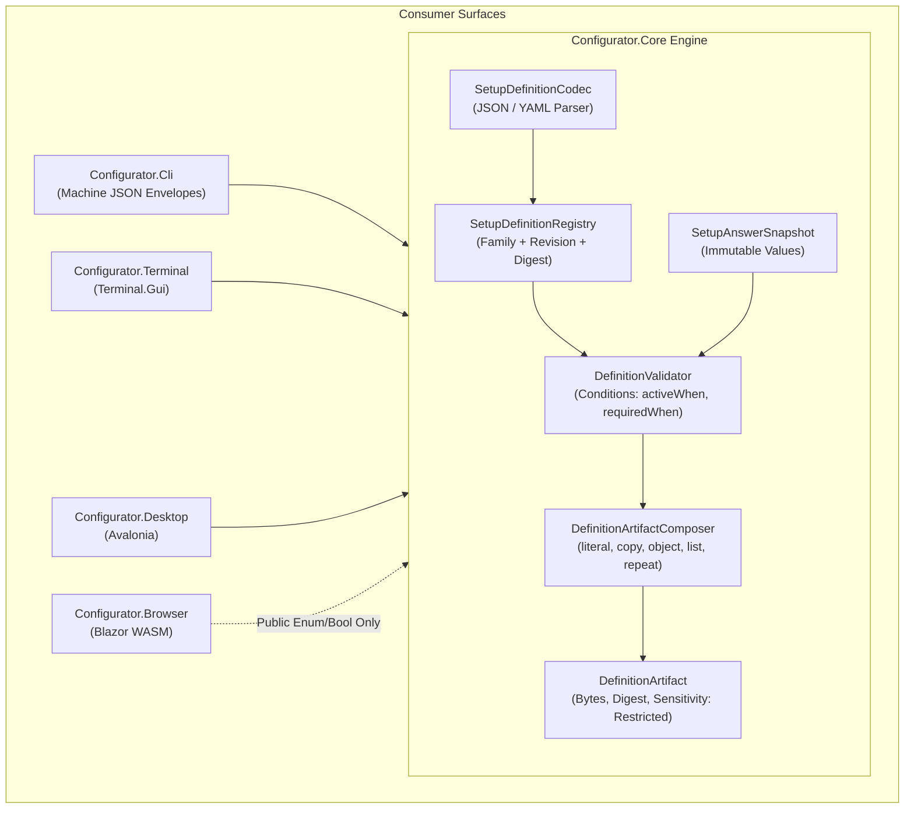
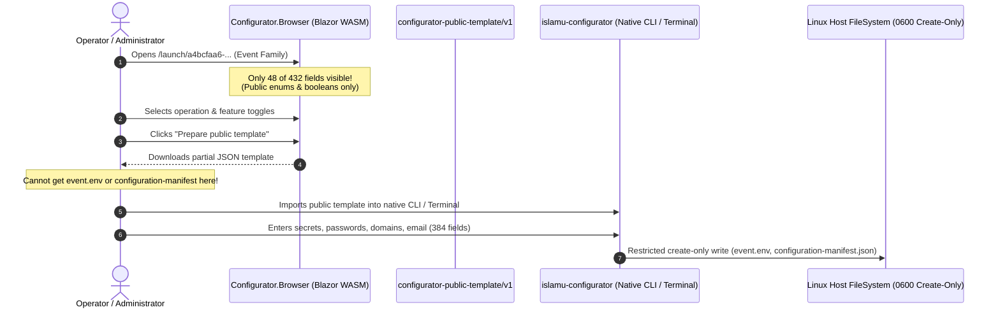

# ISLAMU Configurator Core & Event Integration Readiness Report

> **Target Audience:** Maintainers, Architects, and Integrators  
> **Repository:** [`ISLAMU/Configurator`](../../../) & [`ISLAMU/Event`](../../../../Event)  
> **Evaluation Date:** October 2026  
> **Source Documents Inspected:** All documentation under [`docs/`](../../), [`examples/`](../../../examples), and [`Event/configurator/`](../../../../Event/configurator)

---

## 1. Executive Summary & Verdict

| Question | Verdict | Summary / Rationale |
|---|---|---|
| **Is `Configurator.Core` implemented & ready?** | **YES (Complete & Verified)** | [`Configurator.Core`](../../../src/Configurator.Core) is fully implemented, passes all 75 unit/invariant tests, and has 0 dependencies on Event, databases, or network runtimes. |
| **Can a link to the deployed Blazor WebApp be the direct configuration experience for Event?** | **NO (By Architectural Design)** | Per Invariant 4 (Private-to-Public Boundary), the browser accepts **only public enum/boolean choices** (48 fields out of 432). All 384 secrets, strings, and sensitive fields have **no inputs in the browser**. The browser outputs a partial public template, never full `.env` or manifests. |
| **Are the configuration manifest schemas and projections working?** | **YES (Fully Working)** | [`configuration-manifest-v1alpha2.schema.json`](../../../../Event/schemas/configuration-manifest-v1alpha2.schema.json) in Event and [`setup-definition-v1.schema.json`](../../../schemas/setup-definition-v1.schema.json) in Configurator are fully valid. The projection matches host expectation vectors byte-for-byte. |
| **Is `examples/islamu-event` fully ready?** | **YES (For Fixed Reference Shape)** | All 5 artifact vectors (`environment.env`, `configuration-manifest.json`, `tenant-package.json`, `operator-identity.json`, `legal-drafts.json`) pass strict bit-exact verification. However, it materializes a finite 2-tenant reference shape. Dynamic cardinality requires exporter re-generation. |
| **What is missing to put a link in Event's README?** | **Deployment & Framing** | 1) A deployed static web host (e.g. Cloudflare Pages) with SPA routing fallback; 2) Accurate user documentation explaining that the web link creates a **public preset template**, while full deployment configuration requires the native CLI/Terminal tool to supply credentials. |

---

## 2. Architecture & Capabilities of `Configurator.Core`

[`Configurator.Core`](../../../src/Configurator.Core) is a self-contained, offline-first configuration evaluation and artifact preparation engine. It operates with zero target runtime dependencies (no database, no HTTP APIs, no Aspire, no wire DTOs).



### Key Technical Pillars in Core:

1. **Deterministic Canonical Identity:**
   - Definitions are admitted through [`SetupDefinitionCodec`](../../../src/Configurator.Core/Definitions/SetupDefinitionCodec.cs).
   - Core computes an ordinal, decimal-normalized SHA-256 digest covering the entire admitted document. Family GUIDs and publisher labels provide identity names, but the **computed digest** provides tamper-evident binding.
2. **Immutable Answer Workspaces:**
   - [`SetupAnswerSnapshot`](../../../src/Configurator.Core/Definitions/SetupDefinition.cs) isolates user inputs with generational revision tracking to guarantee thread-safe, stale-free evaluations.
3. **Declarative Projection Engine:**
   - [`DefinitionArtifactComposer`](../../../src/Configurator.Core/Artifacts/DefinitionArtifactComposer.cs) supports formats: `dotenv`, `json`, `yaml`, and `markdown`.
   - Projection operations include: `literal`, `copy`, `object`, `list`, `repeat` (bounded iteration), `index`, and `omit`.
   - Cycle detection and finite recursion limits prevent infinite loops.
4. **Strict Security Boundaries:**
   - Hard memory and complexity limits: 4 MiB aggregate artifact ceiling, 1,024 fields maximum, 64 artifacts maximum, 32 nested JSON depth maximum.
   - All answer-derived artifacts are automatically classified as `Restricted` sensitivity, regardless of whether individual fields are marked public.

---

## 3. The Blazor WebApp Experience vs. ISLAMU Event Reality

A critical misunderstanding to avoid is assuming that the Blazor WebAssembly app ([`Configurator.Browser`](../../../src/Configurator.Browser)) can serve as the **direct, standalone setup wizard** for ISLAMU Event.

### Why the Blazor WebApp Cannot Do Full Event Configuration:

The repository enforces **Invariant 4 (Private-to-Public Boundary)** and **Invariant 5 (Protected Output)**:



1. **Field Breakdown in ISLAMU Event Definition:**
   - **Total Fields Declared:** `432`
   - **Public Enum & Boolean Fields (Rendered in Browser):** `48`
   - **Strings, Numbers, Sensitive & Secret Fields:** `384`
2. **Secrets Are Forbidden in the Browser:**
   - By strict policy, the browser client **has no input controls** for text strings, numbers, passwords, API keys, or connection strings.
   - Fields such as `POSTGRESQL_PASSWORD`, `REDIS_CONNECTION_STRING`, `KEYCLOAK_ADMIN_PASSWORD`, `MAIL_SMTP_PASSWORD`, `STORAGE_S3_SECRET_ACCESS_KEY`, and `INSTANCE_BOOTSTRAP_ADMIN_EMAIL` cannot be viewed or entered in the browser.
3. **No Native Configuration Files Are Produced by the Browser:**
   - The browser **does not generate** `event.env` or `configuration-manifest.json`.
   - The **only** artifact the browser can produce is a `configurator-public-template/v1` envelope containing public choices:
     ```json
     {
       "schemaVersion": "configurator-public-template/v1",
       "familyId": "a4bcfaa6-9979-43e5-b1f5-00d552618cdf",
       "revision": 4,
       "definitionDigest": "33661343436560b8004903d6efe569c6e3342d278f3fae6e9df49fad9e0e65bf",
       "selections": {
         "operation": "environment",
         "select.feature.security-config": true
       }
     }
     ```
4. **What the Browser Experience Actually Is:**
   - It is an **interactive public feature selector / preset builder**.
   - An administrator can explore public architectural options, pick which modules to enable, and download a prefill template.
   - That template must then be imported into the **native tool** (`islamu-configurator` CLI, Terminal.Gui, or Avalonia desktop) on their deployment machine to enter private secrets and generate the restricted files.

---

## 4. Configuration Manifest & Schemas: Detailed Status

### A. Schemas Status

1. **ISLAMU Event Manifest Schema:**
   - Path: [`Event/schemas/configuration-manifest-v1alpha2.schema.json`](../../../../Event/schemas/configuration-manifest-v1alpha2.schema.json)
   - Status: **Fully working and valid JSON Schema (Draft 2020-12)**. Governs `$schema`, `apiVersion`, `kind`, `metadata`, and `spec` (instance settings, legal documents, and tenants).
2. **ISLAMU Event Tenant Package Schema:**
   - Path: [`Event/schemas/tenant-configuration-package-v1alpha2.schema.json`](../../../../Event/schemas/tenant-configuration-package-v1alpha2.schema.json)
   - Status: **Fully working and valid**.
3. **Configurator Definition Schema:**
   - Path: [`Configurator/schemas/setup-definition-v1.schema.json`](../../../schemas/setup-definition-v1.schema.json)
   - Status: **Fresh and verified**. Enforces the structure of setup definitions admitted by Configurator Core.
4. **Configurator CLI Command Schema:**
   - Path: [`Configurator/schemas/islamu-configurator-command-v2.schema.json`](../../../schemas/islamu-configurator-command-v2.schema.json)
   - Status: **Fresh and verified**. Enforces machine envelopes for the CLI.

### B. Manifest Projection in `examples/islamu-event`

In [`examples/islamu-event/`](../../../examples/islamu-event):
- Definition: [`definition.json`](../../../examples/islamu-event/definition.json) (Family: `a4bcfaa6-9979-43e5-b1f5-00d552618cdf`, Revision: `4`, Canonical Digest: `33661343436560b8004903d6efe569c6e3342d278f3fae6e9df49fad9e0e65bf`).
- Tested Inputs: [`answers/configuration-manifest.json`](../../../examples/islamu-event/answers/configuration-manifest.json).
- Generated Output: [`expected/configuration-manifest.json`](../../../examples/islamu-event/expected/configuration-manifest.json).

**Verification Evidence:**
- [`ExternalDefinitionConformanceTests.cs`](../../../tests/Configurator.Core.Tests/Definitions/ExternalDefinitionConformanceTests.cs) passes with **100% byte equality** across all five artifacts.
- Running `DefinitionExporter --check` from Event validates that Event's host parser agrees with the generated outputs:
  ```text
  definition-current:family=a4bcfaa6-9979-43e5-b1f5-00d552618cdf:revision=4:digest=33661343436560b8004903d6efe569c6e3342d278f3fae6e9df49fad9e0e65bf:fields=432:artifacts=5
  ```

---

## 5. What Is Missing & What Is Lacking?

While the engine and reference schemas are fully functioning, four key gaps exist before having an end-to-end production link in Event's README:

### Gap 1: No Public Static Web Hosting Origin Deployed
- **The Issue:** `Configurator.Browser` builds to static WebAssembly files (`wwwroot`), but there is no public URL or CDN hosting it right now (e.g. `https://configurator.islamu.org`).
- **Hosting Requirement:** The host must support SPA navigation fallback (routing all `/launch/*` paths to `index.html` without treating them as 404s), while keeping `_framework/*` static asset MIME types intact.

### Gap 2: Cardinality / Multi-Tenant Hardcoding in the Reference Definition
- **The Issue:** The checked setup definition in `examples/islamu-event` was materialized for a **finite reference topology**: exactly 1 instance, 2 tenants (`community` and `second-community`), and 1 legal draft document.
- **The Consequence:** An administrator cannot arbitrarily add 3, 5, or 10 tenants through this specific setup definition. Preparing a deployment with different tenant cardinality requires running Event's `DefinitionExporter --export` to emit a new definition revision with the desired field structure.

### Gap 3: Native Protected Save is Linux x64-Only
- **The Issue:** Native restricted writes ([`ProtectedArtifactWriter`](../../../src/Configurator.Artifacts/ProtectedArtifactWriter.cs)) enforce `0600` owner-only create-only semantics using Linux anonymous inodes and atomic linking.
- **The Consequence:** On Windows or macOS developer workstations, the native CLI refuses to write configuration files and fails closed. Operators must run the CLI on Linux (or inside a Linux container/WSL2).

### Gap 4: Documentation / User Expectation Gap in Event README
- **The Issue:** If the README provides a link such as `https://configurator.islamu.org/launch/a4bcfaa6-...` without context, users will assume it is an all-in-one web installer (like WordPress or Ghost setup). They will find no inputs for database passwords or domains and will assume the tool is broken.
- **The Requirement:** The link must be framed accurately: **"Online Configuration Preset & Topology Builder"**.

---

## 6. How to Put the Link in `Event/README.md` (Checklist)

To place a working link in `Event/README.md`, follow these steps:

### Step 1: Deploy `Configurator.Browser`
Publish and deploy the Blazor WASM client to your static hosting provider:
```bash
dotnet publish src/Configurator.Browser/Configurator.Browser.csproj \
  --configuration Release \
  --output /var/www/configurator-web
```
Configure your web server (Nginx, Caddy, Cloudflare Pages, etc.) with SPA fallback:
```nginx
location /launch/ {
    try_files $uri $uri/ /index.html;
}
```

### Step 2: Formulate the Pinned Deep Link
Construct the canonical URL using Event's stable family GUID and exact digest:
```text
https://<configurator-origin>/launch/a4bcfaa6-9979-43e5-b1f5-00d552618cdf?appVersion=0.0.0-development&entry=environment&digest=33661343436560b8004903d6efe569c6e3342d278f3fae6e9df49fad9e0e65bf
```
*(Selectors: `appVersion`, `entry`, `digest` are strictly validated by `BrowserLaunchSelection.Resolve`).*

### Step 3: Recommended Framing in `Event/README.md`

Replace lines 100–111 in [`Event/README.md`](../../../../Event/README.md#L100-L111) with clear two-tier guidance:

```markdown
### ⚙️ Configuration Preparation

ISLAMU Event separates public topology planning from confidential local secret preparation:

1. **🌐 Web Preset Builder (Public Options):**
   Use the **[ISLAMU Configurator Web App](https://<configurator-origin>/launch/a4bcfaa6-9979-43e5-b1f5-00d552618cdf)** 
   to select architecture presets, enabled services, and deployment modes. 
   *(Note: The browser handles public presets only and never accepts or stores secrets).*
   Download your `public-template.json`.

2. **💻 Native Offline CLI / Terminal (Secrets & Artifact Generation):**
   Install [`ISLAMU Configurator`](https://github.com/ISLAMU/Configurator) on your deployment host 
   to supply database passwords, API tokens, and generate restricted deployment files:
   ```bash
   # Interactive Terminal UI
   islamu-configurator-terminal --definition configurator/definitions/islamu-event/definition.json

   # Or generate deployment .env via CLI:
   islamu-configurator env render \
     --definition configurator/definitions/islamu-event/definition.json \
     --artifact environment \
     --input environment-answers.json \
     --output deployment.env
   ```
```

---

## 7. Verification Summary Table

| Suite | Executed Command | Results |
|---|---|---|
| **Core Invariants** | `dotnet test tests/Configurator.Core.Tests/Configurator.Core.Tests.csproj -c Release` | **75 passed**, 0 failed (1.2s) |
| **Browser Contracts** | `dotnet test tests/Configurator.Browser.Tests/Configurator.Browser.Tests.csproj -c Release` | **59 passed**, 0 failed (1.3s) |
| **CLI Contracts** | `dotnet test tests/Configurator.Cli.Tests/Configurator.Cli.Tests.csproj -c Release` | **45 passed**, 0 failed (1.8s) |
| **Event Exporter Sync** | `dotnet run --project eng/configurator/DefinitionExporter -c Release -- --check ../Configurator` | **Exit 0** (Family, Revision 4, Digest matched) |
