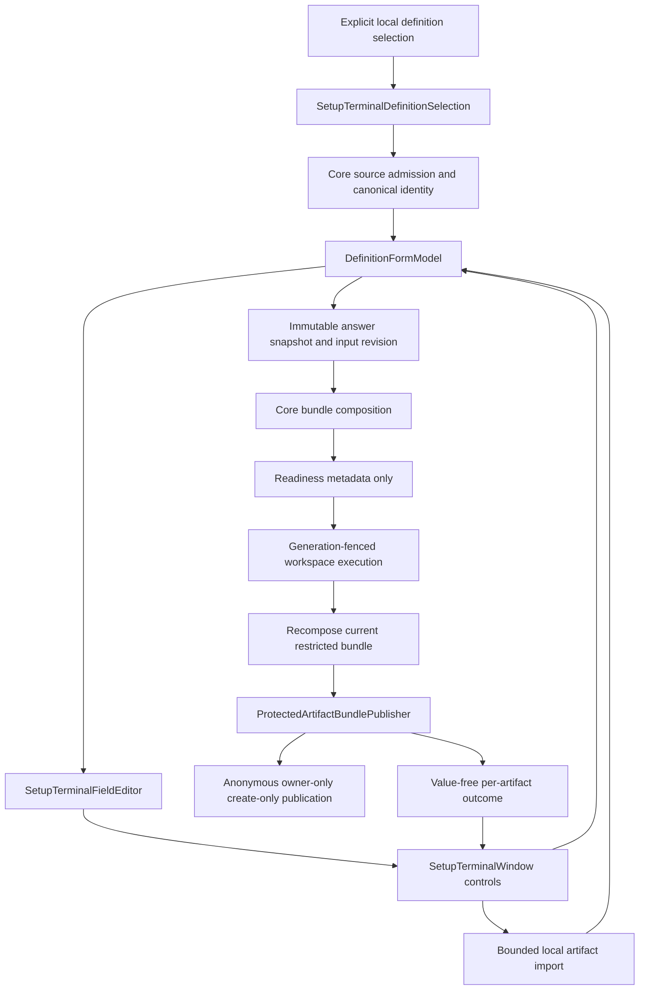

# Terminal client CTO review

> **Audience:** Product owner, maintainers, architects and contributors
> **Status:** Point-in-time assessment, not an implementation contract
> **Owner:** Terminal and shared Presentation maintainers
> **Evaluation date:** 2026-10-14
> **Inspected revision:** `4758afa115f92ab0cfef5b79a9913864ce9090c5` on `main`
> **Source anchors:** `src/Configurator.Terminal/`, `src/Configurator.Presentation/`, `src/Configurator.Artifacts/`, `tests/Configurator.Terminal.Tests/`, `PROJECTS.md`, `TERMINAL_CLIENT.md`

## Overall conclusion

Configurator's terminal client has a sound offline foundation, meaningful privacy controls and useful behavioral tests. Its dependency direction is appropriate: Terminal adapts shared Presentation, Core evaluates definitions, and Artifacts owns restricted native publication. There is no architectural reason in this review to replace Terminal.Gui or rebuild the product around another framework.

The current interaction implementation does not yet support the stated goal of an excellent, highly configurable and highly maintainable TUI. Several ordinary, admitted configurations cannot be edited correctly. Actual terminal execution exposes failures that the current control-level test harness misses. The highest priorities are asynchronous import, collection presence and navigation, minimum-size correctness, and truthful recovery after partial publication. These should precede cosmetic work or additional configuration options.

The most consequential confirmed cases are:

- A 3 MiB synthetic import froze the actual running terminal application. Subsequent input and SIGTERM did not complete shutdown; the isolated audit process required forced termination.
- An actual 80-column, 26-row terminal showed only a notice demanding at least 80 columns and 26 rows. Its bordered window had a 78-by-24 usable viewport, and every editing control was hidden.
- Empty optional boolean lists cannot be skipped; entering an append position at a full string list also prevents normal navigation.
- A required empty object has no editing slot and remains invalid. Navigating through an untouched child of an absent optional object can instead create an invalid supplied object.
- Cancelling after the first bundle file is committed leaves that file on disk while discarding the workspace receipt. The tested TUI clear action reported only that private state had been cleared.
- Choice cycling ignores a pending editor draft and advances from the previously committed answer.

All 38 existing Terminal cases passed. The 36 Presentation and 26 Artifacts cases also passed. Those results are valuable, but they coexist with the confirmed failures above because the missing integration scenarios are materially different from the tested ones.

The recommendation is a focused hardening and interaction-completeness workstream. Preserve the existing privacy and output mechanisms, repair the incomplete editor semantics, add real event-loop qualification, and then improve navigation, feedback and preferences. A major framework migration would introduce substantial risk without addressing the root causes.

## Scope and evidence standard

The audit assumes one local operator working in one terminal session. Configuration answers can include credentials and private organizational data. Definition files and imported answer files must be treated as untrusted local input. A registry may contain many unrelated definitions. The terminal is not a target administration client, a network service or a production deployment controller.

Inspection covered all eleven top-level Terminal C# files, their resource files and project configuration; all three Terminal test classes and their fixture/harness; the direct shared form, workspace, composition and native publication paths; relevant architecture/package tests; central versions and dependency locks; CI; and the public and internal terminal, presentation, output, packaging and dependency guidance. The eleven top-level Terminal C# files contain approximately 1,227 lines, excluding resources, assembly metadata and generated files. This is a compact implementation, not an inherently bloated codebase.

The repository knowledge graph matched the inspected HEAD and supplied entry-point and file relationships. A qualified-method query did not resolve one operation symbol; direct source and caller searches supplied the missing evidence. Graph risk summaries were not treated as security findings or coverage measurements.

Evidence labels mean:

| Label | Meaning |
| --- | --- |
| Reproduced | Observed through a native terminal session or a focused native .NET probe using the existing product classes. |
| Source-confirmed | The implementation and its callers establish a concrete behavior; the exact interaction was not separately executed. |
| Assurance gap | A relevant scenario is not covered by the inspected qualification; this alone does not establish failure. |
| Improvement | A product or maintainability recommendation with a clear user benefit, rather than an existing correctness violation. |
| Unmeasured risk | The source establishes a plausible workload or concurrency concern, but its frequency or performance cost has not been measured. |

Priorities distinguish consequences rather than file size: high means a normal workflow can freeze, become impossible, or conceal an irreversible publication outcome; medium means substantial usability, maintainability or assurance work; lower means useful follow-up. No exploitable remote execution, insecure overwrite or answer-bearing network transport was established by this review.

## Current architecture and control flow

`SetupTerminalProgram` accepts an explicit local definition or registry/family selection and rejects redirected interactive streams. `SetupTerminalDefinitionSelection` bounds each file and routes JSON/YAML through Core admission. Definitions retain canonical identity; registry resolution belongs to Core.

`SetupTerminalApplication` creates one shared form, one owned secret buffer, one artifact operation and one workspace. It captures the launch working directory for output, initializes Terminal.Gui, registers termination handling and runs the window.

`SetupTerminalFieldEditor` flattens objects and object-list rows into leaf slots, converts scalar text to typed JSON values, and uses the shared form to update the corresponding answer path. `SetupTerminalWindow` owns nearly all user interaction, including navigation, draft commits, import I/O, validation, preparation, publication dispatch, results and cleanup.

Preparation composes a restricted bundle and disposes it immediately, retaining only input revision and artifact count. Saving recomposes from a current snapshot and executes publication through the workspace. The Linux writer prepares protected anonymous files and commits each destination without replacement. Bundle publication preflights all destinations, but later failure can leave an already-written prefix. This is deliberately not an atomic multi-file transaction.

The architecture separates preparation from target acceptance correctly. A successfully created artifact does not imply that the target application will accept it or that the operator has apply/admin authority.

## Findings that should be fixed first

### 1. Import can freeze the actual terminal event loop

**Priority:** High. **Evidence:** Reproduced, with a source-confirmed deadlock mechanism.

`SetupTerminalWindow.ImportSelected` starts `DefinitionFormModel.ImportAsync`, supplies a callback that awaits `FileStream.ReadExactlyAsync`, and then blocks the UI callback with `.GetAwaiter().GetResult()`. See [SetupTerminalWindow.cs](../../../src/Configurator.Terminal/SetupTerminalWindow.cs), lines 317–333, and [DefinitionFormModel.cs](../../../src/Configurator.Presentation/Presentation/DefinitionFormModel.cs), lines 276–313.

Terminal.Gui's actual `Run` lifecycle installs its main-loop synchronization context. A suspended read can therefore queue its continuation to the main loop while the main loop is synchronously waiting for that same operation. A small synthetic import completed and was rejected normally; a 3 MiB synthetic file then froze the live application. Further keyboard input produced no response. SIGTERM did not complete shutdown, and the isolated audit process required SIGKILL. The file's invalid contents should have resulted in ordinary import rejection; reading them should not have frozen the application.

The current import tests initialize controls and invoke their commands without running `Begin`/`Run`. They do not install the production event-loop lifecycle, explaining why those tests pass. The framework's main-thread dispatch behavior is documented in its [IApplication.Invoke reference](https://tui-cs.github.io/Terminal.Gui/api/Terminal.Gui.App.IApplication.Invoke.html); the installed 2.5.0 XML documentation was also checked for the lifecycle contract.

**Smallest complete improvement:** Make the UI import operation asynchronous, own its cancellation token and busy state, await the read, and marshal control changes through the UI loop. Preserve the shared form's existing revision and cancellation fencing. Adding `ConfigureAwait(false)` to just one await is insufficient, and retaining the synchronous wait would still impair responsiveness.

**Acceptance:** An import whose read is deliberately suspended does not block navigation, redraw or cancellation; replacing or clearing the workspace rejects its stale result; rejected imports do not expose file contents or paths. Exercise this under a running application context, with explicit barriers and bounded timeouts.

**Consequence of deferral:** Ordinary imports can make the utility appear permanently hung and obstruct private-state cleanup.

### 2. Scalar-list append states can trap the operator

**Priority:** High. **Evidence:** Reproduced.

`SetupTerminalFieldEditor.Write` parses the candidate scalar before deciding that an empty append position is a harmless no-op. Empty boolean, integer and number text fails parsing. It also rejects an append beyond `maxItems` before reaching the empty-append check. `MoveItem` allows the cursor to enter the append position even when the list is full. See [SetupTerminalFieldEditor.cs](../../../src/Configurator.Terminal/SetupTerminalFieldEditor.cs), lines 72–85, and [SetupTerminalWindow.cs](../../../src/Configurator.Terminal/SetupTerminalWindow.cs), lines 180–205.

An absent optional boolean list cannot be skipped because every normal field transition first tries to commit its blank editor. A full string list allows the operator to move to the next/add position, then rejects the blank commit needed to return. Previous item, Previous field, Next field, Validate and Prepare all share that gate. Removing an out-of-range append position does not repair the state.

The focused probe confirmed both failed no-ops and an empty optional boolean-list editor that cannot commit. These are representational failures, not stricter enforcement of legitimate requiredness.

**Smallest complete improvement:** Treat abandoning an untouched append draft as leaving the collection unchanged before scalar parsing. Prevent entering an append position when its declared maximum is reached. Distinguish a new item from a malformed edit to an existing item and explain a reached bound.

**Acceptance:** Optional absent boolean/integer/number lists can be skipped; blank append positions can be abandoned; full and zero-capacity lists remain navigable; existing-item errors remain visible without creating unintended items.

**Consequence of deferral:** Legal definitions can force unnecessary values or leave the operator unable to complete preparation.

### 3. Object and collection presence are incompletely represented

**Priority:** High. **Evidence:** Required-empty-object and optional-object mutation cases reproduced.

Object expansion emits only children and never an object-container slot. A required object with `properties: []` therefore has no TUI operation capable of supplying `{}`. The shared form already provides `SupplyObject`, but Terminal does not use it. See [SetupTerminalFieldEditor.cs](../../../src/Configurator.Terminal/SetupTerminalFieldEditor.cs), lines 30–38, and [DefinitionFormModel.cs](../../../src/Configurator.Presentation/Presentation/DefinitionFormModel.cs), lines 107–115.

The converse case also fails. For an absent optional object with a required child, merely committing that untouched blank child calls `SetValue` on a nested path. The form constructs a root object, removes the nonexistent child and stores `{}`. Absence was valid; the supplied empty object is invalid because its child is required. The probe confirmed this change. The TUI lacks a public container-clear action that restores absence. Navigation has inadvertently made a configuration decision.

Lists need the same presence audit. An absent list and a supplied empty list can have different semantics. Adding and removing a row is not an acceptable general substitute for an explicit empty-list action, particularly when `maxItems` is zero.

**Smallest complete improvement:** Expose explicit container presence, supply and clear operations backed by Presentation. Removing a nonexistent child from an absent container should preserve absence. Reuse shared object construction; do not require raw JSON or add a second recursive object factory in Terminal.

**Acceptance:** Required empty objects and valid empty lists are representable; optional containers can remain absent; visiting a child does not change the answer; supplied containers can be intentionally cleared; validation still enforces declared nested requirements.

**Consequence of deferral:** The engine can admit definitions that the TUI cannot faithfully configure, and browsing can change output semantics.

### 4. The documented minimum terminal size does not work

**Priority:** High for the advertised compatibility contract. **Evidence:** Reproduced in an actual PTY and a native layout probe.

The implementation compares the window's usable viewport against constants of 80 by 26, while the guide and resize message describe the outer terminal as needing 80 by 26. A default single-line window border consumes two columns and two rows. The actual advertised terminal produced a 78-by-24 viewport and hid every editing control. See [SetupTerminalWindow.cs](../../../src/Configurator.Terminal/SetupTerminalWindow.cs), lines 19–20 and 471–479, and [terminal.md](../../public/terminal.md).

The viewport test manually passes `Frame.Size` to the policy and uses 40-by-12 or 100-by-30 dimensions. It bypasses the production viewport callback and does not exercise the advertised boundary. Current code effectively requires an outer terminal of at least 82 by 28 with the default border.

**Smallest complete improvement:** Define the size contract explicitly, derive the usable-size check and operator message from it, and test real viewport notifications at the exact boundary. Keep a safe exit/help path available when the editor is hidden.

Supporting a conventional 80-by-24 terminal is a worthwhile separate layout decision. It requires compact/reflowing interaction rather than changing one constant without inspecting the controls.

**Acceptance:** The advertised minimum permits complete keyboard operation; immediately smaller sizes degrade predictably; resize round trips preserve the draft and restore useful focus.

**Consequence of deferral:** Operators following the documented requirement cannot use the application and receive a misleading instruction.

### 5. Cancellation loses the receipt for files already written

**Priority:** High. **Evidence:** Reproduced with an explicit second-commit barrier around the real Linux writer.

Bundle publication correctly preserves an already-written prefix and returns per-artifact outcomes when later work is cancelled. Terminal puts that receipt into a normal `SetupPresentationOutcome`. Clearing, editing, changing output state or closing invalidates the workspace generation. `pending.WaitAsync(current.Token)` then takes the cancellation path, and `ObserveDiscardedAsync` disposes the eventual result without displaying its publication statuses. See [ProtectedArtifactBundlePublisher.cs](../../../src/Configurator.Artifacts/ProtectedArtifactBundlePublisher.cs), lines 109–131; [SetupPresentationWorkspace.cs](../../../src/Configurator.Presentation/Presentation/SetupPresentationWorkspace.cs), lines 148–156 and 325–337; and [SetupTerminalWindow.cs](../../../src/Configurator.Terminal/SetupTerminalWindow.cs), lines 386–434.

The probe committed the first real protected file, suspended the second commit, and invoked the TUI's clear action. The first file remained, the second did not exist, the workspace receipt was null, and status said only that private state had been cleared. The publisher's lower-level cancellation test already proves its correct prefix behavior; the missing contract is delivery to the operator.

This is a recovery and truthful-status failure. It is not an insecure-overwrite defect: create-only publication still protects existing files. A later retry can nevertheless encounter unexplained conflicts because the operator was not told what the cancelled attempt created.

**Smallest complete improvement:** Keep generation fencing for answers, readiness and private output. Separately preserve an immutable, value-free publication receipt containing operation identity, declared artifact IDs and statuses. Display it as a historical publication attempt even if its generation is cancelled. It must never restore answers, preparation or private bytes or replace a newer operation's current state. A local operation event/callback may be sufficient; a general shared subsystem is not automatically necessary.

**Acceptance:** Cancellation after each possible commit prefix reports exactly what was written and not attempted; stale receipts are labelled historical; no automatic deletion, overwrite or private-state resurrection occurs.

**Consequence of deferral:** The operator cannot reliably reconcile filesystem effects with the TUI's account of the attempt.

### 6. Choice cycling discards the visible pending draft

**Priority:** Medium. **Evidence:** Reproduced.

`CycleChoice` reads the committed form value, chooses the following option, ignores the write result and reloads the editor. It does not first reconcile the pending text shown to the user. With choices red, green and blue, a committed red value and a visible blue draft, cycling advances to green instead of red. See [SetupTerminalWindow.cs](../../../src/Configurator.Terminal/SetupTerminalWindow.cs), lines 277–285.

**Smallest complete improvement:** Base the action on the displayed draft, define the behavior for an invalid draft, and observe whether the typed write succeeded. Do not silently replace rejected input.

**Acceptance:** Cycling after a valid pending edit moves from that visible choice; invalid input is retained or explicitly resolved; collection choice actions do not bypass the same rules.

**Consequence of deferral:** An apparently simple editing action changes a different value from the one the operator sees.

## Improvements required for reliable interaction and maintainability

### 7. Keyboard shortcuts and focus need one consistent interaction contract

**Priority:** Medium, with elevated importance for destructive actions. **Evidence:** Resource collisions are source-confirmed; initial Disclosure focus was observed natively; full shortcut-routing behavior remains unqualified.

English mnemonics collide: Toggle output and Close share O; Validate and Clear private state share V; Apply and Add share A; Previous item and Import share I; Remove item and Next output result share R in applicable states. Arabic has several additional collisions. Uppercase versus lowercase mnemonic spelling does not provide a distinct A–Z binding. See [SetupTerminalText.resx](../../../src/Configurator.Terminal/Resources/SetupTerminalText.resx) and [SetupTerminalText.ar.resx](../../../src/Configurator.Terminal/Resources/SetupTerminalText.ar.resx).

The real initial screen focused Disclosure, rather than the answer input. Collection controls are appended after Clear and Close even though drawn earlier, so keyboard order deserves direct verification. Resize recovery does not explicitly restore the prior editor focus.

**Improvement:** Assign unique active mnemonics in each supported culture; define initial and post-action focus; align Tab order with the visible workflow; test actual application key dispatch. Destructive private-clear, row-delete and close actions must have predictable routing. Keep keyboard conventions visible in a compact contextual help surface.

**Acceptance:** Every active action is reachable; advertised shortcuts select the intended action; initial, error, import, row-add/delete and resize focus are useful; no shortcut accidentally clears private state while the operator expects validation.

### 8. Validation does not give enough information to repair a configuration

**Priority:** Medium. **Evidence:** Source-confirmed limitation.

Validation concatenates all diagnostic codes and field IDs into one three-line label. Draft commit failures often produce only a generic invalid/incomplete message. Preparation failure likewise discards the bundle's detailed diagnostic reasons. There is no navigable error list or jump to the offending field. Nested validation can report a root identifier rather than a precise child location. See [SetupTerminalWindow.cs](../../../src/Configurator.Terminal/SetupTerminalWindow.cs), lines 96, 351–375.

For a large definition, an operator must traverse many fields to infer which value is missing or malformed. Syntax errors, missing required values, bounds, duplicate rows and no selected outputs need different corrective actions. A generic message does not support those actions.

**Improvement:** Present value-free diagnostic items with a field title/path, explanation and focus action. Show the first actionable failure near the editor and offer a navigable list for the rest. Preserve stable diagnostic codes for support without using them as the entire operator explanation. Explain preparation/output-selection failures separately from answer validity.

W3C's [error-identification guidance](https://www.w3.org/WAI/WCAG22/Understanding/error-identification.html) is useful here as a design principle: users need to identify the affected item and understand the error. It is not proof of WCAG conformance for a console application.

**Acceptance:** An operator can locate and repair each class of failure without inspecting raw definition JSON or guessing across the whole form; diagnostic content never contains the answer value.

### 9. Sequential leaf navigation does not scale to the admitted definition space

**Priority:** Medium. **Evidence:** Source-confirmed limitation and product opportunity.

The TUI presents one leaf at a time and cycles Previous/Next through a reconstructed slot list. Core admits up to 1,024 top-level fields, in addition to nested properties and repeated rows. There is no field index, group navigation, search, incomplete-field overview or direct jump to a known setting. Positional item paths are necessary internal coordinates but poor substitutes for a recognizable collection outline.

**Improvement:** Keep the focused editor, but add a compact field/group index and a direct error/incomplete-field jump. Show collection boundaries, actual item count and declared maximum. Distinguish an existing row from an append draft. Disable impossible add/remove actions and explain reached bounds. Confirm deletion when one action removes a populated object row, with no answer-bearing public history.

A searchable index is more valuable than introducing many keyboard customization options. Use existing metadata and stable slot identity; preserve current selection by identity when activation or rows change, rather than relying only on a numeric position.

**Acceptance:** Small forms remain quick; large forms and repeated objects are navigable without hundreds of next-button operations; current location and remaining work are understandable.

### 10. Operation lifecycle and asynchronous failure handling are incomplete

**Priority:** Medium to high for recovery. **Evidence:** Faulted-workspace case reproduced; several surrounding state issues are source-confirmed.

`SetupPresentationWorkspace.ExecuteAsync` invalidates when the operation throws synchronously while returning its task, but its awaited path handles only cancellation. A faulted task leaves the workspace busy. A focused injected `Task.FromException` probe confirmed `IsBusy == true` after the exception was caught by the caller. Terminal invokes the generated asynchronous command through `Execute`, without observing a recoverable fault state. See [SetupPresentationWorkspace.cs](../../../src/Configurator.Presentation/Presentation/SetupPresentationWorkspace.cs), lines 137–157, and [SetupTerminalWindow.cs](../../../src/Configurator.Terminal/SetupTerminalWindow.cs), lines 379–383.

The injected probe establishes a shared lifecycle defect, not that the current native writer regularly throws unhandled failures. Most expected I/O and permission failures already become statuses. Unexpected cleanup or operation faults still need a defined settlement. Microsoft documents that generated async commands [rethrow exceptions by default](https://learn.microsoft.com/en-us/dotnet/communitytoolkit/mvvm/generators/relaycommand#handling-asynchronous-exceptions); merely suppressing propagation would not repair the workspace state or operator feedback.

Readiness is also conflated with the artifact browsing cursor: changing the inspected artifact invalidates preparation even if neither answers nor the selected output set changed. The window keeps `_lastResult` after later edits, and can display it again without identifying it as a previous attempt. Validation and preparation reuse a status resource even though they are different states.

**Improvement:** Define explicit transitions for editing, validating, preparing, saving, cancellation, failure and historical receipt display. Ensure every awaited exit settles busy/cancellation ownership and reports a value-safe failure. Separate artifact inspection from output selection, and historical publication from current readiness. Use the existing workspace rather than adding another operation framework.

**Acceptance:** Synchronous and asynchronous faults cannot leave permanent busy state; cancellation and failure permit an intentional retry; browsing unchanged output metadata does not invalidate readiness; a previous save is clearly historical.

### 11. The window owns too many independently changing responsibilities

**Priority:** Medium. **Evidence:** Source-confirmed structure issue.

`SetupTerminalWindow` is roughly 500 lines and owns layout, localization lookup, navigation, collection actions, pending-draft commit, import file I/O, validation, preparation, workspace invalidation, save outcomes, viewport policy and disposal. The concern is the number of reasons it changes, not its length. Fixing import concurrency, adding navigation and improving result recovery all modify the same class and its loosely related mutable flags and indices.

The constructor is imperative but understandable. The composition root in `SetupTerminalApplication` is small and explicit. Neither warrants a generic dependency-injection architecture merely to follow a slogan. Existing interfaces at the writer and operation boundaries already provide useful seams.

**Improvement:** Let the concrete fixes drive a small decomposition. Keep Window responsible for terminal layout, focus and rendering. Extract import lifecycle or an interaction coordinator when its ownership becomes clear; keep typed path editing in the existing editor. Move reusable object presence, diagnostic and answer-cleanup semantics into Presentation. Do not create one wrapper per button or split methods solely to reduce line count.

The editor duplicates scalar parsing already present in `DefinitionFieldInput`. This is currently consistent for ordinary vectors, but future type changes can diverge across surfaces. Consolidate the typed-edit contract when adding presence and diagnostic support, with independently specified values and error codes. Keep Terminal controls out of Core.

**Acceptance:** A change to terminal focus does not require changing import policy; a new validation rule has one authoritative implementation; operation lifetime can be tested without constructing the entire layout; no speculative framework or compatibility layer is introduced.

### 12. Signal handling crosses the UI ownership boundary

**Priority:** Medium. **Evidence:** Source-confirmed ownership hazard; an independent signal/lock deadlock was not reproduced.

The production signal callback deactivates the workspace and calls `operation.ClearPrivateState` before invoking the window stop action on the main loop. Clearing form inputs raises change notifications synchronously, so model and workspace handlers can run on the signal callback thread. See [SetupTerminalApplication.cs](../../../src/Configurator.Terminal/SetupTerminalApplication.cs), lines 21–27, and [SetupTerminalSignalScope.cs](../../../src/Configurator.Terminal/SetupTerminalSignalScope.cs).

There are opposing lock routes: form editing holds the form gate while notifying operation invalidation, which enters the workspace; workspace commit holds its gate while notifying `IsBusy`, which can immediately invoke result handling and enter the form. Terminal.Gui's `Invoke` runs immediately on its main thread, so it is not an unconditional queue boundary. The initial signal deactivation reduces the simplest interleaving, and this review does not claim a separately demonstrated production lock deadlock.

Current signal tests call `RequestStop` methods directly. They bypass OS registration, callback delivery, concurrent UI execution and terminal restoration. The small native PTY did exit and restore terminal modes after SIGTERM; the import-frozen PTY could not, which belongs to finding 1.

**Improvement:** Cancel immediately through thread-safe ownership and clear the separately locked editor buffer, then marshal form and UI mutation to their owner. Review external notifications raised while shared gates are held. Define whether SIGTSTP exits or suspends; the current scope intercepts it and requests exit, which deserves operator documentation and real-host qualification.

**Acceptance:** Deterministic interleaving tests establish lock ordering; real Ctrl+C, SIGTERM and hangup/suspend policy tests establish termination, private-state handling and terminal restoration. Do not promise cleanup after SIGKILL or machine failure.

### 13. Registry selection lacks a practical aggregate work budget

**Priority:** Medium. **Evidence:** Source-confirmed bound gap; memory and latency are unmeasured.

Selection permits 4,096 candidate files and up to 4 MiB per file. It admits every candidate before resolving the requested family, and Core's registry eagerly retains the definitions. The mathematical aggregate source allowance is 16 GiB before parsing/canonicalization overhead; this is not a measured resident-memory figure. A single unrelated malformed file also prevents resolving an otherwise valid requested family. See [SetupTerminalDefinitionSelection.cs](../../../src/Configurator.Terminal/SetupTerminalDefinitionSelection.cs), lines 12–28, and [SetupDefinitionRegistry.cs](../../../src/Configurator.Core/Definitions/SetupDefinitionRegistry.cs).

Per-file bounds are good trust-boundary controls but do not provide a practical bound on total work. This all happens before the interactive application starts, with no progress or cancellation affordance.

**Improvement:** Establish an aggregate byte/work budget and a documented registry scale. Preserve canonical conflict detection. Do not trust filenames as identity or silently omit conflicting admitted revisions. Decide explicitly whether a registry is one validity unit or supports isolated per-file rejection; the latter changes error semantics and cannot be introduced casually as an optimization.

**Acceptance:** Near-budget registries admit deterministically; over-budget registries reject with a safe actionable code; an adversarial directory cannot make ordinary selection unbounded in practical time or memory.

### 14. Repeated parsing and cleanup should be measured against real definition sizes

**Priority:** Medium. **Evidence:** Source-confirmed repeated work; no latency benchmark was run.

Every `Slots` evaluation derives `VisibleFields`, which validates a snapshot, expands nested rows and builds a new slot array. Nested reads and list counts parse the parent JSON again. Navigation asks for these projections several times. Protected-field cleanup edits each root separately; each assignment reconstructs aggregate answer-budget state and raises another invalidation. The secret buffer also counts UTF-8 bytes over its existing contents on every append and redraws a bullet string for the full length.

These costs are probably inconsequential for short, small forms. Large admitted definitions, repeated object rows and long protected input are concrete workloads where cost can grow sharply. The report does not call them measured performance regressions. See [SetupTerminalFieldEditor.cs](../../../src/Configurator.Terminal/SetupTerminalFieldEditor.cs), lines 27–50 and 121–131; [DefinitionFormModel.cs](../../../src/Configurator.Presentation/Presentation/DefinitionFormModel.cs), lines 187–209; and [SetupTerminalArtifactOperation.cs](../../../src/Configurator.Terminal/SetupTerminalArtifactOperation.cs), lines 120–124.

**Improvement:** First measure navigation, per-keystroke work, validation, preparation and cleanup on small, representative large and near-budget fixtures. Introduce one shared batch private-clear operation with one revision/invalidation. If slot rebuilding is material, cache projections by input revision and display mode and discard them on disposal. A cache must not extend private answer lifetime or bypass activation. Keep preparation's current synchronous composition explicit; returning `Task.FromResult` does not move CPU work off the UI thread.

**Acceptance:** Choose response targets on named hardware, record allocations and latency, and verify the same privacy/cancellation invariants after optimization. Do not impose arbitrary universal millisecond claims or add background execution without proving snapshot ownership.

### 15. Secret editing has substantial usability costs and incomplete Unicode qualification

**Priority:** Medium. **Evidence:** Source-confirmed design tradeoff and assurance gap.

The custom control successfully keeps plaintext out of framework text/history and blocks clipboard commands. It also consumes cursor movement, word movement and selection. Both Delete-left and Delete-right remove the final character, making editing effectively append-and-backspace. Long generated credentials require substantial retyping. UTF-8 bounds are enforced, but deletion handles surrogate pairs rather than complete user-perceived graphemes; combining characters and joined emoji need a specified behavior. See [SetupSecretTextField.cs](../../../src/Configurator.Terminal/SetupSecretTextField.cs), lines 14–40, and [SetupTerminalSecretBuffer.cs](../../../src/Configurator.Terminal/SetupTerminalSecretBuffer.cs), lines 70–90.

Nested sensitivity is conservatively promoted to the root by Core. Every leaf of a mixed-sensitivity object can therefore be masked, and clearing protected state removes the entire root, including public siblings. Existing tests deliberately expect this behavior. It is a safe conservative policy, not a secret-disclosure bug, but it affects recognizability and recovery after save.

**Improvement:** Explain the protected editor's actual behavior in context and make protected local import easy to discover. Test supplementary characters, combining marks, byte limits and deletion through the widget and real driver. Add safe cursor editing over the owned buffer only if user evidence justifies the added complexity. A paste feature requires an explicit custody decision; it is not an automatic usability fix.

If retaining public siblings is desired, specify recursive sensitivity cleanup in Presentation and test it separately. Do not weaken root masking ad hoc inside Terminal. Immutable .NET answer strings and snapshots remain nonzeroizable even though mutable editor and output bytes are cleared.

**Acceptance:** Operators understand how to edit and import long protected values; no clipboard/history regression occurs; Unicode editing matches the documented model; cleanup's retained/discarded data is predictable.

### 16. Localization and accessibility are implemented only in part

**Priority:** Medium. **Evidence:** Current translations exist; full usability and assistive-technology support are unqualified.

English and Arabic resources are selected using `CurrentUICulture`. There is no owned language selector or explicit culture launch option. Startup usage remains English; scalar type, artifact format, apply/restart vocabulary and status enum names remain machine terms. Numeric parsing uses invariant syntax. Arabic labels are present, but the fixed positions, mnemonic collisions, shaping and mixed-direction paths have not been qualified as a complete workflow.

The resource test can fall back to neutral English. Removing an Arabic key would still pass its nonempty/not-key checks. Current translations are not missing; the regression oracle does not establish parity. Existing viewport tests do not construct an Arabic layout. See [SetupTerminalText.cs](../../../src/Configurator.Terminal/SetupTerminalText.cs), lines 9–11, and [SetupTerminalGuiAdapterTests.cs](../../../tests/Configurator.Terminal.Tests/SetupTerminalGuiAdapterTests.cs), lines 19–40.

The public guide honestly states that screen-reader, braille and RTL shaping support are unverified. Native focusable controls alone do not establish assistive-technology compatibility. The TUI's fixed label heights also make long help and diagnostics difficult to consume.

**Improvement:** Define supported terminal/language/assistive-technology combinations, test actual tasks with them, and keep qualification status honest. Use non-color status distinctions and predictable focus. Make help and errors scrollable or expandable. Verify Arabic resource keys without parent fallback and separately verify rendering. Translate surrounding explanations while retaining stable diagnostic identifiers; state accepted numeric syntax explicitly.

A plain sequential interaction alternative may serve assistive technology better than a fullscreen canvas, but the existing machine CLI is not automatically proof of an accessible interactive workflow. Choose an alternative based on actual user testing.

**Acceptance:** Complete configuration and error recovery work in every claimed language/terminal combination; meaningful status reaches the user; no claim of broad accessibility rests only on resource existence or control type.

### 17. Configurability is strong in the engine but incompletely expressed in the TUI

**Priority:** Medium. **Evidence:** Source-confirmed limitation and product opportunity.

Definitions already declare grouping, bounds, help, consequence, recommended values, format/validator hints, activation and disclosure. The TUI mainly shows title, path, scalar type, help and consequence. It omits a compact requiredness/range/length/item-limit summary. The operator learns many declared rules only by failing validation.

Nested object expansion emits all children after filtering top-level visibility, so per-child disclosure is not consistently applied. Shared `VisibleFields` also excludes inactive fields even in the mode named All declared. That name suggests a broader inspection capability than the actual active-only projection. These are cross-surface semantics to resolve once in shared Presentation rather than independently inventing TUI rules.

The most valuable configuration improvements are: better exposure of existing metadata; an explicit local output destination; a deliberate language choice; useful display/disclosure defaults; and documented framework appearance capabilities. The client currently has no owned preference UX or documented configurable theme/keymap surface. Framework configuration may supply some appearance behavior; its presence should be verified before adding duplicate settings.

**Improvement:** Separate definition configurability from display preferences and output custody. Offer a small bounded preference set that answers real user needs. If persistence is added, persist only non-answer display preferences; do not persist answers, import paths or private artifacts as a side effect. Preserve the closed data-only definition contract and avoid executable plugins, arbitrary validators or target-specific generators.

**Acceptance:** Declared constraints are understandable before submission; child disclosure matches a shared specification; preference defaults are stable and documented; clearing private state and changing definitions cannot retain answer data in preference storage.

### 18. Output destination, host capability and recovery are insufficiently visible

**Priority:** Medium. **Evidence:** Source-confirmed behavior and documented host limitation.

The destination is captured from `Directory.GetCurrentDirectory()` during launch. The window offers output selection but no destination chooser. Import requires typing a path and operates on the artifact at the cursor whether or not that artifact is selected for output. These are valid minimal mechanics, but operator intent is easy to confuse. See [SetupTerminalApplication.cs](../../../src/Configurator.Terminal/SetupTerminalApplication.cs), line 16, and [SetupTerminalWindow.cs](../../../src/Configurator.Terminal/SetupTerminalWindow.cs), lines 87–91 and 317–333.

Protected saving is currently available only on Linux through the verified writer posture. On another host, Save is disabled because the writer is unavailable, while the main status can remain generic. The application should explain that limitation before the operator spends time entering credentials. Linux availability alone does not guarantee every filesystem supports the required anonymous-file and publication semantics.

**Improvement:** Provide deliberate local destination selection, an explicit import-artifact target and a pre-save summary of selected filenames and apply/restart consequences. Use framework-native local file/directory selection where appropriate. Keep paths in the operator-controlled UI context, not logs or failure diagnostics. Explain unavailable protection and preflight failures with safe reasons. Preserve defined filenames and create-only behavior; do not silently choose a new filename or overwrite a target to improve convenience.

Result review should show all selected outputs and their outcomes as one coherent attempt, with recoverable historical context. Never imply that local preparation applies configuration to the target.

**Acceptance:** The operator knows where output is intended, which artifact import targets, what publication can do on the host, and what a failed/partial retry requires. Unsupported hosts remain fail-closed.

### 19. Test coverage is valuable but misses the main production interaction boundary

**Priority:** High assurance improvement. **Evidence:** Source-confirmed gaps, reinforced by reproduced failures.

The current Terminal suite has 29 methods and 38 parameter-expanded cases: 13 GUI adapter, 16 offline workflow and 9 security cases. It exercises real Core/Presentation objects, native controls and supported-host writes. Exact output bytes, Unix permissions, conflicts, masked input, immediate invalidation and explicit cancellation barriers are substantive checks.

The harness initializes an application and invokes individual methods/commands; it never runs the main loop or feeds a real PTY. Consequently, it does not qualify production synchronization context, actual shortcut routing, terminal stream privacy, terminal restoration or resize handling. The real 80-by-26 failure and import freeze are direct consequences of this missing layer. The package test inventories the terminal payload but launches `--help` only for CLI. See [SetupTerminalGuiAdapterTests.cs](../../../tests/Configurator.Terminal.Tests/SetupTerminalGuiAdapterTests.cs), lines 362–395, and [StandalonePackageTests.cs](../../../tests/Configurator.Architecture.Tests/StandalonePackageTests.cs), lines 15–49.

Eleven expanded Linux-only cases silently return on other hosts, which would appear as passes without executing their assertions. Current CI is Ubuntu, so this does not invalidate this session's Linux evidence. It would mislead a future host matrix. Other weak or brittle oracles include neutral fallback accepted as Arabic parity, import controls selected by `Y == 14`, and a long editing test that pins total `InputRevision == 14` rather than just meaningful invalidation.

**Improvement:** Keep the fast suite and add a bounded native qualification owner for real event-loop and published-executable workflows. Use semantic control identifiers where layout is not the subject. Report host nonexecution explicitly. Add the concrete regressions in findings 1–6 and 10 before broad coverage targets. Reuse lower-owner writer/registry/concurrency tests; do not duplicate every Core test in Terminal.

**Acceptance:** CI catches an async import hang, incorrect boundary sizing, container mutation, list trap and lost publication receipt. Native qualification proves the claimed driver/host workflow, while structured reports make omissions and skips visible. Passing test counts are never presented as measured branch or line coverage.

### 20. Documentation and CI evidence need to reflect the delivered product

**Priority:** Medium for support and qualification; lower for wording cleanup. **Evidence:** Source-confirmed inconsistencies and retention gaps.

The terminal guide describes multi-output bundles, but [native-output.md](../../public/native-output.md), lines 26–27, still says bundle controls are in development and current commands handle one artifact. The documented minimum is wrong in actual native execution. The example definition's secret help mentions enabling browser secret consent and deferred export; Terminal has neither browser consent controls nor that draft workflow. Shared examples need surface-neutral guidance or clearly identified surface-specific instructions.

CI performs locked restore/build, dependency vulnerability checks and owner tests with nonempty guards. Those are strengths. Its dependency loop overwrites `artifacts/audit/current.json` for each owner, and the upload retains package directories rather than per-owner audits and structured test reports. See [.github/workflows/build-test.yml](../../../.github/workflows/build-test.yml), lines 67–75 and 98–106. Historical dependency checks are not a substitute for current host launch evidence.

**Improvement:** Update the public terminal/native-output guides and their technical anchors alongside the relevant fixes. Retain owner-named dependency audit outputs and structured test/native qualification reports, including on failure. Identify host/driver, definition workload, source revision and package identity in evidence. Record measured coverage only when it answers a specific risk question; do not create an arbitrary percentage target.

The official Terminal.Gui 2.5.0 dependency, generated locks and embedded-asset notices are well governed. The current package vulnerability command reported no vulnerable packages in the terminal closure. This is an advisory-feed result, not proof that the application has no vulnerabilities. Future upgrades should repeat native qualification and exact package/asset review.

One direct reference to `Microsoft.Extensions.DependencyInjection` has no explicit use in the inspected terminal source. That is a candidate for investigation, not a proven removable dependency: check runtime/framework activation and published payload before deleting it, regenerate locks natively and verify launch. No dependency or line-removal saving is claimed without that proof.

**Acceptance:** Operators receive one consistent capability story; maintainers can retrieve failed-owner evidence; dependencies retain their own terms/notices; each host-support claim has actual execution evidence.

## Security assessment and boundaries to preserve

### What is already implemented well

The most important architectural security decisions are already present. The TUI uses explicit local definition selection, not an implicit target catalogue or remote command authority. Definitions are admitted as bounded data and interpreted through a closed vocabulary. Canonical family/revision/content identity is checked in Core; publisher text is not treated as authentication.

Secret and private input uses a dedicated mutable buffer. Framework `TextField.Text` contains bullets, and clipboard, context-menu and undo/history operations are blocked. Definition/import/temporary UTF-8 buffers are cleared in `finally` paths. Navigation clears the transient editor while retaining the intentional multi-field form. Disposal clears its owned state.

Prepared artifacts are restricted regardless of the field labels from which they were derived. Terminal preparation disposes composed bytes and retains metadata; save recomposes against a current snapshot. Workspace generations reject stale results after edits, replacement, cancellation or disposal. Private artifact bytes do not enter the workspace's public output.

Native output is substantially stronger than an ordinary `File.WriteAllText` approach. The supported Linux implementation traverses trusted directory descriptors without following arbitrary symlinks, stages anonymously, verifies owner-only file identity/permissions, and publishes create-only through the kernel. Existing or concurrent destinations are not overwritten. The bundle preflights every destination and returns individual outcomes. Unsupported hosts do not fall back to ordinary writes.

No Terminal HTTP client, telemetry, target authentication, remote apply or answer-bearing console output was found in the inspected TUI implementation. Startup errors use bounded diagnostic codes rather than echoing values, exception messages or private paths. These controls should survive every interaction refactor.

### Residual risks and explicit limits

| Boundary | Current posture | Required treatment |
| --- | --- | --- |
| Terminal display | Protected editors are masked; metadata is admitted and rendered without control characters. | Qualify real captured terminal output, all error paths and redraw/exit behavior with synthetic canaries. |
| Managed memory | Mutable owned buffers are cleared; committed answers include immutable strings and JSON snapshots. | Do not claim cryptographic erasure of the managed heap. Reduce unnecessary copies and lifetimes without promising impossible guarantees. |
| Host custody | The operator and local process own private input. | A compromised terminal, OS, debugger, same-identity hostile process or privileged attacker is outside the masking guarantee. State the threat boundary accurately. |
| Definition identity | Canonical digest/revision binding is enforced; publisher/family metadata is not authenticated authority. | Show identity for reproducibility without presenting a publisher label as a trusted signer. |
| Local import | Bounded read and shared typed mapping; temporary buffers cleared. | Repair asynchronous lifetime and cancellation. Do not add network import or answer-bearing retrieval to solve path UX. |
| Publication | Restricted, create-only writes on the supported Linux path. | Preserve preflight and identity checks, and fix receipt delivery after irreversible partial completion. |
| Cancellation | Prevents future work and invalidates private results; cannot undo committed files. | Keep a truthful historical receipt and never imply rollback. |
| Signals/process death | Handled signals attempt cleanup; current import deadlock obstructs that path. | Qualify actual signal behavior. SIGKILL, power loss and terminal compromise cannot offer cleanup guarantees. |
| Dependency distribution | Exact central version, generated lock closure, reviewed notices. | Check current advisories and exact embedded assets when upgrading; retain each component's licensing identity. |

The key security weakness established here is lifecycle reliability at the UI boundary and publication-accounting honesty. There is no evidence supporting a recommendation to add web authentication, database persistence, an outbox, tenancy machinery or an Event backend to this offline utility. Those would alter the product boundary and increase its attack surface.

## Recommended user experience

The target workflow should make the operator's current task and authority clear at every step.

1. **Open a definition:** Show its title, application/version applicability, revision and reproducible identity. Explain the supported host/output capability early. Keep definition admission complete before answer entry.
2. **Understand the form:** Present a field/group index, required/incomplete summary and a focused typed editor. Distinguish inactive, optional, required and supplied-container states. Readability should come from metadata, not from raw schema exposure.
3. **Edit:** Preserve pending drafts across harmless navigation and resize. Show relevant constraints before submission. For booleans and enums, use explicit choices; for collections, show real row versus append state. For protected values, explain the supported editing/import model.
4. **Import intentionally:** Choose a local source and an explicit artifact target. Show progress/cancellation while the bounded read executes. Explain conflicts and unsupported mappings without exposing source contents.
5. **Validate and repair:** List actionable, value-free problems and move directly to the relevant field. Do not turn browsing an absent container into supplying it.
6. **Review outputs:** Show the selected files, formats, apply/restart consequences, destination choice and current readiness. Inspecting metadata should not invalidate unchanged preparation. A privacy-preserving preview can show structure/completion information without exposing protected values; a full private reveal is a separate policy decision.
7. **Save deliberately:** Keep protected create-only publication. Explain conflicts and host limitations. Report every written, rejected and unattempted file for the attempt.
8. **Recover or exit:** Identify previous publication attempts clearly. Explain which transient state is cleared and whether any files already exist. Restore the terminal on graceful exit.

This remains a definition-driven offline preparation tool. The TUI can be excellent without runtime plugins, remote target execution, hidden answer persistence, a settings framework or a full-screen redesign of every control.

## Proposed ownership and implementation sequence

### Restore correctness before expanding the interface

Start with the import event-loop failure, list append handling, object/list presence, the size contract, choice-draft handling and cancelled publication receipts. Add the failing behavioral/native regression for each before changing its owner. Fix shared presence/lifecycle semantics in Presentation; keep terminal routing, focus and rendering in Terminal; preserve publication policy in Artifacts.

An interaction redesign performed before these fixes risks moving the same defects into a larger UI. Cosmetic polish should not obscure whether definitions are faithfully representable and filesystem outcomes are truthful.

### Define state and recovery once

Next settle asynchronous fault ownership, import cancellation, historical receipts and the meaning of Clear/Cancel/Close. Review signal-thread mutation and notification-under-lock behavior with explicit interleaving tests. Distinguish inspected artifact from selected outputs. Consolidate private clearing only with a clear preservation policy.

The shared workspace is already the operation-generation owner. Add only the small contracts its concrete missing behaviors require. A second parallel command/state architecture would reduce maintainability.

### Improve discoverability and feedback

Add actionable diagnostics, constraint summaries, field/group navigation, coherent collection controls, unique shortcuts, documented focus rules and deliberate destination/import selection. Reuse framework-native widgets where they meet the privacy contract. Resolve nested disclosure in shared semantics rather than coding a different interpretation into each client.

### Qualify the experience and support scope

Introduce a native qualification owner and explicit terminal/host/language support matrix. Measure realistic workloads before adding caches or moving CPU composition off-thread. Preserve test/audit artifacts in CI. Improve bounded display preferences only after the core workflow is coherent.

No reliable schedule or cost estimate can be inferred from this inspection alone. Complexity differs: the minimum-size and blank-append defects are local; container presence, fault settlement and cancellation receipts cross shared ownership and need more careful invariants. Sequence by risk and dependencies, not a single undifferentiated “TUI rewrite” estimate.

## Verification strategy

### Keep the useful existing tests

The tests already protect real output bytes, owner-only permissions, create-only conflicts, invalidation, masked control behavior, import conflicts and deterministic cancellation. They use explicit asynchronous barriers rather than timing luck. Keep these checks and their independent expected vectors.

Do not recreate the entire writer race suite inside Terminal. Artifacts already covers concurrent winners, target appearance, symlink/parent changes, permissions, cancellation and partial bundles. Presentation already covers several stale-result and pending-import cases. Terminal should prove that its actual interaction routes preserve those contracts and communicate their outcomes.

### Add a small, consequential regression matrix

| Scenario | Appropriate owner/layer | Essential assertion |
| --- | --- | --- |
| Read suspends during a real running import | Terminal event-loop/native qualification | Main loop remains responsive; cancel/replacement settles; no stale import commits. |
| Optional scalar list is empty | Terminal editor/workflow | Leaving it does not add a value or fail navigation. |
| List is full or has `maxItems: 0` | Terminal editor/workflow | Append state cannot trap the cursor; bounds remain enforced. |
| Required empty object/list | Shared form plus Terminal workflow | Supplied empty and absent states are representable and distinct. |
| Untouched child of absent optional object | Shared form plus Terminal workflow | Navigation does not materialize an object or change readiness. |
| Pending enum draft followed by cycling | Terminal command/workflow | Cycle starts from visible draft and respects failed writes. |
| Outer terminal at and below stated minimum | Native layout/PTY | Actual viewport events match the advertised contract; safe exit remains reachable. |
| Cancellation after each committed bundle prefix | Artifacts seam plus Terminal lifecycle | Exact value-free historical receipt survives; no private readiness is revived. |
| Synchronous and asynchronous operation failure | Presentation plus Terminal command | Busy state settles, ownership is released, and failure is recoverable/value-safe. |
| Tab/mnemonics, edit/error/import/delete/resize | Native keyboard workflow in each culture | Correct action and useful focus; no destructive collision. |
| Protected Unicode input and deletion | Buffer, widget and selected native driver | Documented grapheme/byte behavior, rejection and no history/clipboard disclosure. |
| Actual OS signal during idle/import/save | Isolated child-process PTY | Defined exit/suspend policy, cleanup, terminal restoration and truthful prefix handling. |
| Published terminal launch | Package smoke plus native qualification | Actual payload starts its UI, not just an inventory assertion. |
| Representative large definitions/rows | Focused performance harness | Measured interaction cost and bounded memory on identified hardware. |
| Unsupported save host/filesystem | Boundary seam plus actual promised host | Clear limitation and no insecure fallback. |

A native test owner should use a real pseudoterminal and an isolated synthetic workload, capture terminal output, feed actual input and observe process termination. It should have bounded timeouts and explicit nonempty scenario guards. It must not turn every fast unit test into a slow terminal session.

Coverage percentages remain unknown. If measured coverage is introduced, inspect branch/flow gaps around the relevant risk rather than using a percentage as a replacement for these scenarios.

## Executed verification and audit observations

All .NET commands used SDK 10.0.302 and `TMPDIR="$HOME/.cache/agent-tmp"`; shell commands were routed through `rtk`. The checkout was initially clean on `main`. No branch, worktree or commit was created, and no application/test implementation or user-owned strategy document was edited.

| Executed command | Result | Reported duration |
| --- | --- | --- |
| `dotnet build src/Configurator.Terminal/Configurator.Terminal.csproj --configuration Release --verbosity quiet` | Exit 0; 0 warnings, 0 errors. | 2m 11.83s, including build/restore work. |
| `dotnet test --project tests/Configurator.Terminal.Tests/Configurator.Terminal.Tests.csproj --configuration Release --verbosity quiet -- --minimum-expected-tests 1` | Exit 0; 38 passed, 0 failed, 0 skipped. | 1.543s test-run summary. |
| `dotnet test --project tests/Configurator.Presentation.Tests/Configurator.Presentation.Tests.csproj --configuration Release --verbosity quiet -- --minimum-expected-tests 1` | Exit 0; 36 passed, 0 failed, 0 skipped. | 0.720s test-run summary. |
| `dotnet test --project tests/Configurator.Artifacts.Tests/Configurator.Artifacts.Tests.csproj --configuration Release --verbosity quiet -- --minimum-expected-tests 1` | Exit 0; 26 passed, 0 failed, 0 skipped. | 0.886s test-run summary. |
| `dotnet list src/Configurator.Terminal/Configurator.Terminal.csproj package --vulnerable --include-transitive --no-restore --format json` | Exit 0; no vulnerable packages or errors reported in its result. | Not recorded. |
| Temporary native .NET probe using existing product classes | Exit 0; reproduced the table below. Probe code and outputs stayed outside the repository. | Not recorded. |
| Native PTY launch of the freshly built terminal DLL at 80-by-26 | Resize notice only; editing hidden. Actual SIGTERM stopped it with exit 4 and emitted terminal restoration sequences. | Not a benchmark. |
| Native PTY launch at 100-by-30 | Normal screen and initial Disclosure focus observed; small rejected import completed; subsequent 3 MiB synthetic import froze. Input/SIGTERM could not complete shutdown; isolated process forcibly stopped. | Not a benchmark. |

The temporary probe was run with `dotnet run --project /tmp/configurator-terminal-audit/InvariantProbe.csproj --configuration Release`; its final expanded run used `--no-restore`. It referenced the existing product, used the friend assembly name for internal seams, and used a reflected preparation wrapper only to insert an explicit barrier before the second real protected commit. It did not substitute unprotected output or alter product source. Synthetic committed output was removed from the isolated audit directory after the probe.

| Probe observation | Observed value |
| --- | --- |
| Empty optional boolean-list blank no-op accepted | False. |
| Full string-list blank append no-op accepted | False. |
| Required empty object has a TUI slot | False. |
| Required empty object fails readiness validation | True. |
| Absent optional object starts valid | True. |
| Blank optional-child navigation creates an invalid supplied object | True. |
| 80-by-26 outer frame's usable viewport | 78-by-24; answer input hidden. |
| Choice cycling starts from pending blue draft rather than committed red | False. |
| Empty optional boolean-list current editor can commit | False. |
| Faulted asynchronous workspace stays busy after caller observes exception | True. |
| Cancellation preserves first real file, omits second and discards workspace receipt | True. |
| TUI clear action then reports only private-cleared status | True. |

The native launch required all three standard streams to be attached to the PTY; an initial tool-wrapped invocation without that attachment correctly refused redirected interaction. That refusal is a tooling precondition, not a product defect. The interactive observations are from the subsequently attached streams.

These probes establish concrete behaviors, not a replacement qualification suite. Regression tests should be added to their proper owners during implementation.

Document verification passed: all 34 local Markdown links in this report resolve,
the foundation's report link resolves, the new report contains no trailing
whitespace, and `git diff --check` passed. The final tracked/untracked change set
contains only this report and its five-line foundation index entry.

## Research basis and limits

External research used neutral framework/standards questions through the Firecrawl developer index and official documentation retrieval. Repository source and private data were not sent externally. No third-party implementation source, asset, expressive UI arrangement or code was adopted. Recommendations derive from repository-owned behavior and general interface/standard facts.

Relevant official documentation consulted on 2026-10-14:

- [Terminal.Gui keyboard documentation](https://tui-cs.github.io/Terminal.Gui/docs/keyboard) for keyboard concepts; actual 2.5.0 bindings/lifecycle were also checked against the installed package's XML API documentation.
- [Terminal.Gui IApplication.Invoke](https://tui-cs.github.io/Terminal.Gui/api/Terminal.Gui.App.IApplication.Invoke.html) for immediate main-thread execution versus queued dispatch.
- [Microsoft AsyncRelayCommand guidance](https://learn.microsoft.com/en-us/dotnet/communitytoolkit/mvvm/asyncrelaycommand) for asynchronous progress/cancellation and nonblocking result access.
- [Microsoft generated command exception behavior](https://learn.microsoft.com/en-us/dotnet/communitytoolkit/mvvm/generators/relaycommand#handling-asynchronous-exceptions) for default rethrow semantics.
- [W3C error-identification explanation](https://www.w3.org/WAI/WCAG22/Understanding/error-identification.html) as a transferable usability principle, not a terminal conformance claim.

Online framework documentation can describe a newer development version. Exact pinned-package facts in this review were reconciled against local 2.5.0 API documentation and actual behavior. No claim is made that 2.5.0 is the latest release or that a version upgrade alone fixes these defects.

Not executed: the full Core or architecture/package suites, fresh standalone publication, Windows/macOS/Linux-arm64 native qualification, SSH/tmux/multiple-emulator runs, Arabic rendered qualification, assistive-technology tests, memory-forensic analysis, exhaustive fuzzing, performance/coverage measurement, or a separate signal-lock deadlock reproduction. The Terminal and its direct shared owners were exercised; unchanged unrelated suites and package assembly were not necessary to establish the reported failures. Native execution used the built DLL rather than the published standalone payload, so it does not certify that payload.

The practical readiness position is clear: retain the current engine and security boundaries, fix the reproduced interaction and recovery failures first, and require real terminal qualification before describing the TUI as broadly polished or fully supported across hosts. Maintainability should improve through explicit shared semantics and a smaller UI responsibility set, with every new option justified by an actual operator task.
