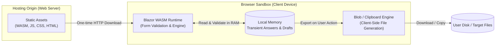

# Browser Configuration (Blazor WebAssembly)

ISLAMU Configurator Browser is a static, client-side web application built with Blazor WebAssembly and MudBlazor. It allows operators to prepare production-ready configuration files directly in modern web browsers without installing native software.

All form processing, schema validation, and file composition execute entirely inside your browser's local sandbox. No configuration answers or generated files are ever transmitted to an application server.

---

## Data Custody & Security Architecture

Configurator Browser maintains strict isolation between static asset hosting and runtime execution:



> [!WARNING]
> **Browser Environment & Custody Considerations:**
> While Blazor WebAssembly executes locally and sends no answer data to the web host, browser environments cannot enforce OS-level file permissions (such as Linux `0600`) or prevent malicious browser extensions from inspecting DOM memory. For high-value production secrets, prefer the native [Desktop](desktop.md), [Terminal](terminal.md), or [CLI](cli.md) clients on a trusted workstation.

---

## Why WebAssembly Interactivity

Configurator uses standalone Blazor WebAssembly rather than Blazor Server:

- **Local Data Custody:** Forms, validation rules, and file preparation execute client-side. The hosting server acts solely as a static file CDN.
- **Offline Capability:** Once assets are cached, operators can disconnect from the network and complete configurations entirely offline.
- **AOT Performance:** Release builds use ahead-of-time (AOT) WebAssembly compilation to minimize interactive latency and provide snappy form navigation.

---

## Using the Workspace

### Loading Definitions

Start by selecting a configuration definition from the **Home** screen:
- **Bundled Examples:** Choose from built-in sample applications.
- **Definition Store:** Search the public [Definition Store](definition-store.md) by project name or publisher.
- **Local File Upload:** Upload a local `.json` or `.yaml` definition (up to 4 MiB). Compact maintainer sources are compiled locally in your browser.
- **Pinned Publisher Link:** Open an authorized public URL pointing to a published definition.

Upon loading, the header displays the verified title, publisher, family UUID, revision, and computed SHA-256 digest.

### Workspace Layout & Appearance

The application bar provides controls to customize your viewing experience:
- **Color Themes:** Toggle between System, Light, Dark, and High-Contrast palettes.
- **Text Direction:** Supports Automatic, Left-to-Right (LTR), and Right-to-Left (RTL) reading directions.
- **Display Density:** Choose Comfortable or Compact spacing.
- **Session Safety:** Leaving the workspace prompts a confirmation dialog to discard transient data before loading another definition.

### Form Navigation & Journeys

Definitions can organize complex setup options into guided journeys:

- **Experience Selector:** Switch between authored journeys (e.g., *Recommended*, *Production*) or neutral *Configure*.
- **Detail Profiles:** Adjust visible complexity using **Detail in this profile** (*Follow experience*, *Essential*, *Standard*, or *All active*).
- **Batched Rendering:** Large sections load controls progressively in small batches to keep the browser responsive.
- **Error Visibility:** Missing required settings and active validation errors remain accessible regardless of the selected journey.

### Form Controls & Container Management

Inputs dynamically adapt to their declared data types:

- **Typed Inputs:** Strings, invariant decimals, integers, booleans, and enum choices enforce strict schema validation.
- **Object Containers:** Click **Supply container** to explicitly include an object, even if empty (`{}`). Click **Clear container** to omit it completely.
- **List Rows:** Use bounded row controls to add or remove list items. Removed rows are excluded from output bundles.
- **Explicit Omission:** Use **Actions for...** to explicitly omit a setting without affecting sibling fields. Empty strings (`""`) and `false` are valid supplied values distinct from omission.

### Finding and Filtering Settings

Quickly locate specific questions using the built-in search palette:

- **Keyboard Shortcut:** Press `Ctrl + K` or `Cmd + K` (or tap **Search settings** on mobile) to open search.
- **Search Queries:** Searches match question titles, field IDs, concepts, and authored guidance.
- **Faceted Filters:** Filter settings by section, requirement, applicability, completion status, and sensitivity.
- **Direct Navigation:** Selecting a search result navigates directly to the question and brings it into focus.

### Review and Diagnostics

The **Review** view provides an overview of your configuration before generating files:

- **Active Corrections:** Displays validation errors across all sections with direct links to jump to the affected field.
- **Configuration Inventory:** Inspect all active settings, defaulted values, deferred secrets, and declared output bindings.
- **Output Inspection:** Review declared output filenames, formats, and restart guidance.

### Secret Consent & Secret-Deferred Drafts

> [!IMPORTANT]
> **Secret Consent Policy:**
> Secret entry is disabled by default for every new workspace. You choose between two secure workflows:
> - **Secret-Deferred Draft:** Keep secret entry disabled. Configurator produces a draft file with clear placeholders marking where secrets must be supplied locally after export.
> - **Explicit Consent:** Voluntarily enable secret entry for this workspace. Inputs are masked, and password manager autofill is supported. Revoking consent immediately flushes secrets from memory and invalidates staged outputs.

### Importing Existing Configuration

Prefill answers by importing existing `.json`, `.yaml`, or `.env` configuration files:

1. Under **Start from an existing configuration**, select an eligible declared artifact format.
2. Choose a local file (up to 1 MiB) with top-level copy mappings.
3. The engine parses the file and fills matching definition answers.

Conflicting manual answers or unknown keys reject the entire import cleanly without altering your existing form state.

### Exporting & Downloading Files

Once answers are validated, choose **Prepare complete configuration** or **Prepare draft**:

- **Masked Staging:** Generated outputs remain redacted on screen until you deliberately choose to reveal them.
- **Export Actions:** Use **Copy** to copy contents to the clipboard, or **Download** to trigger a browser file download via short-lived Blob URLs.
- **Filename Verification:** Verify downloaded filenames before deployment. Some browsers normalize special filenames (for example, downloading `.env` as `env.txt`). Rename the downloaded file if required.

---

## Offline Work & PWA Support

> [!TIP]
> **Full Offline Capability:**
> Once the Progressive Web App (PWA) shell and public definition metadata are cached, you can disconnect from the internet and complete configurations entirely offline.

To prepare for offline work:
1. Open the definition online and verify its details.
2. Confirm the prompt stating the definition is safe for public metadata caching, then select **Retain definition for offline use**.
3. Once cached, the definition appears under **Retained public definitions** on the Open configuration page.
4. Up to 8 public definitions (up to 4 MiB each) can be retained. Reopening offline creates a clean workspace; answers are never stored in browser caches.

---

## Self-Hosting & Deployment

### Building Static Assets

Build the standalone static package using the repository-pinned .NET SDK:

```bash
# Install WebAssembly build tools once
dotnet workload install wasm-tools

# Publish static distribution
dotnet msbuild eng/configurator/Configurator.Release.proj \
  -target:PublishConfiguratorBrowser -property:Configuration=Release
```

Serve the resulting `artifacts/configurator/browser/wwwroot/` directory using any standard web server (Nginx, Caddy, Cloudflare Pages, S3). Ensure:
- HTTPS is enabled in production.
- Proper MIME types for `.wasm` (`application/wasm`) and `.json` are served.
- Single-page application (SPA) fallback redirects unknown routes to `index.html`.

### Docker Container

The Browser project includes a multi-stage `Dockerfile` serving static assets via an unprivileged .NET static server:

```bash
# Build the container image from the repository root
docker build -f src/Configurator.Browser/Dockerfile -t islamu-configurator-browser .

# Run with hardened security flags
docker run --rm --read-only --tmpfs /tmp:rw,noexec,nosuid,size=16m \
  --cap-drop ALL --security-opt no-new-privileges \
  -p 127.0.0.1:8080:8080 islamu-configurator-browser
```

To include the public Definition Store catalogue in your image, pass `--build-arg INCLUDE_DEFINITION_STORE=true` during build.

### Deploying with Coolify

Deploy Configurator Browser as a Docker service in Coolify with these settings:

| Setting | Recommended Value |
| --- | --- |
| **Build Pack** | Dockerfile |
| **Base Directory** | `/` |
| **Dockerfile Location** | `/src/Configurator.Browser/Dockerfile` |
| **Docker Build Stage** | *(Leave empty to use final runtime stage)* |
| **Exposed Ports** | `8080` |
| **Port Mappings** | *(Leave empty for automatic Coolify reverse proxy)* |
| **Domain & HTTPS** | Configure your custom domain in Coolify |

For advanced integration details, see the [launch integration guide](launch-integration.md) and [packaging guide](packaging.md).
