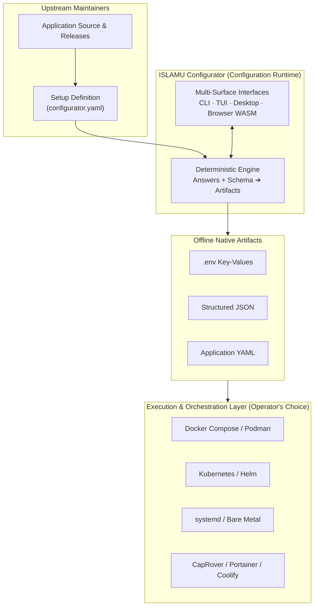
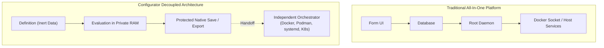
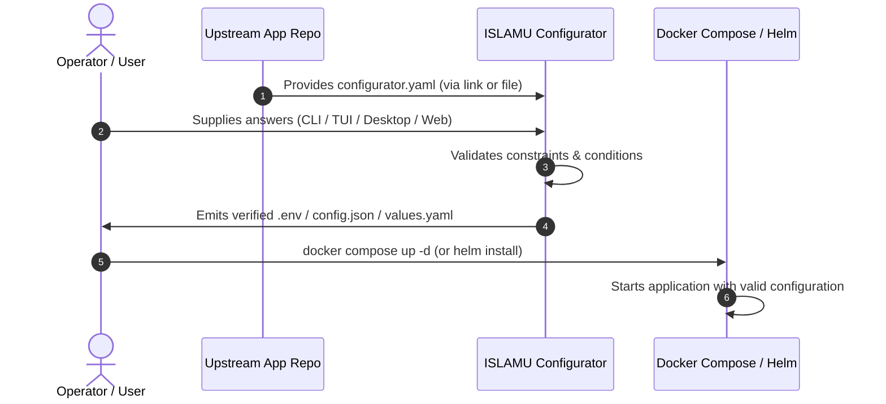

# Architectural & Functional Comparison

> **Audience:** Adopters | Integrators | Contributors | AI agents  
> **Status:** Implemented  
> **Owner:** Presentation  
> **Last Verified:** 2026-10-27  
> **Source Anchors:** `docs/internal/VISION_AND_APPROACH.md`, `docs/internal/ARCHITECTURE.md`, `docs/internal/CORE_DEFINITION_CONTRACT.md`

This document compares ISLAMU Configurator with established tools in self-hosting, application templating, developer portals, and infrastructure automation. It highlights Configurator's unique positioning as an **offline-first configuration runtime** that prepares deployment files without managing containers or processes.

---

## Executive Summary: The Configuration Runtime

In modern software deployment, a wide architectural divide exists between **user-facing application configuration** and **infrastructure execution**:

Most tools in the self-hosting ecosystem bundle configuration into an all-in-one platform: they manage Docker daemons, reverse proxies, app stores, background databases, and system user accounts.

ISLAMU Configurator takes a fundamentally different path:
1. **Pure Data, Zero Scripts:** Setup definitions are inert, declarative data documents. They contain no shell scripts, Python code, or executable hooks.
2. **Offline & Air-Gapped:** Configurator runs entirely in local memory. It never requires an internet connection, telemetry endpoint, or remote cluster connection.
3. **Orchestrator Independent:** It does not require Docker, Kubernetes, or any specific container daemon. It compiles into standard files (`.env`, JSON, YAML) that feed into any deployment system.
4. **Zero Secret Custody:** Configurator never retains or transmits credentials. On Linux, files are written with owner-only (`0600`) create-only permissions.
5. **Multi-Surface Rendering:** One single definition renders identically across Headless CLI, Terminal TUI, Native Desktop GUI, and Browser WebAssembly.

---

## Detailed Comparison Matrix

The matrix below contrasts Configurator across six core technical dimensions against six major categories of configuration and deployment tooling:

| Dimension | ISLAMU Configurator | RunTipi / Umbrel | CapRover / Portainer | Backstage Templates | YunoHost | Home Assistant Blueprints | Helm Charts / Kustomize |
|---|---|---|---|---|---|---|---|
| **Primary Role** | Offline configuration runtime & compiler | All-in-one homelab app store & platform | Container dashboard & PaaS manager | Developer portal project scaffolder | Self-hosting Linux distribution | Reusable smart home automation schemas | Kubernetes package manager & overlay engine |
| **Orchestrator Independence** | **100% Independent** (Docker, K8s, bare metal, systemd, Nomad) | **Docker-only** (locked to host platform) | **Docker-only** (Swarm or standalone) | **Agnostic** (generates repo scaffolds) | **Debian-only** (system services & nginx) | **HA-only** (Home Assistant core runtime) | **Kubernetes-only** (requires K8s API/cluster) |
| **Definition Model** | **Data-only** (declarative schema, zero executable code) | App store metadata + `docker-compose.yml` | Template JSON + `docker-compose.yml` | Cookiecutter / React / Node actions | Shell scripts (`install`, `upgrade`, `remove`) | YAML data schema (Jinja2 evaluation) | Go templates + YAML schemas |
| **Secret Custody & Privacy** | **Zero custody** (transient RAM, Linux `0600`, masked inputs) | Stored in platform database / disk | Stored in manager database / daemon | Handled by backend plugins | Root filesystem / Debian configs | Stored in home-assistant database | Stored in etcd / K8s Secrets |
| **Surfaces** | **4 Surfaces** (CLI, TUI, Desktop, Browser WASM) | Web dashboard only | Web dashboard only | Web portal only | Web UI + CLI (Debian) | Web dashboard only | CLI only (`helm`, `kubectl`) |
| **Output Formats** | `.env`, JSON, YAML, bounded Markdown | Direct container instantiation | Direct container instantiation | Git repository commit / PR | Installed Debian packages & configs | Automation YAML rules | Kubernetes resource manifests |
| **Upstream Ownership** | Maintained beside app code; deep linkable | Third-party app store repository | Third-party template repository | Central platform engineering repo | YunoHost app packaging community | Community blueprint exchange | Helm chart repository / OCI artifact |
| **Execution Responsibility** | **None** (operator hands files to target) | Manages container lifecycle | Manages container lifecycle | Triggers repository creation & CI | Manages OS services & users | Executes home automation events | Deploys pods & services to K8s |

---

## In-Depth Tool Comparisons

### 1. RunTipi & Umbrel (Homelab App Stores & Appliances)

**What they do:** RunTipi and Umbrel are integrated home-server operating systems. They offer "one-click" app stores for self-hosters, managing Docker containers, reverse proxies (Traefik/Tor), and dashboard interfaces.

**How Configurator differs:**
- **No Background Daemons:** RunTipi and Umbrel require running long-lived system daemons with Docker socket access. Configurator is a transient utility that exits as soon as files are generated.
- **Any Infrastructure:** Umbrel and RunTipi cannot configure an application running directly on bare metal via systemd, inside an LXC container, or on a Kubernetes cluster. Configurator prepares standard configuration files that run anywhere.
- **Zero Platform Lock-In:** When using an app store platform, you rely on the platform maintainers to package and update applications. With Configurator, upstream application maintainers distribute their own definitions directly in their repositories.

> [!NOTE]
> Configurator is not a competitor to RunTipi or Umbrel. In fact, a homelab platform can use Configurator's CLI internally to guide users through complex initial configurations.

---

### 2. CapRover & Portainer Templates (PaaS & Container Managers)

**What they do:** CapRover and Portainer provide graphical management consoles for Docker and Swarm. Their template systems provide form fields that substitute variables into Docker Compose files before launching containers.

**How Configurator differs:**
- **Separation of Configuration from Runtime:** CapRover and Portainer bundle configuration input directly into container provisioning. If their database corrupts or their daemon halts, managing configurations becomes difficult. Configurator produces standalone, transparent files on your filesystem.
- **Advanced Conditional Logic:** Container templates offer rudimentary variable substitution (e.g. `PORT=8080`). Configurator supports advanced conditional logic (`activeWhen`, `requiredWhen`), cross-field validation, arrays of complex objects, and deterministic digests.
- **Multi-File Bundle Composition:** A single Configurator run can simultaneously prepare a `.env` file for Docker, a `config.json` for tenant authentication, and a `README.md` containing run instructions, from a single coherent answer set.

---

### 3. Backstage Software Templates (Developer Portals)

**What they do:** Spotify's Backstage is an enterprise internal developer portal (IDP). Its Software Templates feature allows platform engineers to define multi-step scaffolding wizards that create Git repositories, run Cookiecutter, and trigger CI/CD pipelines.

**How Configurator differs:**
- **Zero Infrastructure Footprint:** Backstage is an enterprise Node.js/PostgreSQL application that requires substantial infrastructure, ongoing maintenance, and complex authentication setups. Configurator requires zero infrastructure—it can run as a single static WebAssembly page or a standalone native binary.
- **Configuration vs. Scaffolding:** Backstage templates specialize in generating entire codebases and registering them in service catalogs. Configurator specializes in parameterizing and preparing runtime configuration files for existing software.
- **Offline & Local Execution:** Backstage requires a central server. Configurator works completely offline in air-gapped environments, secure terminals, or local operator workstations.

---

### 4. YunoHost (Self-Hosting Operating System)

**What they do:** YunoHost is a complete operating system based on Debian GNU/Linux. It packages applications as Debian-level packages with complex bash scripts that configure Nginx, generate SSL certificates via Let's Encrypt, manage LDAP users, and configure systemd services.

**How Configurator differs:**
- **Data vs. Shell Scripts:** YunoHost packages rely heavily on procedural Bash scripts running as root (`install`, `upgrade`, `backup`, `restore`). Configurator definitions are strictly declarative JSON/YAML documents containing zero executable code, eliminating entire classes of script injection and privilege escalation risks.
- **Portability:** YunoHost is tied exclusively to Debian. Configurator runs on Linux, macOS, Windows, and in any modern web browser.
- **Security Scope:** Configurator runs under the operator's unprivileged user account. It never requests root privileges or alters system services.

---

### 5. Home Assistant Blueprints (Automation Schemas)

**What they do:** Home Assistant Blueprints are declarative YAML schemas that turn complex automation templates into user-friendly configuration forms. Community members share blueprints, and users fill in specific entities (sensors, lights) through the Home Assistant UI.

**How Configurator differs:**
- **Cross-Domain Scope:** Home Assistant Blueprints are arguably the closest conceptual relative to Configurator definitions—they define input forms, types, defaults, and validation rules in pure YAML without executable code. However, Blueprints are locked strictly to Home Assistant automation entities.
- **Universal Application Support:** Configurator generalizes this exact paradigm to any self-hosted or cloud software, projecting answers into environment files, JSON documents, and YAML files.
- **Multiple Output Bindings:** Blueprints only output Home Assistant internal automation configs. Configurator outputs standard deployment files for any target application.

---

### 6. Helm Charts & Kustomize (Kubernetes Configuration)

**What they do:** Helm is the standard package manager for Kubernetes, using Go template interpolation over `values.yaml`. Kustomize provides template-free overlays for Kubernetes manifests.

**How Configurator differs:**
- **Target Independence:** Helm and Kustomize only produce Kubernetes manifests and require access to Kubernetes concepts (ConfigMaps, Secrets, Deployments). Configurator produces generic application configuration files suitable for any host.
- **Human-Friendly Guidance:** Helm `values.yaml` files often contain hundreds of undocumented, nested settings. Users edit these files in raw text editors without guided conditional flows or contextual field documentation. Configurator provides rich, guided experiences (TUI, GUI, Web) that prevent invalid configurations before any deployment is attempted.
- **Complementary Workflow:** Configurator can output a validated `values.yaml` file that is directly consumed by `helm install`, combining Configurator's guided user experience with Helm's Kubernetes orchestration power.

---

## Why Configurator Decouples Configuration from Execution

By deliberately refusing to become an application launcher, deployment manager, or process supervisor, Configurator achieves four crucial architectural properties:

### 1. Zero Root Privilege & Maximum Security

All-in-one platforms often require root access or access to `/var/run/docker.sock` to start and stop services. Giving a web application Docker socket access creates significant security exposure.

Configurator runs entirely as an unprivileged user. It never binds to system daemons, opens network ports, or mounts privileged sockets.

### 2. Upstream Maintainer Ownership

In traditional platforms, app store packages are maintained by third-party catalog maintainers. When an upstream application releases a major version with new configuration flags, users must wait weeks or months for the catalog package to be updated.

With Configurator, the application's upstream maintainers author `configurator.yaml` directly in their own source repository. When they release version 2.0, their configuration definition is immediately updated and verified alongside their code.

### 3. Absolute Privacy & Secret Custody

Platforms with web dashboards typically store database passwords, API tokens, and private encryption keys in their own internal SQLite or PostgreSQL databases.

Configurator has no database and zero credential custody:
- In native interfaces (CLI, TUI, Desktop), credentials exist only in transient memory and are committed directly to disk using Linux `0600` owner-only protections.
- In the browser, secret entry requires voluntary per-workspace consent. Alternatively, operators can generate secret-deferred drafts that leave clear placeholders for secrets to be filled in locally.

### 4. True Multi-Surface Portability

Because Configurator is an offline evaluation engine, the exact same setup definition can be executed anywhere:
- Headless in CI/CD automation pipelines via `islamu-configurator` CLI.
- Over SSH sessions in headless cloud servers via the interactive TUI.
- On a desktop workstation via the native Avalonia GUI.
- In a web browser with zero local installation via client-side WebAssembly.

---

## The Complementary Workflow: Using Configurator in Your Stack

Configurator does not replace your favorite tools—it makes them better by ensuring they receive valid, verified configuration files every time:

1. **Maintainer authors once:** The application maintainer adds `configurator.yaml` to their repository.
2. **Operator configures:** The operator opens the definition in their preferred interface (CLI, TUI, Desktop, or Browser).
3. **Engine validates:** Configurator checks all types, patterns, dependencies, and required fields locally.
4. **Files are produced:** Configurator emits production-ready `.env`, `config.json`, or `values.yaml` files.
5. **Orchestrator deploys:** The operator hands those verified files to Docker Compose, systemd, or Helm to launch the service.

---

## When to Choose What

| If your goal is... | Recommended Solution |
|---|---|
| Configure self-hosted apps offline with zero telemetry and verified permissions | **ISLAMU Configurator** |
| Run an all-in-one homelab server with a web app store and managed reverse proxy | **RunTipi** or **Umbrel** |
| Manage multi-container applications on Docker Swarm through a web dashboard | **CapRover** or **Portainer** |
| Scaffold new microservice codebases across enterprise engineering teams | **Backstage Software Templates** |
| Turn a dedicated Debian machine into a self-hosted appliance with email and LDAP | **YunoHost** |
| Create reusable smart home automation rules | **Home Assistant Blueprints** |
| Package and deploy complex microservices to Kubernetes clusters | **Helm** + **ISLAMU Configurator** (for values preparation) |
