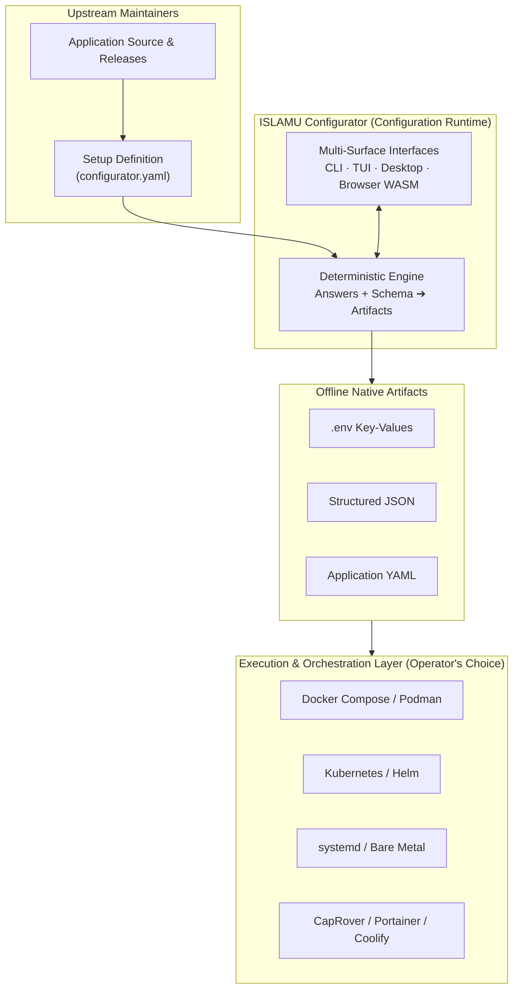
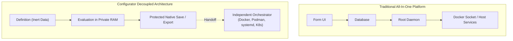
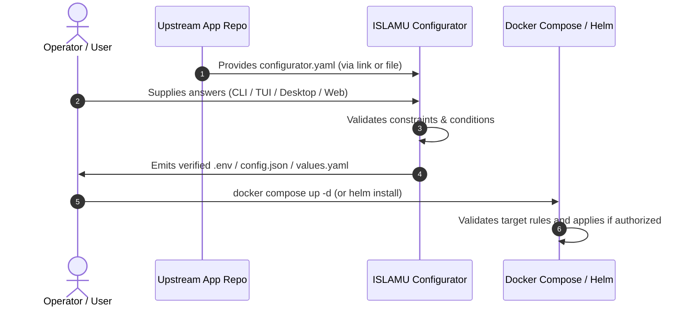

# Architectural & Functional Comparison

> **Audience:** Adopters | Integrators | Contributors | AI agents  
> **Status:** Architectural orientation; third-party feature details not reverified
> **Owner:** Presentation  
> **Last Verified:** 2026-10-30
> **Review basis:** Configurator source boundaries only; third-party details not reverified
> **Source Anchors:** `docs/internal/VISION_AND_APPROACH.md`, `docs/internal/ARCHITECTURE.md`, `docs/internal/CORE_DEFINITION_CONTRACT.md`

This document compares ISLAMU Configurator with established tools in self-hosting, application templating, developer portals, and infrastructure automation. It highlights Configurator's unique positioning as an **offline-first configuration runtime** that prepares deployment files without managing containers or processes.

Treat the named tools as workflow examples, not a current version-by-version
feature audit or a security ranking. Third-party details were not externally
reverified for this correction. Plugins, deployment modes and supported platforms
vary; check each tool's own current documentation before choosing it. Configurator
claims below are bounded by [current status](../internal/STATUS.md) and actual-host
qualification, not by a promise of production readiness.

---

## Executive Summary: The Configuration Runtime

In modern software deployment, a wide architectural divide exists between **user-facing application configuration** and **infrastructure execution**:

Integrated deployment platforms can combine configuration with container
management, reverse proxies, application catalogues or system administration.
Those responsibilities differ from preparing files for an independently managed
target.

ISLAMU Configurator takes a fundamentally different path:
1. **Pure Data, Zero Scripts:** Setup definitions are inert, declarative data documents. They contain no shell scripts, Python code, or executable hooks.
2. **Offline Preparation:** After obtaining the client and definition, evaluation
   can run offline. Browser asset preparation, optional public definition
   retrieval and explicit offline retention are separate steps.
3. **Orchestrator Independent:** Core preparation requires no Docker or
   Kubernetes daemon. A target-specific definition must still project files the
   selected target understands.
4. **Local Answer Custody:** Workspaces hold private answers transiently, while
   selected input files and deliberately exported output remain private
   material outside that workspace. Supported Linux saves are create-only and
   owner-only (`0600`); Browser downloads do not inherit that protection.
5. **Shared Semantics, Distinct Interfaces:** CLI, TUI, Desktop and Browser
   consume the same Core rules. They do not render identically or have identical
   capabilities, consent requirements or delivery guarantees.

---

## Detailed Comparison Matrix

The matrix summarizes architectural roles rather than exhaustive product support.
Its third-party columns are unverified orientation, not qualification evidence:

| Dimension | ISLAMU Configurator | RunTipi / Umbrel | CapRover / Portainer | Backstage Templates | YunoHost | Home Assistant Blueprints | Helm Charts / Kustomize |
|---|---|---|---|---|---|---|---|
| **Primary Role** | Offline configuration runtime & compiler | All-in-one homelab app store & platform | Container dashboard & PaaS manager | Developer portal project scaffolder | Self-hosting Linux distribution | Reusable smart home automation schemas | Kubernetes package manager & overlay engine |
| **Execution Context** | Prepares files without an orchestrator dependency | Integrated homelab platform | Container-management workflow | Scaffolding actions selected by platform owners | Managed self-hosting system | Home Assistant automation context | Kubernetes-oriented files; rendering and deployment are distinct steps |
| **Definition Model** | **Data-only** (declarative schema, zero executable code) | App store metadata + `docker-compose.yml` | Template JSON + `docker-compose.yml` | Cookiecutter / React / Node actions | Shell scripts (`install`, `upgrade`, `remove`) | YAML data schema (Jinja2 evaluation) | Go templates + YAML schemas |
| **Secret Custody & Privacy** | Local transient workspace plus explicit private input/export files; restricted drafts | Inspect platform storage and integrations | Inspect daemon, manager and deployment storage | Inspect selected backend actions/plugins | Inspect system configuration and backups | Inspect automation storage and integrations | Inspect rendered files and cluster storage separately |
| **Typical Surface** | CLI, TUI, Desktop, Browser WASM | Web dashboard | Web dashboard | Web portal | Web UI and CLI | Web dashboard | CLI workflows; other integrations vary |
| **Output Formats** | `.env`, JSON, YAML, bounded Markdown | Direct container instantiation | Direct container instantiation | Git repository commit / PR | Installed Debian packages & configs | Automation YAML rules | Kubernetes resource manifests |
| **Upstream Ownership** | Maintained beside app code; deep linkable | Third-party app store repository | Third-party template repository | Central platform engineering repo | YunoHost app packaging community | Community blueprint exchange | Helm chart repository / OCI artifact |
| **Execution Responsibility** | **None** (operator hands files to target) | Manages container lifecycle | Manages container lifecycle | Triggers repository creation & CI | Manages OS services & users | Executes home automation events | Deploys pods & services to K8s |

---

## In-Depth Tool Comparisons

### 1. RunTipi & Umbrel (Homelab App Stores & Appliances)

**What they do:** RunTipi and Umbrel are integrated home-server operating systems. They offer "one-click" app stores for self-hosters, managing Docker containers, reverse proxies (Traefik/Tor), and dashboard interfaces.

**How Configurator differs:**
- **No Target Daemon Dependency:** Configurator preparation does not require a
  container daemon. Interactive clients can remain open after preparation, and
  serving public Browser assets is a separate hosting process.
- **Separate Infrastructure Choice:** Configurator prepares declared files
  without controlling the target host. Whether a specific application can use
  those files on systemd, LXC or Kubernetes is a target/deployment question,
  not a universal compatibility guarantee.
- **Direct Definition Distribution:** Upstream maintainers can distribute
  definitions beside application code without requiring a central app store.
  Definition accuracy and release maintenance remain their responsibility.

> [!NOTE]
> Configurator is not a competitor to RunTipi or Umbrel. In fact, a homelab platform can use Configurator's CLI internally to guide users through complex initial configurations.

---

### 2. CapRover & Portainer Templates (PaaS & Container Managers)

**What they do:** CapRover and Portainer provide graphical management consoles for Docker and Swarm. Their template systems provide form fields that substitute variables into Docker Compose files before launching containers.

**How Configurator differs:**
- **Separation of Configuration from Runtime:** Configurator produces
  independently inspectable files without requiring access to a container
  manager's daemon or storage.
- **Bounded Conditional Rules:** Configurator uses
  `x-configurator.applicableWhen`, object `required`, `dependentRequired`, and
  bounded `if`/`then.required`/`else.required`, not `activeWhen` or `requiredWhen`.
  Its schema supports recursive objects/arrays and deterministic projections.
  This is its admitted vocabulary, not a ranking of every template system.
- **Multi-File Bundle Composition:** A single Configurator run can simultaneously prepare a `.env` file for Docker, a `config.json` for tenant authentication, and a `README.md` containing run instructions, from a single coherent answer set.

---

### 3. Backstage Software Templates (Developer Portals)

**What they do:** Spotify's Backstage is an enterprise internal developer portal (IDP). Its Software Templates feature allows platform engineers to define multi-step scaffolding wizards that create Git repositories, run Cookiecutter, and trigger CI/CD pipelines.

**How Configurator differs:**
- **Smaller Preparation Boundary:** Configurator does not require a developer
  portal service or target login. A Browser still needs trusted static delivery
  and public assets; native clients still need a trusted host and package.
- **Configuration vs. Scaffolding:** Backstage templates specialize in generating entire codebases and registering them in service catalogs. Configurator specializes in parameterizing and preparing runtime configuration files for existing software.
- **Offline & Local Execution:** Backstage requires a central server. Configurator works completely offline in air-gapped environments, secure terminals, or local operator workstations.

---

### 4. YunoHost (Self-Hosting Operating System)

**What they do:** YunoHost is a complete operating system based on Debian GNU/Linux. It packages applications as Debian-level packages with complex bash scripts that configure Nginx, generate SSL certificates via Let's Encrypt, manage LDAP users, and configure systemd services.

**How Configurator differs:**
- **Data vs. Administrative Execution:** Configurator definitions admit no
  executable hooks. This avoids granting scripts authority through a definition;
  it does not eliminate supply-chain, parser, browser, OS or target risks.
- **Portability:** Configurator has native and Browser adapters. Package targets
  are not actual-host qualification; protected saving remains Linux-only and
  unsupported hosts reject it.
- **Security Scope:** Configurator runs under the operator's unprivileged user account. It never requests root privileges or alters system services.

---

### 5. Home Assistant Blueprints (Automation Schemas)

**What they do:** Home Assistant Blueprints are declarative YAML schemas that turn complex automation templates into user-friendly configuration forms. Community members share blueprints, and users fill in specific entities (sensors, lights) through the Home Assistant UI.

**How Configurator differs:**
- **Cross-Domain Scope:** Home Assistant Blueprints are arguably the closest conceptual relative to Configurator definitions—they define input forms, types, defaults, and validation rules in pure YAML without executable code. However, Blueprints are locked strictly to Home Assistant automation entities.
- **Application-Owned Mapping:** Configurator projects answers into dotenv,
  JSON and YAML for targets whose requirements fit the bounded profile. It does
  not automatically infer or support every application's configuration semantics.
- **Multiple Output Bindings:** A Configurator definition can declare several
  output projections from one snapshot. Compatibility still depends on each
  target's requirements fitting those projections and the bounded schema.

---

### 6. Helm Charts & Kustomize (Kubernetes Configuration)

**What they do:** Helm is the standard package manager for Kubernetes, using Go template interpolation over `values.yaml`. Kustomize provides template-free overlays for Kubernetes manifests.

**How Configurator differs:**
- **Target Independence:** Configurator's definition/output model is not
  Kubernetes-specific. Distinguish local rendering from cluster application in
  any comparison: preparing manifests need not itself contact a cluster.
- **Human-Friendly Guidance:** Configurator can provide typed forms,
  applicability, disclosure and contextual instructions for declared settings.
  Guidance quality depends on the maintainer; passing local constraints does
  not prevent all target-invalid configurations.
- **Complementary Workflow:** Configurator can output a validated `values.yaml` file that is directly consumed by `helm install`, combining Configurator's guided user experience with Helm's Kubernetes orchestration power.

---

## Why Configurator Decouples Configuration from Execution

By deliberately refusing to become an application launcher, deployment manager, or process supervisor, Configurator achieves four crucial architectural properties:

### 1. No Target Administration Required

All-in-one platforms often require root access or access to `/var/run/docker.sock` to start and stop services. Giving a web application Docker socket access creates significant security exposure.

Configuration preparation does not need root, daemon sockets or target
administration. Static hosting may listen on a port to serve public app assets;
that delivery responsibility is separate from the offline engine. Running a
native client as root is neither required nor a security benefit.

### 2. Upstream Maintainer Ownership

Separately maintained app packages and upstream configuration can drift unless
their owners coordinate releases. A definition maintained beside application
code makes that coordination explicit, rather than guaranteeing its quality.

With Configurator, maintainers can author `configurator.yaml` in their repository
and verify it alongside the target's own acceptance tests. The utility does not
automatically update a definition when the application changes.

### 3. Local Processing and Explicit Custody Transfers

Platforms with web dashboards typically store database passwords, API tokens, and private encryption keys in their own internal SQLite or PostgreSQL databases.

Configurator has no answer database, but does process private answers:
- Native interfaces use transient workspace state and explicitly selected
  private input/output files. Supported Linux output is owner-only/create-only
  per file, not transactionally across a bundle.
- Browser secret entry requires per-workspace consent. Secret-deferred drafts
  report completion locations and remain incomplete and restricted: ordinary
  settings can also be confidential. Input files, downloads, clipboard history
  and password managers remain separate custody surfaces.

### 4. True Multi-Surface Portability

The same admitted definition can be used through supported adapters and their
declared capability sets:
- Headless in CI/CD automation pipelines via `islamu-configurator` CLI.
- Over SSH sessions in headless cloud servers via the interactive TUI.
- On a desktop workstation via the native Avalonia GUI.
- In a web browser with zero local installation via client-side WebAssembly.

---

## The Complementary Workflow: Using Configurator in Your Stack

Configurator can complement these tools by preparing declared input formats.
The target must still validate semantics and authorize application:

1. **Maintainer authors once:** The application maintainer adds `configurator.yaml` to their repository.
2. **Operator configures:** The operator opens the definition in their preferred interface (CLI, TUI, Desktop, or Browser).
3. **Engine validates:** Configurator checks admitted types, bounds,
   applicability and presence relationships locally. Arbitrary regex patterns
   and general JSON Schema are outside the bounded profile.
4. **Files are prepared:** Configurator composes declared `.env`, JSON or YAML
   projections; it does not certify production readiness.
5. **Target handoff:** The operator obtains target validation and permission
   before using deployment tooling to apply or restart.

---

## When to Choose What

| If your goal is... | Recommended Solution |
|---|---|
| Configure self-hosted apps offline with zero telemetry and verified permissions | **ISLAMU Configurator** |
| Run an all-in-one homelab server with a web app store and managed reverse proxy | **RunTipi** or **Umbrel** |
| Manage multi-container applications on Docker Swarm through a web dashboard | **CapRover** or **Portainer** |
| Scaffold new microservice codebases across enterprise engineering teams | **Backstage Software Templates** |
| Turn a dedicated Debian machine into a self-hosted appliance with email and LDAP | **YunoHost** |
| Create reusable smart home automation rules | **Home Assistant Blueprints** |
| Package and deploy complex microservices to Kubernetes clusters | **Helm** + **ISLAMU Configurator** (for values preparation) |
