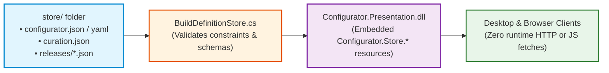

# Public Definition Store

The Definition Store is a reviewed catalog of configuration definitions compiled directly into `Configurator.Presentation` and shipped offline inside both the ISLAMU Configurator Desktop and Browser clients.

It allows operators to discover and configure popular self-hosted applications with a single click, completely offline, without needing to author, host, or download raw definition files manually.

---

## How Store Bundling Works

Definitions contributed to the repository are validated, compiled, and embedded into the shared Presentation assembly at build time:



1. **Repository Sources:** Maintainers store human-readable definitions in `store/<project-slug>/`.
2. **Compilation:** `BuildDefinitionStore.cs` validates schema adherence, checks revision immutability, and generates search manifests into an intermediate build directory.
3. **Assembly Embedding:** MSBuild embeds the generated `index.json` and canonical revision snapshots directly into `Configurator.Presentation` (`Configurator.Store.*` manifest resources), distributing them identically to Desktop and WebAssembly packages.
4. **Offline Browsing:** Both Desktop (`Open`) and Browser (`/`) query `EmbeddedDefinitionStoreProvider` from local memory, allowing full search and configuration even without network connectivity.

---

## Discovering Definitions in the Browser Client

When you open the Configurator WebAssembly application:

1. **Choose a project:** Open the home catalogue. Definitions are grouped by their exact application identifier; matching titles alone never combine projects.
2. **Search and Filter:** Search applications by name, keywords, or curated category tags (e.g. `monitoring`, `database`, `proxy`).
3. **Start Configuration:** Use **Configure** for the explicitly identified available source. A directory choice is checked against its exact indexed identity before the workspace opens in the same action.
4. **Choose alternatives when needed:** **Source details** retains other families and revisions, publisher metadata, application versions and filenames. Multiple ambiguous candidates require an explicit choice; no revision is silently selected as latest.
5. **Inspect a directory revision:** Optional project details let you choose an exact revision and configure it directly. An unavailable requested revision reports an error instead of substituting another.

Application identifiers and publisher labels organize navigation, not trust.
The catalogue lives at `/`; the former `/store` alias is removed. Exact
directory details remain at `/store/{projectId}`.

> [!NOTE]
> Alongside the bundled Store catalog, **Open** remains fully operational in both Desktop and Browser for loading local files or explicit credential-free public HTTPS links.

The Store catalog, curation and definition contracts use the fixed development
version `0.0.1`. Only the current format is supported; older local copies belong
in ignored archives. Content identity remains independent: a changed definition
needs a new immutable revision or a deliberate fresh-family fork. Existing
family/revision identities are never repinned, and the browser does not migrate
private answers. Local compilation or
catalog inclusion does not authenticate a publisher or prove target acceptance.

---

## Proposing a Project to the Store

Anyone may submit a pull request to add an open-source application to the official store catalog under [`store/`](../../store/README.md).

### 1. Directory Structure

Each application lives in a dedicated subdirectory named after the project slug:

```text
store/example-service/
├── configurator.yaml      # Maintainer authoring source
├── curation.json          # Optional: tags and search metadata
└── releases/
    └── 1.json             # Generated canonical runtime definition
```

### 2. Curation Metadata (`curation.json`)

To add search tags or specify a custom slug, include an optional `curation.json` adhering to the [curation schema](../../schemas/definition-store-curation.schema.json):

```json
{
  "schemaVersion": "0.0.1",
  "tags": [
    "monitoring",
    "metrics",
    "dashboard"
  ],
  "slug": "example-service",
  "slugReason": "Matches standard upstream container image name"
}
```

- **`schemaVersion`**: Must be `"0.0.1"`.
- **`tags`**: Up to 16 unique lowercase alphanumeric tags (max 32 characters each).
- **`slug` & `slugReason`**: If the directory name differs from the project ID in `configurator.yaml`, explain the reason in `slugReason` (16–512 characters).

---

## Contributor Step-by-Step Workflow

Follow these steps to contribute a new definition:

### Step 1: Author Your Source

Create your `store/<project-slug>/configurator.yaml` following the authoring standards in [Integrate Your Tool](integrate-your-tool.md).

> [!IMPORTANT]
> Definitions must describe only public, non-sensitive configuration templates. Never commit real passwords, private API keys, or proprietary internal hostnames.

### Step 2: Validate and Compile the Store

Run the definition store builder tool from the repository root:

```bash
# Verify internal builder rules
dotnet run eng/configurator/BuildDefinitionStore.cs -- --self-test

# Compile missing releases and write catalog snapshots
dotnet run eng/configurator/BuildDefinitionStore.cs -- \
  --source store \
  --output .tmp/definition-store \
  --write

# Verify that all releases are valid and committed
dotnet run eng/configurator/BuildDefinitionStore.cs -- \
  --source store \
  --output .tmp/definition-store \
  --check
```

The `--write` command generates `store/<project-slug>/releases/1.json`. This compiled file must be committed along with your source YAML.

### Step 3: Run Pull Request Validation

Push your changes to a branch and open a pull request on GitHub. CI automatically validates your PR against the baseline commit:
- Verifies that all YAML and JSON files conform to their respective schemas.
- Ensures existing historical releases have not been modified or deleted.
- Verifies that new revisions correctly increment the revision integer.

---

## Store Contribution Checklist

Before opening your pull request, verify that:

- [ ] The directory name in `store/<slug>` contains only lowercase letters, numbers, and hyphens.
- [ ] `configurator.yaml` specifies an open-source `project.definitionLicense` (e.g. `MIT`, `Apache-2.0`).
- [ ] `project.repository` is an absolute HTTPS URL to the public upstream repository.
- [ ] Every secret field is classified as `sensitivity: secret` and has no default value.
- [ ] Generated `releases/<revision>.json` was created using `BuildDefinitionStore.cs --write` and is included in the git commit.
- [ ] `BuildDefinitionStore.cs --check` succeeds locally with zero errors.

---

## Where to Go Next

- **Authoring details?** Read the comprehensive [Definitions Reference](definitions.md).
- **Maintainer lifecycle?** See [Integrate Your Tool](integrate-your-tool.md).
- **Packaging the store?** Learn how to build store assets in [Packaging](packaging.md).
