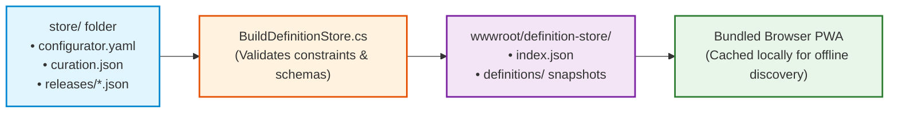

# Public Definition Store

The Definition Store is an optional, reviewed catalog of configuration definitions bundled directly into the ISLAMU Configurator web client.

It allows operators to discover and configure popular self-hosted applications with a single click, completely offline, without needing to author or download raw definition files manually.

---

## How Store Bundling Works

Definitions contributed to the repository are validated, compiled, and bundled into the static browser application at build time:



1. **Repository Sources:** Maintainers store human-readable definitions in `store/<project-slug>/`.
2. **Compilation:** The store builder validates schema adherence, checks revision immutability, and generates search manifests.
3. **PWA Bundling:** The resulting index and immutable revision snapshots are packaged into the browser's static assets.
4. **Offline Browsing:** The browser client caches the catalog, allowing full search and configuration even when disconnected from the internet.

---

## Discovering Definitions in the Browser Client

When you open the Configurator WebAssembly application:

1. **Access the Store Tab:** Click **Store** in the main navigation bar.
2. **Search and Filter:** Search applications by name, keywords, or curated category tags (e.g. `monitoring`, `database`, `proxy`).
3. **Inspect Application Details:** Review the project's publisher, source repository, supported application versions, and generated configuration files (`.env`, JSON, YAML).
4. **Choose a Revision:** Select the exact definition revision that matches your target deployment version.
5. **Start Configuration:** Click **Configure** to open an interactive workspace pinned to that canonical definition.

> [!NOTE]
> The store is entirely optional. If you run a custom or private Configurator build without a bundled store, the **Open** tab remains fully operational for loading local files or deep-link URLs.

The current store generation uses definition v2. Its two checked examples have
fresh families at revision 1; pre-release v1 definitions remain historical Git
evidence rather than selectable current revisions. Existing v1 family/revision
identities were not repinned, and the browser does not migrate private answers.
Within a v2 family, historical revisions remain immutable. Local compilation or
catalog inclusion does not authenticate a publisher or prove target acceptance.

---

## Proposing a Project to the Store

Anyone may submit a pull request to add an open-source application to the official store catalog under [`store/`](../../store/README.md).

### 1. Directory Structure

Each application lives in a dedicated subdirectory named after the project slug:

```text
store/example-service/
├── configurator.yaml      # Maintainer authoring source
├── curation.json          # Optional: tags and search metadata
└── releases/
    └── 1.json             # Generated canonical runtime definition
```

### 2. Curation Metadata (`curation.json`)

To add search tags or specify a custom slug, include an optional `curation.json` adhering to the [curation schema](../../schemas/definition-store-curation-v1.schema.json):

```json
{
  "schemaVersion": 1,
  "tags": [
    "monitoring",
    "metrics",
    "dashboard"
  ],
  "slug": "example-service",
  "slugReason": "Matches standard upstream container image name"
}
```

- **`schemaVersion`**: Must be `1`.
- **`tags`**: Up to 16 unique lowercase alphanumeric tags (max 32 characters each).
- **`slug` & `slugReason`**: If the directory name differs from the project ID in `configurator.yaml`, explain the reason in `slugReason` (16–512 characters).

---

## Contributor Step-by-Step Workflow

Follow these steps to contribute a new definition:

### Step 1: Author Your Source

Create your `store/<project-slug>/configurator.yaml` following the authoring standards in [Integrate Your Tool](integrate-your-tool.md).

> [!IMPORTANT]
> Definitions must describe only public, non-sensitive configuration templates. Never commit real passwords, private API keys, or proprietary internal hostnames.

### Step 2: Validate and Compile the Store

Run the definition store builder tool from the repository root:

```bash
# Verify internal builder rules
dotnet run eng/configurator/BuildDefinitionStore.cs -- --self-test

# Compile missing releases and write catalog snapshots
dotnet run eng/configurator/BuildDefinitionStore.cs -- \
  --source store \
  --output .tmp/definition-store \
  --write

# Verify that all releases are valid and committed
dotnet run eng/configurator/BuildDefinitionStore.cs -- \
  --source store \
  --output .tmp/definition-store \
  --check
```

The `--write` command generates `store/<project-slug>/releases/1.json`. This compiled file must be committed along with your source YAML.

### Step 3: Run Pull Request Validation

Push your changes to a branch and open a pull request on GitHub. CI automatically validates your PR against the baseline commit:
- Verifies that all YAML and JSON files conform to their respective schemas.
- Ensures existing historical releases have not been modified or deleted.
- Verifies that new revisions correctly increment the revision integer.

---

## Store Contribution Checklist

Before opening your pull request, verify that:

- [ ] The directory name in `store/<slug>` contains only lowercase letters, numbers, and hyphens.
- [ ] `configurator.yaml` specifies an open-source `project.definitionLicense` (e.g. `MIT`, `Apache-2.0`).
- [ ] `project.repository` is an absolute HTTPS URL to the public upstream repository.
- [ ] Every secret field is classified as `sensitivity: secret` and has no default value.
- [ ] Generated `releases/<revision>.json` was created using `BuildDefinitionStore.cs --write` and is included in the git commit.
- [ ] `BuildDefinitionStore.cs --check` succeeds locally with zero errors.

---

## Where to Go Next

- **Authoring details?** Read the comprehensive [Definitions Reference](definitions.md).
- **Maintainer lifecycle?** See [Integrate Your Tool](integrate-your-tool.md).
- **Packaging the store?** Learn how to build store assets in [Packaging](packaging.md).
