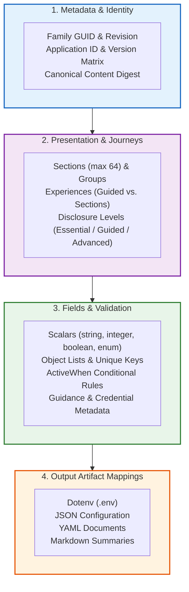
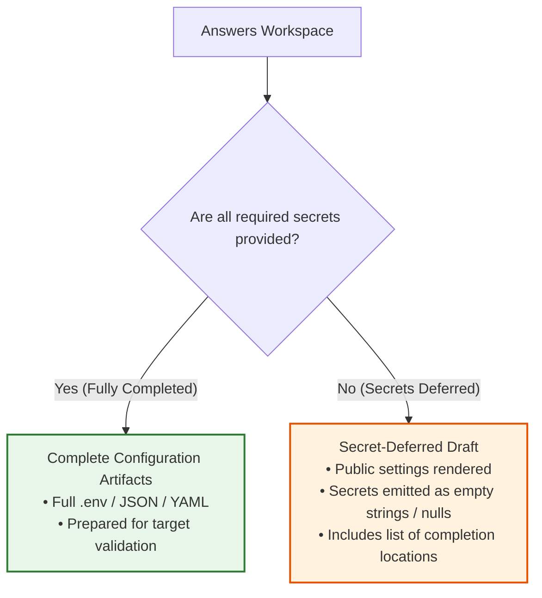

# Configuration Definitions

A configuration definition is a declarative, non-executable document that describes an application's settings, validation rules, guided journeys, and output file mappings. 

Configurator reads this data to render interactive setup interfaces across the terminal, desktop, and web, preparing configuration files offline. The target application still owns semantic acceptance and application of those files.

The [current contract reference](definition-reference.md) describes implemented
authoring/runtime v2, presence/default rules, import limits and client capabilities.
The output section below uses v2. Earlier field-oriented examples in this guide
are migration material, not accepted v2 sources; v1 definitions have no fallback.
Use the checked v2 examples and current reference while the longer guide is migrated.

---

## Anatomy of a Definition

Every definition is organized into four distinct structural layers, ensuring a clean separation between identity, user experience, data validation, and file generation:



---

## Authoring Source vs. Runtime Definition

Configurator distinguishes between human-authored sources and machine-distributed canonical definitions:

| File Type | Format | Typical Location | Purpose |
|---|---|---|---|
| **Maintainer Source** | YAML / JSON | `configurator.yaml` | The compact, commentable source file maintained alongside your application code. |
| **Runtime Definition** | Canonical JSON | `dist/configurator/revisions/1.json` | The compiled, admitted document distributed to clients, pinned by SHA-256 digest. |
| **Answer Workspace** | JSON | Local transient memory | Local user inputs keyed by field ID. Answers are never stored inside definitions. |

> [!NOTE]
> Start with the [minimal self-hosted source](../../examples/minimal-self-hosted/configurator.yaml) and its [compiled definition](../../examples/minimal-self-hosted/setup-definition.json). The [Grafana example](../../examples/grafana-13.2.2/README.md) demonstrates checked format projections, not execution or acceptance by a Grafana target.

---

## Identity & Integrity Pinning

Each definition declares an immutable family identity and semantic revision:

```yaml
identity:
  familyId: 69cdb122-41d2-4fab-9b82-7929a889c726
  revision: 1
project:
  id: example.service
  name: Example Service
applicationVersions: ["1.0.0", "1.1.0"]
```

When a client loads a runtime definition, Configurator computes a canonical SHA-256 digest over its admitted content. Sessions pin this exact revision and digest:
- **No Silent Upgrades:** A catalog or web update will never alter an active configuration session.
- **Canonical Content Pinning:** Comparing against an independently selected expected digest detects different admitted canonical content. Formatting changes that canonicalize identically need not change the digest.
- **Identity Is Not Authentication:** Family IDs and publisher labels do not authenticate an author or establish curation. Target applications still validate all generated files.

---

## Declaring Fields & Validation

Fields represent the individual configuration values required by the application. Field IDs are internal keys and remain decoupled from output variable names.

### Basic Scalar Types

Configurator supports `string`, `boolean`, `integer`, `number`, and `enum` types:

```yaml
fields:
  service.host:
    type: string
    title: Service Hostname
    help: Fully qualified domain name where this instance is reachable.
    sensitivity: public
    disclosure: essential
    required: true
    default: "localhost"
    minLength: 1
    maxLength: 255

  service.port:
    type: integer
    title: Listening Port
    sensitivity: public
    disclosure: guided
    default: 8080
    minimum: 1
    maximum: 65535

  service.tls:
    type: boolean
    title: Enable TLS
    sensitivity: public
    disclosure: essential
    default: true

  service.log_level:
    type: enum
    title: Log Verbosity
    sensitivity: public
    disclosure: advanced
    choices: [debug, info, warn, error]
    default: info
```

In compiled JSON format, the same fields appear with explicit types and constraints:

```json
{
  "id": "service.port",
  "type": "integer",
  "title": "Listening Port",
  "sensitivity": "public",
  "disclosure": "guided",
  "default": 8080,
  "minimum": 1,
  "maximum": 65535
}
```

### Sensitivity Classifications

Every compiled field has a data sensitivity level. In compact source, omission defaults to `sensitive`:
- **`public`**: Non-sensitive settings (hostnames, ports, flags, log levels). Safe for defaults and pre-population.
- **`sensitive`**: Internal operational details (internal endpoints, usernames). Defaults and recommendations are rejected in sensitive contexts, not silently withheld.
- **`secret`**: Passwords, API tokens, encryption keys, and private keys. Controls mask values; browser entry requires per-workspace consent. Deliberate output export transfers custody to the operator.

> [!IMPORTANT]
> Defaults and recommendations require a wholly public applicable context. A public child cannot lower a private ancestor's classification, and a public container cannot conceal protected descendants. All answer-derived artifacts remain restricted; browser exports do not establish native file protection.

---

## Nested Objects & Object Lists

For repeating records (such as tenants, upstream proxies, or route tables), declare an object list with `itemType: object`:

```yaml
fields:
  proxy.upstreams:
    type: list
    itemType: object
    title: Upstream Backend Servers
    sensitivity: public
    minItems: 1
    maxItems: 16
    uniqueBy: [name]
    properties:
      name:
        type: string
        title: Server Identifier
        required: true
        minLength: 1
        maxLength: 64
      endpoint:
        type: string
        title: Target URL
        required: true
        minLength: 8
        maxLength: 255
      weight:
        type: integer
        title: Traffic Weight
        sensitivity: public
        default: 100
        minimum: 1
        maximum: 1000
```

- **`properties`**: Defines the child fields evaluated for each item in the list.
- **`uniqueBy`**: Enforces ordinal uniqueness across list rows for the specified property keys.
- **Budget Limits**: Object lists enforce Configurator's safe resource limits (up to 4,096 items). Duplicate values trigger validation rejections without echoing sensitive data.

---

## Conditional Activation (`activeWhen`)

Fields can dynamically activate or deactivate based on answers given to other fields:

```yaml
fields:
  auth.provider:
    type: enum
    title: Authentication Provider
    sensitivity: public
    choices: [local, oidc, ldap]
    default: local

  auth.oidc_issuer:
    type: string
    title: OIDC Issuer URL
    required: true
    activeWhen:
      op: equals
      field: auth.provider
      value: oidc

  auth.ldap_host:
    type: string
    title: LDAP Directory Server
    required: true
    activeWhen:
      op: equals
      field: auth.provider
      value: ldap
```

Supported condition operators include:
- `equals` and `notEquals`: Match exact scalar values.
- `present`: Check whether an active effective value exists and is non-null. Defaults and empty strings count as present; this is not a test of deliberate user entry.
- `in`: Match against a set of permitted choices.
- `all`, `any`, and `not`: Compose complex Boolean expressions using nested `operands`.

> [!TIP]
> Inactive fields are excluded from required validation checks and omitted from compiled output projections.

Conditions currently reference root fields only; nested `activeWhen` and `requiredWhen` reject. Both conditional requirement and activation references participate in cycle rejection. See [presence and defaults](definition-reference.md#presence-defaults-and-requiredness) before combining conditions with defaults.

---

## Credential Classification

When declaring sensitive or secret fields, you can supply optional `credential` metadata to guide password managers and security tooling:

```yaml
fields:
  database.password:
    type: string
    title: Database Password
    sensitivity: secret
    required: true
    credential:
      kind: password
      acquisition: create

  api.external_token:
    type: string
    title: External API Token
    sensitivity: secret
    required: true
    credential:
      kind: opaque-token
      acquisition: issuer
```

The combination of `kind` and `acquisition` follows a strict classification contract:

| `kind` | Allowed `acquisition` Values | Description |
|---|---|---|
| `password` | `existing`, `create`, `issuer` | Traditional user/service passwords. |
| `opaque-token` | `existing`, `issuer` | API tokens, bearer keys, personal access tokens. |
| `symmetric-key` | `existing`, `create` | AES/HMAC encryption keys, shared web secrets. |
| `private-key` | `existing`, `issuer` | RSA/ECDSA/Ed25519 private keys. |
| `connection-string` | `existing`, `issuer` | Composite database URIs with embedded credentials. |

> [!CAUTION]
> The `create` acquisition indicates a task for the operator to generate or enter a new credential. Configurator never automatically runs background key generators or scripts.

---

## Presentation & Guided Journeys

Definitions can organize fields into structured user journeys without affecting underlying validation logic:

```yaml
presentation:
  defaultExperience: guided-setup
  sections:
    - id: network
      title: Network & Connectivity
      description: Basic ports and listening endpoints.
      fields: [service.host, service.port]
      disclosure: essential

    - id: security
      title: Authentication & Secrets
      description: Access tokens and administrative passwords.
      fields: [database.password, api.external_token]
      disclosure: essential

  experiences:
    - id: guided-setup
      title: Guided Onboarding
      initialDisclosure: essential
      navigation: guided
      sections: [network, security]

    - id: advanced-tuning
      title: Full System Inspection
      initialDisclosure: advanced
      navigation: sections
      sections: [security, network]
```

- **Sections (max 64)**: Group related root fields. Each root field must belong to exactly one section.
- **Experiences (max 16)**: Order and present sections for specific user personas.
- **Disclosure Levels**:
  - `essential`: Settings kept prominent in progressive disclosure; this does not make them required.
  - `guided`: Common operational settings.
  - `advanced`: Fine-grained tuning parameters.

---

## Field Guidance Metadata

Attach inline help, documentation links, and search keywords to assist operators during interactive configuration:

```yaml
fields:
  database.url:
    type: string
    title: Database Endpoint
    help: Postgres connection string including pool configuration.
    guidance:
      instructions: "Ensure the postgresql server is running and the user has CREATEDB privileges."
      links:
        - title: "Official Postgres Setup Documentation"
          url: "https://docs.example.org/database-setup"
      searchTerms: [postgres, psql, database, dsn]
```

- **`instructions`**: Plain text instructions up to 4,096 characters. Controls, HTML tags, and Markdown executable formatting are rejected.
- **`links`**: Up to 4 external links. Must be absolute HTTPS URLs without query strings or fragments.
- **`searchTerms`**: Up to 16 public metadata keywords. Rendering and search support vary by client; see the [capability table](definition-reference.md#client-capabilities).

---

## Output Artifact Mappings

Definitions prepare restricted local configuration candidates. The target still
owns acceptance and application.

### 1. Simple Output Bindings

For flat key-value outputs, use `bindings`:

```yaml
outputs:
  .env:
    format: dotenv
    targetUpdateMode: create
    restartRequirement: process
    bindings:
      HOST: {scope: root, path: /service.host}
      PORT: {scope: root, path: /service.port}
      DB_PASSWORD: {scope: root, path: /database.password}

  config.json:
    format: json
    targetUpdateMode: create
    restartRequirement: process
    bindings:
      /server/host: {scope: root, path: /service.host}
      /server/port: {scope: root, path: /service.port}
```

### 2. Structured Projections

For nested documents or YAML trees, use explicit projection operators (`object`, `list`, `copy`, `literal`):

```yaml
outputs:
  config.yaml:
    format: yaml
    targetUpdateMode: create
    restartRequirement: deployment
    projection:
      op: object
      members:
        version:
          op: literal
          value: "2.0"
        server:
          op: object
          members:
            listen:
              op: copy
              reference: {scope: root, path: /service.host}
            port:
              op: copy
              reference: {scope: root, path: /service.port}
        security:
          op: object
          members:
            credentials:
              op: list
              items:
                - op: object
                  members:
                    secret:
                      op: copy
                      reference: {scope: root, path: /database.password}
```

| Format | Typical Extensions | Best Used For |
|---|---|---|
| `dotenv` | `.env` | Docker Compose, systemd EnvironmentFile, container runtimes |
| `json` | `.json` | Node.js, Go services, modern microservice daemons |
| `yaml` | `.yaml`, `.yml` | Kubernetes ConfigMaps, Prometheus, Grafana, Home Assistant |
| `markdown` | `.md` | Operator setup summaries and printable deployment receipts |

Binding targets are concrete JSON pointers for JSON/YAML, but literal environment
keys for dotenv. Source pointers preserve exact names: `/service.host` selects
one dotted property, not a nested object. Escape literal slashes and tildes as
`~1` and `~0`. Omitted JSON/YAML mappings copy the effective root; dotenv and
Markdown require explicit mappings.

Admission rejects nullable/container dotenv members, non-string Markdown list
results and nullable repeat sources before answers are collected. A `when`
inside a repeat may use the current `item`; it does not search other rows.
Missing secret controllers remain unknown and withhold their dependent artifact,
while independent projections remain available.

Existing-file import supports unconditional one-to-one root/nested copies.
Nested JSON/YAML target objects reconstruct the declared source object paths;
scalar dotenv values recover declared types. Whole typed-map copies retain
declared dynamic entries. Transforms, conditional projections, repeated/index
ambiguity, overlapping source mappings and unknown imported members reject
atomically. Existing values need provenance-owned replacement permission;
explicit omissions require a deliberate reset before import. A prefill is not
complete readiness or target acceptance.

---

## Complete Configurations vs. Secret-Deferred Drafts

Configurator offers two distinct export modes depending on whether secrets have been entered:



- **Complete Configuration:** All required active fields and credentials are provided. Produces final configuration files ready for deployment.
- **Secret-Deferred Draft:** Allows operators to prepare non-sensitive configurations in untrusted environments (e.g. CI, staging previews) while deferring credential entry until files are moved to protected production servers.

---

## Where to Go Next

- **Ready to author a definition?** Follow the step-by-step [Integrate Your Tool](integrate-your-tool.md) guide.
- **Testing and building?** Learn how the [CLI](cli.md) checks, builds, and revises definitions.
- **Distributing publicly?** Read about publishing in the [Definition Store](definition-store.md).
