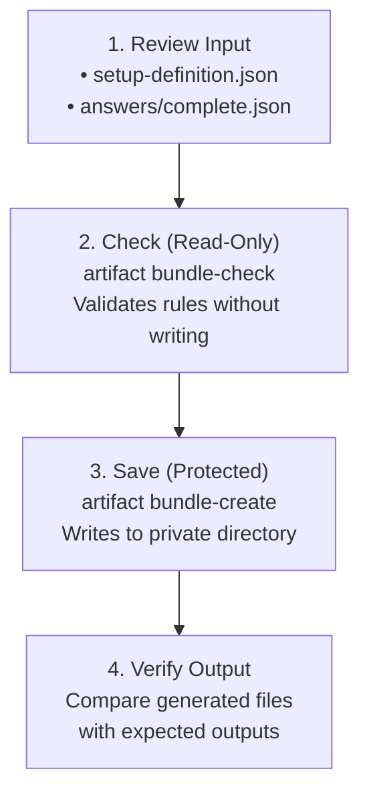

# Quickstart: Prepare a Configuration Offline

In this tutorial, you will use Configurator to prepare three configuration files (`.env`, `service.json`, and `service.yaml`) for a neutral example service using verified sample answers.

Definition evaluation and file preparation run offline on your machine. Obtain
the checkout, SDK, dependencies and any required workloads first; `dotnet run`
may restore/build before running the CLI. No target service, account or external
catalogue is needed for this example.

---

## The Workflow at a Glance



---

## Prerequisites

- **Environment:** Linux (x64 recommended) with [.NET SDK 10.0.302](https://dotnet.microsoft.com/) installed.
- **Working Directory:** Open a terminal in the root of your local `Configurator` checkout.
- **Shell:** Bash on Linux; the backslash continuations below are Bash syntax.
  Complete the source-build prerequisites in [PROJECTS.md](../../PROJECTS.md)
  before disconnecting. Use a fresh `prepared` destination for the write step.
- **Standalone Package Alternative:** If you have a current standalone package
  (`islamu-configurator`), substitute its executable path for
  `dotnet run --project src/Configurator.Cli/Configurator.Cli.csproj --configuration Release --`
  in all commands below. No SDK is needed for that executable.

For source invocation, establish the repository temporary directory in Bash
(this creates it if absent and affects this shell's later commands):

```bash
export TMPDIR="$HOME/.cache/agent-tmp"
mkdir -p "$TMPDIR"
```

> [!NOTE]
> **Windows and macOS Users:** The native writer implements create-only,
> owner-only (`0600`) publication on supported Linux hosts. macOS and Windows
> protected writes fail closed. You can still perform the read-only check or use
> the [Browser client](browser.md), whose downloads do not provide native save
> protection. Adapt shell syntax for your environment.

---

## Step 1: Review the Definition and Sample Answers

Before generating configuration files, take a quick look at the inputs:

- **Definition:** [`examples/minimal-self-hosted/setup-definition.json`](../../examples/minimal-self-hosted/setup-definition.json) describes the service's settings, validation constraints, and file mappings.
- **Answers:** [`examples/minimal-self-hosted/answers/complete.json`](../../examples/minimal-self-hosted/answers/complete.json)
  is a complete synthetic private-answer v1 fixture (shown in formatted form):

```json
{
  "answerContractVersion": 1,
  "values": {
    "metrics.enabled": true,
    "service.credential": "synthetic-placeholder",
    "service.mode": "extended",
    "service.name": "sample"
  },
  "omitted": []
}
```

> [!TIP]
> The sample answers provide synthetic placeholder credentials suitable for testing. When configuring a real service, supply your own values in a private local answers file.

Names are exact: `service.name` is one property, not a nested `service` object.
The definition's standard `default` would be descriptive only. Its admitted
`initialValue` values apply to eligible absent settings, while explicit omission
suppresses them and reset makes them eligible again. Supplied null needs a
nullable schema; the sample fields are not nullable. See the
[glossary](glossary.md#presence-omission--null) for empty-value distinctions.

---

## Step 2: Validate Outputs Without Writing (Read-Only Check)

Run `artifact bundle-check` to validate and compose all selected artifacts
without publishing configuration files. Source invocation can still create
restore/build outputs:

```bash
dotnet run --project src/Configurator.Cli/Configurator.Cli.csproj --configuration Release -- \
  artifact bundle-check \
  --definition examples/minimal-self-hosted/setup-definition.json \
  --artifact environment --artifact configuration --artifact configuration-yaml \
  --input examples/minimal-self-hosted/answers/complete.json --machine
```

### What to Look For:
The v4 receipt reports local preparation, separately from host acceptance.
This is an **illustrative receipt excerpt**, not a complete captured envelope;
digests and other mandatory fields are omitted:

```json
{
  "schemaVersion": "islamu-configurator-command/v4",
  "status": "success",
  "exitCode": 0,
  "preparation": "ready",
  "targetAcceptance": "unassessed",
  "readiness": { "state": "incomplete", "missingCount": 1, "blockedCount": 0 },
  "artifacts": [
    { "id": "environment", "writeStatus": "none" },
    { "id": "configuration", "writeStatus": "none" },
    { "id": "configuration-yaml", "writeStatus": "none" }
  ]
}
```

- **Exit code `0`, `preparation: "ready"`**: Local composition passed.
- **`writeStatus: "none"`**: No artifact was published.
- **Incomplete readiness**: Host validation is still required; this is not a
  missing sample answer or permission to apply the configuration.

---

## Step 3: Save to a Protected Private Directory

Now create a private, owner-only directory (`0700`) and publish all three files:

```bash
mkdir -m 700 prepared

dotnet run --project src/Configurator.Cli/Configurator.Cli.csproj --configuration Release -- \
  artifact bundle-create \
  --definition examples/minimal-self-hosted/setup-definition.json \
  --artifact environment --artifact configuration --artifact configuration-yaml \
  --input examples/minimal-self-hosted/answers/complete.json \
  --output ./prepared --machine
```

### Verify Created Files
On successful publication, each artifact reports `writeStatus: "written"`,
`installation: "established"` and `verification: "succeeded"`. Inspect the
operation's cleanup and exit as well. A written file with failed verification
is not a successful save. Files use owner-only (`0600`) permissions.

Compare the generated files against the checked-in expected outputs:

```bash
cmp prepared/.env examples/minimal-self-hosted/expected/environment.env
cmp prepared/service.json examples/minimal-self-hosted/expected/service.json
cmp prepared/service.yaml examples/minimal-self-hosted/expected/service.yaml
```

If the files match, `cmp` prints nothing and exits with `0`. Congratulations—you have successfully prepared a multi-format configuration bundle offline!

---

## Generated File Contents

The following are **expected output fixture contents**, not output captured
during this documentation correction. They are maintained under
`examples/minimal-self-hosted/expected/` and are what the comparison checks above
use:

### 1. `.env` (Dotenv Format)
```ini
METRICS_ENABLED=true
SERVICE_CREDENTIAL=synthetic-placeholder
SERVICE_MODE=extended
SERVICE_NAME=sample
```

### 2. `service.json` (JSON Document)
```json
{"credential":"synthetic-placeholder","metrics":true,"mode":"extended","name":"sample"}
```

### 3. `service.yaml` (YAML Document)
```yaml
"credential": "synthetic-placeholder"
"metrics": true
"mode": "extended"
"name": "sample"
```

> [!IMPORTANT]
> **Create-Only Protection:** Existing selected destination filenames block the
> save; unrelated files alone do not make a directory invalid. Choose a fresh
> private directory when rerunning. Bundle preflight precedes every commit, but
> a later race or I/O failure can leave a written prefix: the bundle is not one
> transaction. Inspect the receipt and directory before retrying.

---

## Step 4: Next Steps & Alternative Interfaces

Now that you've seen the core pipeline in action, explore the rest of Configurator:

- **Prefer an Interactive Terminal?** Run the same definition interactively using our [Terminal TUI guide](terminal.md).
- **Prefer a Graphical App?** Try the Avalonia desktop application with the [Desktop guide](desktop.md).
- **Want to run in your Browser?** Load the definition without installing any software using the [Browser guide](browser.md).
- **Authoring Your Own Definition?** Learn how to define questions, conditions, and artifact mappings with [Integrate Your Tool](integrate-your-tool.md).
- **Automating in CI/CD?** Dive into full command syntax and JSON envelopes in the [CLI Reference](cli.md).

---

## Troubleshooting Common Errors

| Symptom / Exit Code | Cause | Resolution |
|---|---|---|
| `mkdir: cannot create directory 'prepared': File exists` | Destination already exists | Choose a new empty directory (e.g., `mkdir -m 700 prepared-2`). Configurator refuses to overwrite existing files. |
| Exit `2` or `3` | Answer validation failure | Check diagnostic errors in the JSON result; ensure required answers are present and meet type bounds. |
| Exit `4` | Bundle publication boundary refusal, including existing selected files or unsupported host | Inspect per-artifact facts; use a fresh trusted Linux destination. Read-only `bundle-check` and deliberate [Browser export](browser.md) have different custody boundaries. |
| Exit `64` | Invalid command arguments | Check flag names; run command-specific `--help`. |
| Exit `65` | Input syntax or definition admission failure | Check the v2 definition and private v1 answer envelope. |
| Exit `70` or `74` | Partial save interrupted or I/O failure | Some files may have already been written. Inspect `./prepared/` and follow [save recovery](native-output.md#recover-before-retrying). |
