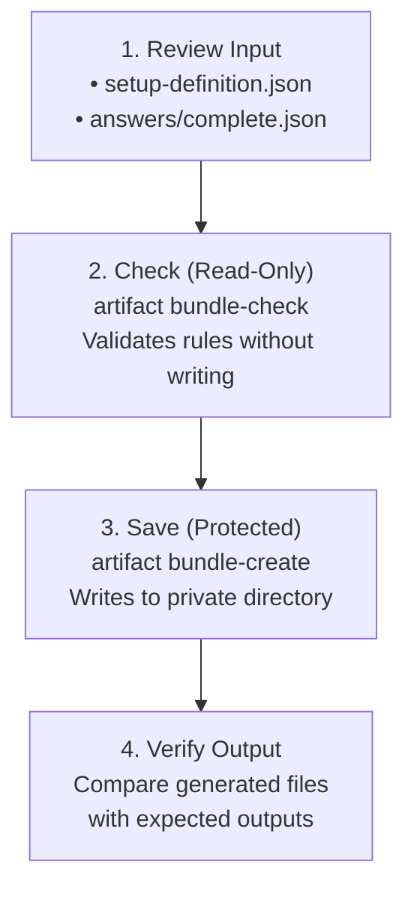

# Quickstart: Prepare a Configuration Offline

In this tutorial, you will use Configurator to prepare three configuration files (`.env`, `service.json`, and `service.yaml`) for a neutral example service using verified sample answers.

The entire process runs **100% offline** on your machine. No account, network connection, external catalogue, or running container is required.

---

## The Workflow at a Glance



---

## Prerequisites

- **Environment:** Linux (x64 recommended) with [.NET SDK 10.0.302](https://dotnet.microsoft.com/) installed.
- **Working Directory:** Open a terminal in the root of your local `Configurator` checkout.
- **Standalone Package Alternative:** If you already downloaded a standalone package (`islamu-configurator`), you can substitute `path/to/islamu-configurator` for `dotnet run --project src/Configurator.Cli/Configurator.Cli.csproj --` in all commands below.

> [!NOTE]
> **Windows and macOS Users:** Linux provides native create-only, owner-only (`0600`) filesystem security via kernel namespaces. On Windows and macOS, the CLI's native write command fails closed for safety. If you are on Windows or macOS, you can still run Step 2 (the read-only check) or use the [Browser WebAssembly Client](browser.md) to export files locally.

---

## Step 1: Review the Definition and Sample Answers

Before generating configuration files, take a quick look at the inputs:

- **Definition:** [`examples/minimal-self-hosted/setup-definition.json`](../../examples/minimal-self-hosted/setup-definition.json) describes the service's settings, validation constraints, and file mappings.
- **Answers:** [`examples/minimal-self-hosted/answers/complete.json`](../../examples/minimal-self-hosted/answers/complete.json) contains sample values for the service:

```json
{
  "service.name": "sample",
  "service.mode": "extended",
  "metrics.enabled": true,
  "service.credential": "synthetic-placeholder"
}
```

> [!TIP]
> The sample answers provide synthetic placeholder credentials suitable for testing. When configuring a real service, supply your own values in a private local answers file.

---

## Step 2: Validate Outputs Without Writing (Read-Only Check)

Run `artifact bundle-check` to validate your answers against the definition without writing any files to disk:

```bash
dotnet run --project src/Configurator.Cli/Configurator.Cli.csproj -- \
  artifact bundle-check \
  --definition examples/minimal-self-hosted/setup-definition.json \
  --artifact environment --artifact configuration --artifact configuration-yaml \
  --input examples/minimal-self-hosted/answers/complete.json --machine
```

### What to Look For:
The CLI returns a JSON envelope confirming that all three artifacts passed validation:

```json
{
  "outcome": "success",
  "exitCode": 0,
  "readiness": "ready",
  "artifacts": [
    { "id": "environment", "writeStatus": "none", "digest": "sha256:..." },
    { "id": "configuration", "writeStatus": "none", "digest": "sha256:..." },
    { "id": "configuration-yaml", "writeStatus": "none", "digest": "sha256:..." }
  ]
}
```

- **Exit code `0`**: All constraints and validation rules passed.
- **`writeStatus: "none"`**: Confirms zero files were created or modified during the check.

---

## Step 3: Save to a Protected Private Directory

Now create a private, owner-only directory (`0700`) and publish all three files:

```bash
mkdir -m 700 prepared

dotnet run --project src/Configurator.Cli/Configurator.Cli.csproj -- \
  artifact bundle-create \
  --definition examples/minimal-self-hosted/setup-definition.json \
  --artifact environment --artifact configuration --artifact configuration-yaml \
  --input examples/minimal-self-hosted/answers/complete.json \
  --output ./prepared --machine
```

### Verify Created Files
Each artifact now reports `writeStatus: "written"` with owner-only (`0600`) file permissions.

Compare the generated files against the checked-in expected outputs:

```bash
cmp prepared/.env examples/minimal-self-hosted/expected/environment.env
cmp prepared/service.json examples/minimal-self-hosted/expected/service.json
cmp prepared/service.yaml examples/minimal-self-hosted/expected/service.yaml
```

If the files match, `cmp` prints nothing and exits with `0`. Congratulations—you have successfully prepared a multi-format configuration bundle offline!

---

## Generated File Contents

Here is what Configurator created in `./prepared/`:

### 1. `.env` (Dotenv Format)
```ini
METRICS_ENABLED=true
SERVICE_CREDENTIAL=synthetic-placeholder
SERVICE_MODE=extended
SERVICE_NAME=sample
```

### 2. `service.json` (JSON Document)
```json
{"credential":"synthetic-placeholder","metrics":true,"mode":"extended","name":"sample"}
```

### 3. `service.yaml` (YAML Document)
```yaml
credential: synthetic-placeholder
metrics: true
mode: extended
name: sample
```

> [!IMPORTANT]
> **Create-Only Protection:** On Linux, Configurator writes files with create-only semantics. If you re-run `bundle-create` pointing to an existing file or non-empty directory, the operation refuses to overwrite existing files to protect you from data loss. To prepare a new configuration, specify a new destination directory.

---

## Step 4: Next Steps & Alternative Interfaces

Now that you've seen the core pipeline in action, explore the rest of Configurator:

- **Prefer an Interactive Terminal?** Run the same definition interactively using our [Terminal TUI guide](terminal.md).
- **Prefer a Graphical App?** Try the Avalonia desktop application with the [Desktop guide](desktop.md).
- **Want to run in your Browser?** Load the definition without installing any software using the [Browser guide](browser.md).
- **Authoring Your Own Definition?** Learn how to define questions, conditions, and artifact mappings with [Integrate Your Tool](integrate-your-tool.md).
- **Automating in CI/CD?** Dive into full command syntax and JSON envelopes in the [CLI Reference](cli.md).

---

## Troubleshooting Common Errors

| Symptom / Exit Code | Cause | Resolution |
|---|---|---|
| `mkdir: cannot create directory 'prepared': File exists` | Destination already exists | Choose a new empty directory (e.g., `mkdir -m 700 prepared-2`). Configurator refuses to overwrite existing files. |
| Exit `2` or `3` | Answer validation failure | Check diagnostic errors in the JSON result; ensure required answers are present and meet type bounds. |
| Exit `4` | Unsupported platform for protected save | Native protected writes require Linux. For macOS/Windows, use `bundle-check` or use the [Browser interface](browser.md). |
| Exit `64` or `65` | Invalid command arguments or syntax | Check flag names and file paths. Run `islamu-configurator --help` for options. |
| Exit `70` or `74` | Partial save interrupted or I/O failure | Some files may have already been written. Inspect `./prepared/` and follow [save recovery](native-output.md#recover-before-retrying). |
