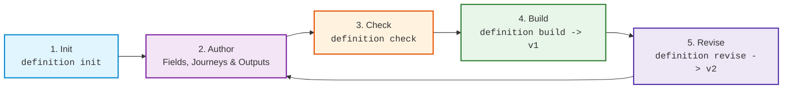

# Integrate Your Tool

Integrating your application with ISLAMU Configurator gives your users a guided, visual configuration experience across the terminal, desktop, and web—without writing custom wizard UIs or exposing secrets over the web.

You maintain a single public source file (`configurator.yaml`) in your repository. Configurator compiles that declaration into an immutable, canonical JSON definition that can be distributed independently or via the public [Definition Store](definition-store.md).

---

## The Maintainer Lifecycle

Authoring and maintaining a definition follows a predictable 5-step lifecycle:



1. **Initialize (`definition init`):** Scaffold a fresh `configurator.yaml` with a unique family GUID and revision 1.
2. **Author:** Add fields, validation bounds, guidance metadata, and output artifact bindings.
3. **Check (`definition check`):** Validate definition integrity and constraints locally without side effects.
4. **Build (`definition build`):** Compile the source YAML into canonical, pinned runtime JSON (`dist/revisions/1.json`).
5. **Revise (`definition revise`):** Safely advance the revision number when your configuration requirements evolve.

---

## Complete Minimal `configurator.yaml` Example

Here is a complete, production-ready `configurator.yaml` illustrating field types, sensitivity rules, journeys, and multiple output bindings:

```yaml
$schema: urn:islamu:configurator:authoring:v1
identity:
  familyId: 69cdb122-41d2-4fab-9b82-7929a889c726
  revision: 1
project:
  id: example.service
  name: Example Service
  description: A production service configuration template.
  repository: https://github.com/example/service
  definitionLicense: MIT
applicationVersions: ["1.0.0", "1.1.0"]

presentation:
  defaultExperience: guided-setup
  sections:
    - id: network
      title: Network Settings
      description: Ports and hostnames.
      fields: [service.host, service.port]
      disclosure: essential
    - id: security
      title: Credentials
      description: API tokens and database keys.
      fields: [service.token]
      disclosure: essential
  experiences:
    - id: guided-setup
      title: Standard Onboarding
      initialDisclosure: essential
      navigation: guided
      sections: [network, security]

fields:
  service.host:
    type: string
    title: Service Hostname
    help: Hostname or IP where the service listens.
    sensitivity: public
    disclosure: essential
    default: "localhost"
    minLength: 1
    maxLength: 255

  service.port:
    type: integer
    title: Service Port
    help: Port number for incoming traffic.
    sensitivity: public
    disclosure: guided
    default: 8080
    minimum: 1
    maximum: 65535

  service.token:
    type: string
    title: API Token
    help: Secret token for administrative access.
    sensitivity: secret
    disclosure: essential
    required: true
    guidance:
      instructions: "Generate a secure 32-character random string or obtain one from your security team."
      links:
        - title: "API Authentication Docs"
          url: "https://example.org/docs/auth"
      searchTerms: [token, auth, api, secret]
    credential:
      kind: opaque-token
      acquisition: create

outputs:
  .env:
    id: dotenv-output
    format: dotenv
    applySemantics: create
    restart: process
    bindings:
      SERVICE_HOST: service.host
      SERVICE_PORT: service.port
      SERVICE_TOKEN: service.token

  config.json:
    id: json-output
    format: json
    applySemantics: create
    restart: process
    projection:
      op: object
      members:
        server:
          op: object
          members:
            host:
              op: copy
              field: service.host
            port:
              op: copy
              field: service.port
        auth:
          op: object
          members:
            token:
              op: copy
              field: service.token
```

> [!NOTE]
> Generate your own family GUID with `definition init`. Never copy another project's `familyId` directly.

---

## Step-by-Step Maintainer Guide

### Step 1: Initialize Your Project

Generate a fresh authoring file in your repository:

```bash
islamu-configurator definition init \
  --project-id example.service \
  --name "Example Service" \
  --application-version 1.0.0 \
  --machine
```

If you already have an existing `.env.example`, you can scaffold fields automatically:

```bash
islamu-configurator definition init \
  --project-id example.service \
  --name "Example Service" \
  --application-version 1.0.0 \
  --from-env-example .env.example \
  --machine
```

> [!TIP]
> `--from-env-example` extracts variable names as string fields and discards example values. Always review each field's type, sensitivity, and required status after scaffolding.

### Step 2: Validate Your Definition

Run `definition check` to verify syntax, constraints, and relationships:

```bash
islamu-configurator definition check --machine
```

`definition check` ensures:
- All referenced fields in `outputs` and `presentation` actually exist.
- Secret fields do not declare invalid defaults or public sensitivity.
- Unique constraints on object lists are well-formed.
- The YAML syntax adheres to strict data-only rules (no tags, anchors, or merge keys).

### Step 3: Build Canonical JSON

Compile your source into the immutable runtime definition:

```bash
islamu-configurator definition build --machine
```

This generates `dist/configurator/revisions/1.json`. This compiled file is what native clients and the web client read. Its SHA-256 digest acts as its cryptographic pin.

### Step 4: Revise for Subsequent Releases

When your application adds new configuration options or changes defaults, you must create a new revision rather than modifying a published release:

```bash
islamu-configurator definition revise \
  --output candidates/configurator.next.yaml \
  --machine
```

1. Review and test the generated candidate file.
2. Replace your working `configurator.yaml` with the approved candidate.
3. Run `definition build --machine` to produce revision 2 (`dist/configurator/revisions/2.json`).

> [!IMPORTANT]
> Configurator enforces revision immutability. If you edit fields without advancing the revision number, `definition check` and `build` will reject the changes.

---

## Scaffolding from JSON Schema (`--from-schema`)

If your project already maintains a JSON Schema (Draft 2020-12) for its configuration, Configurator can automatically scaffold a `configurator.yaml`.

### Before: Input `schema.json`

```json
{
  "$schema": "https://json-schema.org/draft/2020-12/schema",
  "title": "ServiceConfig",
  "type": "object",
  "additionalProperties": false,
  "required": ["port", "apiKey"],
  "properties": {
    "host": {
      "type": "string",
      "default": "localhost",
      "description": "Listening interface hostname"
    },
    "port": {
      "type": "integer",
      "minimum": 1,
      "maximum": 65535,
      "default": 8080,
      "description": "Port to bind HTTP server"
    },
    "apiKey": {
      "type": "string",
      "writeOnly": true,
      "description": "Secret administrative API key"
    }
  }
}
```

### Command

```bash
islamu-configurator definition init \
  --project-id example.service \
  --name "Example Service" \
  --application-version 1.0.0 \
  --from-schema schema.json \
  --accept-bounded-semantics \
  --machine
```

### After: Generated `configurator.yaml`

```yaml
$schema: urn:islamu:configurator:authoring:v1
identity:
  familyId: 69cdb122-41d2-4fab-9b82-7929a889c726
  revision: 1
project:
  id: example.service
  name: Example Service
applicationVersions: ["1.0.0"]
fields:
  host:
    type: string
    title: Host
    help: Listening interface hostname
    sensitivity: public
    default: "localhost"
  port:
    type: integer
    title: Port
    help: Port to bind HTTP server
    sensitivity: public
    default: 8080
    minimum: 1
    maximum: 65535
  apiKey:
    type: string
    title: Api key
    help: Secret administrative API key
    sensitivity: secret
    required: true
```

### Why `--accept-bounded-semantics` is Required

JSON Schema and Configurator evaluate constraints with slightly different semantics:
- **Required Strings:** Configurator treats whitespace-only strings as invalid answers.
- **String Length:** Configurator measures character length in UTF-16 code units.
- **Numbers:** Configurator uses bounded 64-bit integers (`Int64`) and exact decimals.

The `--accept-bounded-semantics` flag acknowledges these specific differences. Complex features like dynamic remote `$ref` URIs, regex evaluation, and open polymorphism are strictly rejected to ensure predictable offline compilation.

---

## Integration Checklist

Before publishing your definition, verify that you have met each of the following quality criteria:

- [ ] **Stable Identity:** `familyId` was generated via `definition init` and is preserved across revisions.
- [ ] **Accurate Version Matrix:** `applicationVersions` explicitly enumerates all supported target application versions.
- [ ] **Sensitivity Review:** All password and token fields are set to `sensitivity: secret` with no default values.
- [ ] **Public Defaults Verified:** Every default value on `public` fields has been tested and verified as safe.
- [ ] **Clean Presentation:** Root fields are mapped into logical sections, and disclosure levels prioritize essential settings.
- [ ] **Help & Guidance:** Secret fields include clear plain-text instructions or documentation links explaining where to obtain the credential.
- [ ] **Target Validation:** Generated output files (`.env`, `.json`, `.yaml`) have been verified against the target application's actual startup process.
- [ ] **Automated CI Checks:** Your repository's CI pipeline runs `islamu-configurator definition check --machine` on pull requests.

---

## Distributing Your Definition

Once compiled, you can distribute your definition through any of the following channels:
1. **Directly in Your Repository:** Commit `configurator.yaml` and `dist/revisions/1.json` beside your code.
2. **Web Deep Links:** Host `1.json` on any static HTTPS origin and link users directly to the Configurator WebAssembly app (see [Launch Integration](launch-integration.md)).
3. **Public Store:** Submit a pull request to include your application in the bundled [Definition Store](definition-store.md).

For AI coding agents helping you author definitions, consult the portable [configurator-integrate skill](../../skills/configurator-integrate/SKILL.md).
