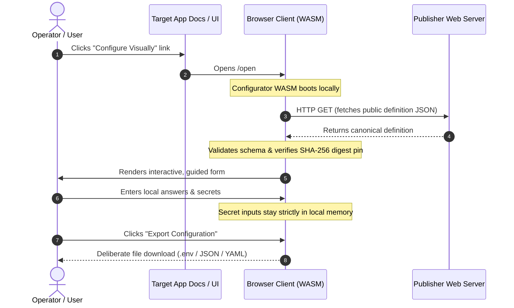

# Launch Integration & Deep Linking

Application maintainers can embed direct setup links in their documentation, READMEs, and web portals. When clicked, these deep links launch ISLAMU Configurator in the user's browser, load the application's configuration definition, and guide the user through form entry.

All evaluation happens strictly client-side via WebAssembly. Neither secrets nor configuration answers are ever sent across the network.

---

## The Launch & Configuration Flow

The deep-link journey separates definition delivery from local answer collection and file generation:



1. **Launch Request:** The user clicks a deep link from your project's website or repository.
2. **Local Boot:** Configurator's static WebAssembly client boots in the operator's browser.
3. **Definition Pinning:** Configurator fetches the public canonical definition and pins its revision and SHA-256 digest.
4. **Interactive Setup:** The operator completes questions with real-time validation and inline guidance.
5. **Deliberate Export:** The operator downloads the prepared configuration files directly to their local machine.

---

## Launch Approaches

Configurator supports two types of deep links:
1. **Publisher Source Links (`/open#src=...`):** Host your definition on your own web server or CDN.
2. **Bundled Store Links (`/launch/<family-guid>?...`):** For definitions packaged into the Configurator PWA.

---

## 1. Publisher Source Links (`/open`)

Publisher links allow any application author to host their own canonical runtime JSON without registering with a central directory.

```text
https://<configurator-origin>/open#src=https%3A%2F%2Fpublisher.example%2Fsetup-definition.json&digest=7f83b1657ff1fc53b92dc18148a1d65dfc2d4b1fa3d677284addd200126d9069&appVersion=1.0.0&entry=setup&locale=en
```

### Parameter Reference for `/open`

All parameters are specified within the **URL fragment** (`#`) using standard URL encoding:

| Parameter | Type | Maximum Length | Requirement | Description |
|---|---|---|---|---|
| `src` | URL | 2,048 chars | **Required** | The percent-encoded, absolute HTTPS URL to the public canonical JSON definition. |
| `digest` | Hex string | 64 chars | **Recommended** | The canonical SHA-256 digest. Pinning prevents unexpected upstream modifications. |
| `appVersion` | String | 64 chars | Optional | The exact application version to select from the definition's declared versions. |
| `entry` | String | 128 chars | Optional | The specific entry point identifier (defaults to first declared entry). |
| `locale` | String | 35 chars | Optional | The preferred language code (e.g. `en`, `ar`). |

> [!IMPORTANT]
> The `src` URL must point to a **compiled canonical JSON definition** (`dist/revisions/1.json`), not an authoring YAML file. YAML sources can be loaded via local file upload.

### Why Use URL Fragments (`#`) Instead of Query Parameters (`?`)?

Configurator deliberately mandates URL fragments (`#`) for `/open` parameters rather than query strings:

1. **Zero Server Logging:** Browsers never transmit URL fragments to web servers in HTTP request lines. The hosting server hosting Configurator never sees your `src` or version parameters in access logs.
2. **Referer Leak Protection:** If an operator clicks an external link from within the app, browsers strip fragments, ensuring publisher locations are never leaked in `Referer` headers.
3. **Pure Client Routing:** The WebAssembly client parses the fragment after booting, maintaining strict client-side custody.

---

## Enabling Cross-Origin Resource Sharing (CORS)

Because the user's browser fetches the definition directly from your web host, your web server must allow cross-origin GET requests.

### Nginx

```nginx
location /setup-definition.json {
    add_header Access-Control-Allow-Origin * always;
    add_header Access-Control-Allow-Methods "GET, OPTIONS" always;
    add_header Access-Control-Allow-Headers "Content-Type" always;
    default_type application/json;
}
```

### Caddy

```caddy
example.com {
    @definition path /setup-definition.json
    header @definition {
        Access-Control-Allow-Origin *
        Access-Control-Allow-Methods "GET, OPTIONS"
        Access-Control-Allow-Headers "Content-Type"
    }
}
```

### AWS S3 / CloudFront

Add this CORS configuration to your S3 bucket permissions:

```json
[
  {
    "AllowedHeaders": ["*"],
    "AllowedMethods": ["GET"],
    "AllowedOrigins": ["*"],
    "ExposeHeaders": [],
    "MaxAgeSeconds": 3600
  }
]
```

> [!TIP]
> If your definition is hosted in a private network or repository where CORS is blocked, users can always download the definition file and load it manually via the **Open Local File** dialog.

---

## 2. Bundled Definition Links (`/launch`)

For definitions packaged directly into the Configurator build (such as entries from the [Definition Store](definition-store.md)), use direct GUID links:

```text
https://<configurator-origin>/launch/69cdb122-41d2-4fab-9b82-7929a889c726?appVersion=1.0.0&entry=setup&locale=en
```

- **Path:** Must contain the canonical lowercase D-format family GUID.
- **Query Parameters:** Supports `appVersion`, `entry`, `locale`, and `digest`.
- If both `appVersion` and `digest` are omitted, the launcher selects the highest compatible registered revision.

---

## Launch Security Boundaries

To protect users against malicious redirects or network tampering, Configurator enforces strict boundary checks:

- **HTTPS Only:** Remote definitions must use HTTPS. Plain HTTP and private IP addresses (such as `127.0.0.1`, `10.0.0.0/8`, `192.168.0.0/16`, and `.local`/`.localhost` domains) are rejected.
- **Size Bounds:** Remote definitions are streamed up to a strict **4 MiB** limit. Larger payloads are immediately aborted.
- **Non-Executable Data:** Definitions are pure data. Configurator executes no JavaScript, shell commands, or dynamic templates from imported definitions.
- **Pre-Workspace Review:** The browser client presents the publisher name, repository link, and digest for review before initiating a session.

---

## Where to Go Next

- **Ready to author a definition?** Follow the [Integrate Your Tool](integrate-your-tool.md) guide.
- **Curious about browser privacy?** Read the [Browser Guide](browser.md) for details on memory handling and export.
- **Contributing to the public catalog?** Check out the [Definition Store](definition-store.md).
