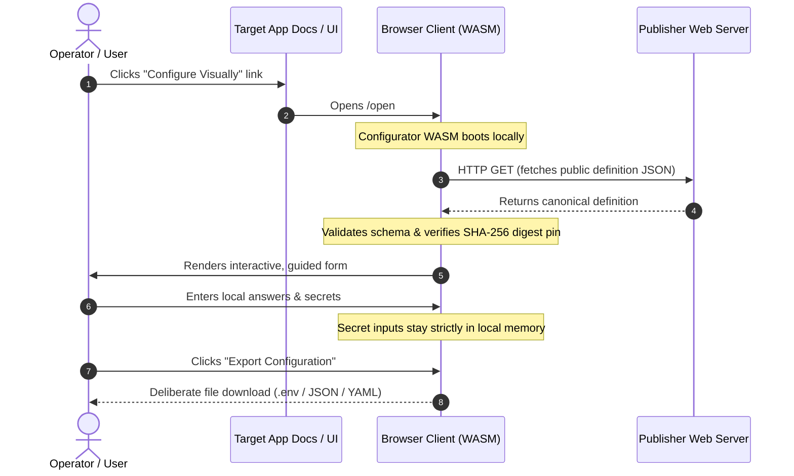

# Launch Integration & Deep Linking

Application maintainers can embed direct setup links in their documentation, READMEs, and web portals. When clicked, these deep links launch ISLAMU Configurator in the user's browser, load the application's configuration definition, and guide the user through form entry.

Definition evaluation, answer validation and preparation run client-side via
WebAssembly. App assets and public definitions can be fetched before answer
custody; answers and artifacts do not belong in links, requests or public
caches. Secret entry requires explicit consent in each new workspace.

---

## The Launch & Configuration Flow

The deep-link journey separates definition delivery from local answer collection and file generation:



1. **Launch Request:** The user clicks a deep link from your project's website or repository.
2. **Local Boot:** Configurator's static WebAssembly client boots in the operator's browser.
3. **Definition Pinning:** Configurator fetches the public canonical definition and pins its revision and SHA-256 digest.
4. **Interactive Setup:** The operator acknowledges workspace custody and
   completes questions. Secret entry starts disabled; enabling it is a separate
   per-workspace action.
5. **Deliberate Export:** The operator copies or downloads restricted output.
   Secret-deferred drafts remain incomplete and restricted. Browser exports
   cannot enforce native owner-only/create-only protection or target acceptance.

---

## Launch Approaches

Configurator supports two types of deep links:
1. **Publisher Source Links (`/open#src=...`):** Host your definition on your own web server or CDN.
2. **Bundled Store Links (`/launch/<family-guid>?...`):** For definitions packaged into the Configurator PWA.

---

## 1. Publisher Source Links (`/open`)

Publisher links allow an application author to host canonical runtime JSON
without a central directory. This **URL template** is not an official deployment
or a working publisher endpoint. Replace both origins and use the digest and
selectors from your compiled definition; the shown digest/version come from the
maintained neutral example:

```text
https://<configurator-origin>/open#src=https%3A%2F%2Fpublisher.example%2Fsetup-definition.json&digest=1c60953fc09c4160ca38357a0b30e948aa0137ee117ea0df77e974352d428fdc&appVersion=1.0&entry=setup&locale=en
```

### Parameter Reference for `/open`

All parameters are specified within the **URL fragment** (`#`) using standard URL encoding:

| Parameter | Type | Maximum Length | Requirement | Description |
|---|---|---|---|---|
| `src` | URL | 2,048 chars | **Required** | The percent-encoded, absolute HTTPS URL to the public canonical JSON definition. |
| `digest` | Hex string | 64 chars | **Recommended** | The canonical SHA-256 digest. Pinning prevents unexpected upstream modifications. |
| `appVersion` | String | 64 chars | Optional | The exact application version to select from the definition's declared versions. |
| `entry` | String | 128 chars | Optional | The specific entry point identifier (defaults to first declared entry). |
| `locale` | String | 35 chars | Optional | A declared locale; omission uses the definition's localization default. |

Names are closed, unique and case-sensitive. Selector values use admitted ASCII
letters, digits, `.`, `-` and `_`; version matching is exact, not a semantic
version range. The entire fragment is bounded to 4,096 characters. A supplied
digest is checked against canonical content, not raw downloaded whitespace.
Without a digest the admitted session still pins its computed digest, but the
link has not pinned content in advance. Neither form authenticates a publisher.

> [!IMPORTANT]
> The `src` URL must point to a **compiled canonical JSON definition** (`dist/revisions/1.json`), not an authoring YAML file. YAML sources can be loaded via local file upload.

### Why Use URL Fragments (`#`) Instead of Query Parameters (`?`)?

Configurator deliberately mandates URL fragments (`#`) for `/open` parameters rather than query strings:

1. **Request-Line Separation:** Fragments are not sent in the Configurator
   page's HTTP request line. This does not hide the URL from delivered scripts,
   extensions, clipboard history or the person sharing it.
2. **Definition Fetch Privacy:** The definition request omits credentials and
   referrer and uses `no-store`. The publisher still receives a request for its
   public definition; fragments are not an anonymity mechanism.
3. **Pure Client Routing:** The WebAssembly client parses the fragment after booting, maintaining strict client-side custody.

---

## Enabling Cross-Origin Resource Sharing (CORS)

Because the user's browser fetches the definition directly from your web host, your web server must allow cross-origin GET requests.

The following are **illustrative host-configuration fragments**, not Configurator
runtime configuration or verified deployment recipes. Apply only the fragment
appropriate to your own server and verify its response headers. Reapplying a
server configuration changes your public hosting behavior; it does not change
an already pinned workspace.

### Nginx

```nginx
location /setup-definition.json {
    add_header Access-Control-Allow-Origin * always;
    add_header Access-Control-Allow-Methods "GET, OPTIONS" always;
    add_header Access-Control-Allow-Headers "Content-Type" always;
    default_type application/json;
}
```

### Caddy

```caddy
example.com {
    @definition path /setup-definition.json
    header @definition {
        Access-Control-Allow-Origin *
        Access-Control-Allow-Methods "GET, OPTIONS"
        Access-Control-Allow-Headers "Content-Type"
    }
}
```

### AWS S3 / CloudFront

Add this CORS configuration to your S3 bucket permissions:

```json
[
  {
    "AllowedHeaders": ["*"],
    "AllowedMethods": ["GET"],
    "AllowedOrigins": ["*"],
    "ExposeHeaders": [],
    "MaxAgeSeconds": 3600
  }
]
```

> [!TIP]
> If remote admission or CORS blocks retrieval, obtain an authorized local
> public definition and load it through local-file selection before entering
> answers. Local upload admits authoring or runtime JSON/YAML; it does not add a
> proxy, target login or remote private-network authority.

---

## 2. Bundled Definition Links (`/launch`)

For definitions present in the active registry, use GUID links. Bundled
definitions are available independently of the optional
[Definition Store](definition-store.md). This **URL template** selects the
maintained neutral v2 family on your own host:

```text
https://<configurator-origin>/launch/9b6a7b3e-45bf-4485-8fa1-d7888938c09b?appVersion=1.0&entry=setup&locale=en
```

- **Path:** Must contain the canonical lowercase D-format family GUID.
- **Query Parameters:** Supports `appVersion`, `entry`, `locale`, and `digest`.
- With `appVersion`, resolution chooses the highest compatible registered
  revision, subject to any digest pin. If both version and digest are omitted,
  exactly one registered revision is required; ambiguous selection rejects.
- Query length is at most 1,024 characters. Unknown, repeated or invalid
  selectors reject rather than silently falling back.
- The session retains the admitted definition and digest. Reopening starts a
  new workspace; registry refresh cannot silently upgrade current answers.

---

## Launch Security Boundaries

To protect users against malicious redirects or network tampering, Configurator enforces strict boundary checks:

- **Bounded Public HTTPS:** Source URLs must be absolute HTTPS, without
  credentials, query or fragment; redirects reject. Local/private literal
  addresses, single-label hosts and `.local`/`.localhost` suffixes reject.
  This syntactic host filter does not resolve DNS or prove network isolation.
- **Size Bounds:** Remote definitions are streamed up to a strict **4 MiB** limit. Larger payloads are immediately aborted.
- **Fetch Lifetime:** Retrieval has a ten-second timeout and is forbidden
  during live answer custody or offline operation. Previously retained public
  definitions can support offline reopening; answers are not retained.
- **Non-Executable Data:** Definitions are pure data. Configurator executes no JavaScript, shell commands, or dynamic templates from imported definitions.
- **Admission Before Answers:** Schema, capabilities, selectors and optional
  digest pin must pass before workspace entry. Public display labels and family
  GUIDs are not authentication, curation or permission to apply configuration.

---

## Where to Go Next

- **Ready to author a definition?** Follow the [Integrate Your Tool](integrate-your-tool.md) guide.
- **Curious about browser privacy?** Read the [Browser Guide](browser.md) for details on memory handling and export.
- **Contributing to the public catalog?** Check out the [Definition Store](definition-store.md).
