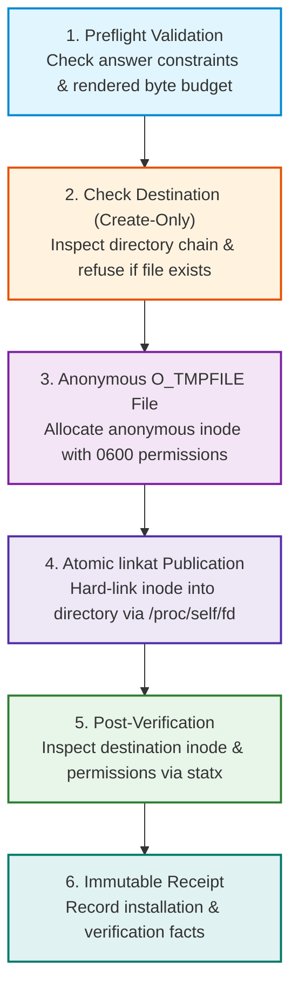

# Native Protected Artifact Output

When preparing production configuration files containing sensitive credentials, Configurator uses a kernel-enforced, protected save mechanism on Linux.

Files are prepared as anonymous files and published with atomic, create-only semantics at owner-only permissions (`0600`). Existing files are never overwritten, and fallbacks to insecure permissions are strictly rejected.

---

## Linux Protected Save Lifecycle

The native Linux publication engine executes a multi-stage validation and publishing sequence before committing files to disk:



1. **Preflight Validation:** Verifies answers, ensures all required fields are present, and checks that total output size is within the 4 MiB budget.
2. **Directory & Destination Inspection:** Traverses the destination directory chain using directory file descriptors (`O_DIRECTORY | O_NOFOLLOW`) to ensure parent directories are trusted. If a file with the target name already exists, publication aborts immediately.
3. **Anonymous Staging:** Allocates an unlinked, anonymous inode (`O_TMPFILE`) with strict owner-only permissions (`0600`). Data is written and flushed directly to disk (`fsync`).
4. **Atomic Publication:** Links the anonymous inode into the target directory using `linkat()` via `/proc/self/fd/`. If another process created a file at the target name in the interim, the kernel returns `EEXIST` and publication fails safely.
5. **Post-Verification:** Performs an immediate `fstatat` (`statx`) inspection of the published file, verifying that the on-disk inode and owner permissions match the prepared file.
6. **Immutable Receipt:** Issues an immutable receipt documenting the exact installation and verification status.

---

## Supported Filesystems Matrix

Protected publication relies on native Linux filesystem capabilities, specifically anonymous inode creation (`O_TMPFILE`) and atomic descriptor-based linking (`linkat`).

| Filesystem | Support Status | Notes |
|---|---|---|
| **ext4** | **Supported** | Full support for `O_TMPFILE`, atomic `linkat`, and POSIX `0600` permissions. |
| **xfs** | **Supported** | Native support across all modern Linux kernels. |
| **btrfs** | **Supported** | Full support for anonymous inode creation and verification. |
| **tmpfs** | **Supported** | Fast, secure in-memory staging for ephemeral containers and CI runners. |
| **NFS (v3 / v4)** | **Rejected** | Network file protocol lacks atomic `O_TMPFILE` linking; root-squash can alter permissions. |
| **SMB / CIFS** | **Rejected** | Non-POSIX filesystem; Windows ACL translation prevents strict `0600` mode guarantees. |
| **FAT / exFAT** | **Rejected** | Does not support POSIX owner permissions, file modes, or anonymous inodes. |

> [!IMPORTANT]
> If a target directory is located on an unsupported filesystem, Configurator fails closed with a permission or I/O refusal. It will **never** silently fall back to an unprotected, world-readable file write.

---

## Operating System Boundaries

Platform support for protected native file output differs by operating system:

- **Linux (x64, arm64, musl):** Fully supported. Uses native architecture-specific syscall flags and procfs descriptor verification.
- **macOS & Windows:** Currently fail closed for protected writes (`doctor` reports exit code `4`).
- **Browser WebAssembly:** The browser client operates under a separate user-directed custody model (deliberate file download) and does not promise filesystem ACL protections.

> [!WARNING]
> Running the CLI or Desktop client on Windows or macOS does not enable protected file output. Use Linux hosts or container environments when kernel-enforced create-only guarantees are required.

---

## Multi-File Bundles & Partial Results

When generating multi-file outputs (e.g. a `.env` file alongside a `config.yaml`):

1. **Pre-Check:** Configurator inspects all target destinations before creating the first file. If any file already exists, nothing is published.
2. **Sequential Commits:** Files are committed sequentially in the order declared by the definition.
3. **No Automatic Rollback:** If a system error or power failure occurs mid-bundle, files that were already successfully linked remain on disk. Configurator **never deletes existing files** to attempt a rollback, preventing accidental loss of user data.
4. **Committed Prefix:** The receipt clearly identifies which files succeeded (`written`) and which were `not-attempted`.

---

## Publication Status Outcomes

CLI machine receipts and interactive status views categorize each artifact into one of the following immutable states:

| Status Code | Meaning | Required Operator Action |
|---|---|---|
| `written` | The file was successfully published with `0600` permissions. | File is ready. If post-verification failed, inspect the file manually before use. |
| `conflict` | The destination already exists or changed during publication. | Inspect the existing file. Select a clean destination path rather than overwriting. |
| `blocked` | Rejected by filesystem or directory security checks. | Ensure the destination directory has `0700` permissions and is on a supported filesystem. |
| `failed` | A low-level operating system I/O error occurred. | Check available disk space, inode limits, and mount options. |
| `not-attempted` | Skipped because an earlier file in the bundle encountered an error. | Resolve the error from the prior file and re-run into a fresh directory. |
| `unknown` | Process interrupted before confirmation arrived. | Inspect the target directory to verify whether the file was created. |

---

## Operator Recovery & Inspection

When a publication is interrupted or reports a conflict, use standard Linux commands to inspect the state before retrying:

### 1. Verify File Permissions and Inodes

Check that existing files are owner-only (`-rw-------`):

```bash
ls -la /path/to/destination/
```

Inspect exact octal modes and owner UID/GID:

```bash
stat -c "%a %U:%G %n" /path/to/destination/.env
# Expected output: 600 youruser:yourgroup /path/to/destination/.env
```

### 2. Compare Conflicting Files

If an existing file blocked publication, diff the files to see what differs:

```bash
diff -u /path/to/destination/.env /path/to/new-directory/.env
```

### 3. Save into a Clean Private Directory

To retry a partially completed bundle, create a fresh private directory and output into it:

```bash
# Create an owner-only directory (0700)
mkdir -m 0700 /path/to/fresh-config

# Run artifact save into the fresh location
islamu-configurator artifact save \
  --bundle \
  --output-dir /path/to/fresh-config \
  --answers answers.json \
  --machine
```

---

## Interactive Save History (Terminal & Desktop)

Both the [Terminal TUI](terminal.md) and [Desktop GUI](desktop.md) maintain a shared, bounded save history:

- **16-Attempt Memory Ring:** The client remembers the 16 most recent completed attempts plus the currently active save.
- **Value-Free Receipts:** History records timestamps, artifact IDs, and status codes (`written`, `conflict`, `failed`), but never contains secret values or full file paths.
- **Session-Local:** Save history exists only in transient memory and is cleared when the application exits.
- **Safe Graceful Shutdown:** If you close the application while a save is in progress, the client waits up to 2 seconds for kernel operations to settle before prompting for confirmation.

---

## Where to Go Next

- **Ready to run a save?** Try the [Quick Start Guide](getting-started.md) to practice saving files.
- **Automating with scripts?** Review the [CLI Guide](cli.md) for machine receipts and exit codes.
- **Reviewing platform support?** Consult the [Packaging Guide](packaging.md) for system requirements.
