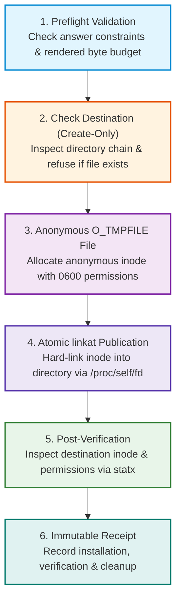

# Native Protected Artifact Output

Configurator uses a protected native save mechanism on supported Linux hosts
for answer-derived files. All such files are restricted, including drafts and
files containing only ordinary settings. Preparation does not establish
production readiness or target acceptance.

Each file is prepared anonymously and installed atomically with create-only,
owner-only (`0600`) protection. Existing files are never overwritten and there is
no ordinary-file fallback. A multi-file bundle is not one atomic transaction.

---

## Linux Protected Save Lifecycle

The native Linux publication engine executes a multi-stage validation and publishing sequence before committing files to disk:



1. **Preflight Validation:** Complete composition checks active required values
   and constraints and enforces the 4 MiB aggregate rendered-byte bound.
   Secret-deferred preparation is a separate incomplete mode, not relaxed
   complete validation.
2. **Directory & Destination Inspection:** Traverses the destination directory chain using directory file descriptors (`O_DIRECTORY | O_NOFOLLOW`) to ensure parent directories are trusted. If a file with the target name already exists, publication aborts immediately.
3. **Anonymous Staging:** Allocates an unlinked, anonymous inode (`O_TMPFILE`) with strict owner-only permissions (`0600`). Data is written and flushed directly to disk (`fsync`).
4. **Atomic Publication:** Links the anonymous inode into the target directory using `linkat()` via `/proc/self/fd/`. If another process created a file at the target name in the interim, the kernel returns `EEXIST` and publication fails safely.
5. **Post-Verification:** Inspects the destination using descriptor-relative
   `statx`, checking identity, owner, mode and size against the prepared file.
   Installation is recorded immediately after linking, before this check.
6. **Immutable Receipt:** Records installation, immediate verification and
   cleanup separately. Verification failure does not undo installation, and
   successful verification does not promise continued integrity.

---

## Filesystem Capability Guidance

Protected publication relies on native Linux filesystem capabilities, specifically anonymous inode creation (`O_TMPFILE`) and atomic descriptor-based linking (`linkat`).

| Filesystem | Support Status | Notes |
|---|---|---|
| **ext4** | Candidate local filesystem | Requires the actual mount/kernel to support staging, linking and verification. |
| **xfs** | Candidate local filesystem | Same native capability and trusted-directory checks apply. |
| **btrfs** | Candidate local filesystem | Do not infer qualification from the filesystem name alone. |
| **tmpfs** | Candidate memory-backed filesystem | Requires the same checks; storage lifetime differs from disk. |
| **NFS (v3 / v4)** | Do not assume support | Remote ownership/mount behavior and missing staging/link capabilities can refuse saving. |
| **SMB / CIFS** | Do not assume support | Permission translation and native capabilities can refuse saving. |
| **FAT / exFAT** | Unsuitable for this contract | Owner-only modes and required native operations cannot be assumed. |

This is capability guidance, not a tested filesystem certification matrix.
The writer checks native operations and directory/file identity rather than
maintaining an allowlist of filesystem names. `doctor` checks writer availability;
it does not probe your chosen mount. See [status](../internal/STATUS.md) and
[packaging](packaging.md) for actual-host evidence and remaining qualification.

> [!IMPORTANT]
> If a target directory is located on an unsupported filesystem, Configurator fails closed with a permission or I/O refusal. It will **never** silently fall back to an unprotected, world-readable file write.

---

## Operating System Boundaries

Platform support for protected native file output differs by operating system:

- **Linux:** The implementation selects architecture-specific flags for native
  staging and procfs descriptor linking. Linux x64 evidence does not qualify
  every architecture, libc, filesystem or container mount.
- **macOS & Windows:** Currently fail closed for protected writes (`doctor` reports exit code `4`).
- **Browser WebAssembly:** The browser client operates under a separate user-directed custody model (deliberate file download) and does not promise filesystem ACL protections.

> [!WARNING]
> Running the CLI or Desktop client on Windows or macOS does not enable protected file output. Use Linux hosts or container environments when kernel-enforced create-only guarantees are required.

---

## Multi-File Bundles & Partial Results

When generating multi-file outputs (e.g. a `.env` file alongside a `config.yaml`):

1. **Pre-Check:** Configurator inspects all target destinations before creating the first file. If any file already exists, nothing is published.
2. **Sequential Commits:** Files are committed sequentially in the order declared by the definition.
3. **No Automatic Rollback:** If a system error or power failure occurs mid-bundle, files that were already successfully linked remain on disk. Configurator **never deletes existing files** to attempt a rollback, preventing accidental loss of user data.
4. **Committed Prefix:** The receipt preserves established writes, untouched
   `not-attempted` outcomes and uncertain `unknown` outcomes. Read installation
   and verification facts, not just status or the overall exit.

---

## Publication Status Outcomes

CLI machine receipts and interactive status views categorize each artifact into one of the following immutable states:

| Status Code | Meaning | Required Operator Action |
|---|---|---|
| `written` | Installation was established; verification may still have failed. | Require `installation: established`, `verification: succeeded` and successful cleanup/operation completion before treating the save as successful. |
| `conflict` | No installation was established because the destination exists or changed. | Inspect the existing file. Select a clean destination path rather than overwriting. |
| `blocked` | Rejected by filesystem or directory security checks. | Ensure the destination directory has `0700` permissions and is on a supported filesystem. |
| `failed` | A low-level operating system I/O error occurred. | Check available disk space, inode limits, and mount options. |
| `not-attempted` | No publication attempt occurred, including an untouched later bundle output. | Resolve the earlier error and re-run into a fresh directory. |
| `unknown` | No definite outcome was established after work began. | Inspect the target directory; unknown never means certainly unwritten. |

---

## Recover Before Retrying

When publication is interrupted or reports a conflict, inspect before retrying.
The Bash inspection commands below are templates: replace `/path/to/...` with
your own local destinations. They do not constitute captured output.

### 1. Verify File Permissions and Inodes

Check that existing files are owner-only (`-rw-------`):

```bash
ls -la /path/to/destination/
```

Inspect exact octal modes and owner UID/GID:

```bash
stat -c "%a %U:%G %n" /path/to/destination/.env
# Expected output: 600 youruser:yourgroup /path/to/destination/.env
```

### 2. Compare Conflicting Files

If an existing file blocked publication, compare privately with a separately
prepared candidate. `diff` below prints file contents, possibly secrets; run
only in a trusted terminal, not a shared log. `cmp -s` can check equality without
printing contents:

```bash
diff -u /path/to/destination/.env /path/to/new-directory/.env
```

### 3. Save into a Clean Private Directory

This runnable Bash example uses the maintained synthetic fixtures. Prerequisites:
run from the checkout root with a current packaged `islamu-configurator` on
`PATH`, on a supported Linux destination. `mktemp` creates a new private directory
on each run; publication creates three files and never applies them to a target:

```bash
destination=$(mktemp -d "$HOME/configurator-retry.XXXXXXXX")
islamu-configurator artifact bundle-create \
  --definition examples/minimal-self-hosted/setup-definition.json \
  --artifact environment --artifact configuration --artifact configuration-yaml \
  --input examples/minimal-self-hosted/answers/complete.json \
  --output "$destination" \
  --machine
```

---

## Interactive Save History (Terminal & Desktop)

The [Terminal TUI](terminal.md) and [Desktop GUI](desktop.md) each retain bounded
session-local save history using shared immutable receipt facts:

- **16-Attempt Memory Ring:** The client remembers the 16 most recent completed attempts plus the currently active save.
- **Value-Free Receipts:** History records timestamps, artifact IDs, and status codes (`written`, `conflict`, `failed`), but never contains secret values or full file paths.
- **Session-Local:** Save history exists only in transient memory and is cleared when the application exits.
- **Bounded Graceful Shutdown:** A two-second close budget does not prove that a
  pending operation wrote nothing. Unsettled results remain unknown; forced
  termination cannot guarantee cleanup. Inspect the destination before retrying.

---

## Where to Go Next

- **Ready to run a save?** Try the [Quick Start Guide](getting-started.md) to practice saving files.
- **Automating with scripts?** Review the [CLI Guide](cli.md) for machine receipts and exit codes.
- **Reviewing platform support?** Consult the [Packaging Guide](packaging.md) for system requirements.
