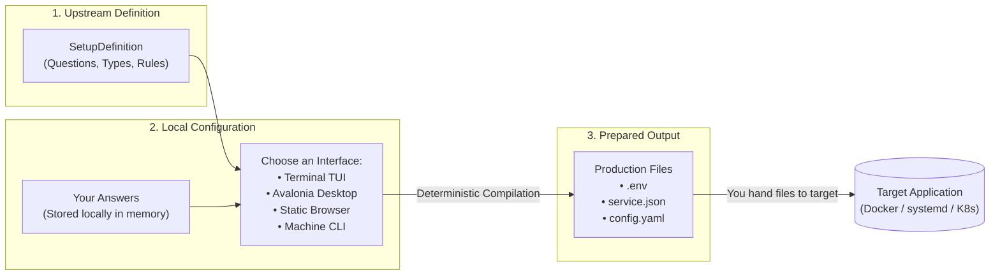
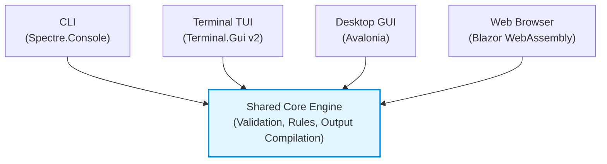

# Overview of ISLAMU Configurator

Welcome to ISLAMU Configurator! Configurator is an open-source, offline tool designed to turn application setup requirements into clean, production-ready configuration files (`.env`, JSON, YAML).

Whether you are self-hosting an application, managing local servers, or authoring setup definitions for your own project, Configurator gives you a guided, predictable, and secure setup experience across the terminal, desktop, and web.

---

## What Problem Does Configurator Solve?

Setting up modern self-hosted applications often involves navigating dozens of environment variables, complex YAML structures, and undocumented configuration files. Operators frequently run into:

- **Guesswork and Broken Syntax:** Typos in `.env` variable names or incorrect YAML indentation crash services on boot.
- **Hidden Dependencies:** Choosing a specific feature (like enabling metrics or an external database) requires several related settings that are easy to miss.
- **Accidental Secret Exposure:** Passwords and API tokens frequently get committed to Git, pasted into shared chat channels, or transmitted across unencrypted web forms.
- **Platform Lock-In:** Many guided setup tools only work if you adopt a specific Docker platform, app store, or cloud provider.

Configurator eliminates this friction. Upstream application maintainers describe their setup requirements once in a clean, non-executable definition. Operators can then answer those questions in any interface they prefer—terminal, desktop, browser, or CLI—and generate verified configuration files offline.

---

## How It Works: The 3-Step Mental Model

Configurator separates the *description* of configuration from the *answers*, and keeps both separate from the *running application*:

1. **Review the Definition:** The application author supplies a declarative definition file describing what settings are available, which ones are required, and what formats they produce.
2. **Provide Your Answers:** You enter your configuration values interactively or load them from an existing file. Sensitive values remain strictly in local memory and are never transmitted across the network.
3. **Generate Clean Files:** Configurator deterministically produces the exact configuration files the target software expects. On Linux, native clients write them with create-only, owner-only (`0600`) permissions.

> [!NOTE]
> **Strict Target Authority Separation:** Configurator is a configuration *preparation* tool. It does not start your containers, restart systemd units, connect to remote servers, or administer target applications. You stay in full control of when and how files are handed to the target software.

---

## Choose Your Interface

Configurator offers four interfaces built on the same shared engine. Every interface validates the same rules and produces identical files:

| Interface | Best For | Platform Support | Secret Handling | Network / Offline |
|---|---|---|---|---|
| **[Machine CLI](cli.md)** | CI/CD automation, scripts, headless pipelines, and AI coding agents | Linux (x64, arm64, musl), macOS, Windows | Stdin / files; masked diagnostics | Fully offline; zero network calls |
| **[Terminal TUI](terminal.md)** | SSH sessions, servers, keyboard-driven power users | Linux, macOS, Windows | Transient memory; masked fields | Fully offline; runs in any terminal |
| **[Desktop GUI](desktop.md)** | Local graphical desktop workflow with full form validation | Linux x64 (Avalonia) | Protected Linux file write (`0600`) | Fully offline; native desktop window |
| **[Static Browser](browser.md)** | Zero-install onboarding, quick previews, and web deep-links | Any modern browser (WebAssembly) | Consented local memory; deliberate export | Pure client-side WASM; no backend server |

---

## Core Principles

- **Offline by Default:** Everything runs on your machine. The browser client is compiled to static WebAssembly, processing all forms locally without sending answers to any remote backend.
- **Non-Executable Definitions:** Definitions are pure data (JSON or YAML). They contain no scripts, plugins, or executable code, eliminating supply-chain vulnerabilities.
- **Privacy & Secret Protection:** Sensitive fields (like passwords and API tokens) are explicitly categorized. On Linux, files are written atomically with create-only permissions, refusing to overwrite existing files.
- **Standard Output Formats:** Configurator outputs standard files your tools already understand—`.env` files, JSON documents, YAML configurations, and Markdown tables.

---

## Where to Go Next

- **Ready to try it out?** Follow our 5-minute [Quick Start Guide](getting-started.md) to generate real configuration files.
- **Want to explore the interfaces?** Check out the [Terminal](terminal.md), [Desktop](desktop.md), [Browser](browser.md), or [CLI](cli.md) guides.
- **Integrating your own application?** Read [Integrate Your Tool](integrate-your-tool.md) to create your first `configurator.yaml`.
- **Looking up terminology?** Consult our [Glossary](glossary.md) for plain-language definitions of key concepts.
