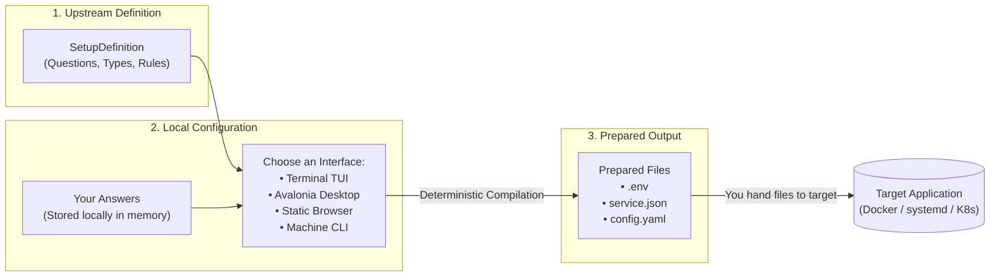
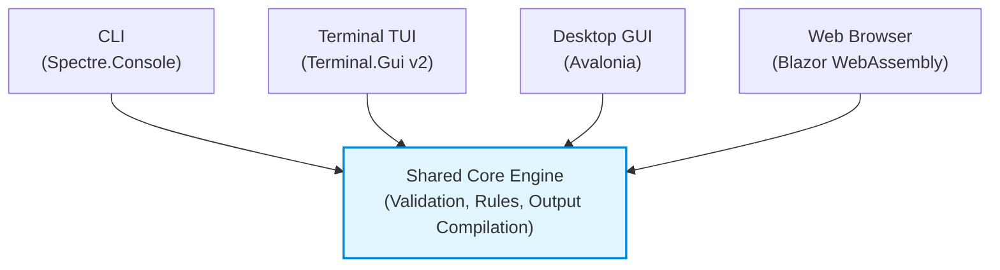

# Overview of ISLAMU Configurator

ISLAMU Configurator is an open-source, offline preparation utility that turns
declared application setup requirements and local answers into configuration
files (`.env`, JSON, YAML). It is in pre-release development; generated files
still need target-owned semantic validation and authorization before use.

Whether you are self-hosting an application, managing local servers, or authoring setup definitions for your own project, Configurator gives you a guided, predictable, and secure setup experience across the terminal, desktop, and web.

---

## What Problem Does Configurator Solve?

Setting up modern self-hosted applications often involves navigating dozens of environment variables, complex YAML structures, and undocumented configuration files. Operators frequently run into:

- **Guesswork and Broken Syntax:** Typos in `.env` variable names or incorrect YAML indentation crash services on boot.
- **Hidden Dependencies:** Choosing a specific feature (like enabling metrics or an external database) requires several related settings that are easy to miss.
- **Accidental Secret Exposure:** Passwords and API tokens frequently get committed to Git, pasted into shared chat channels, or transmitted across unencrypted web forms.
- **Platform Lock-In:** Many guided setup tools only work if you adopt a specific Docker platform, app store, or cloud provider.

Configurator reduces this friction. Application maintainers describe bounded
setup requirements in a non-executable definition. Operators answer those
questions through terminal, desktop, browser or CLI interfaces and prepare files
locally against the same admitted rules.

---

## How It Works: The 3-Step Mental Model

Configurator separates the *description* of configuration from the *answers*, and keeps both separate from the *running application*:

1. **Review the Definition:** The application author supplies a declarative definition file describing what settings are available, which ones are required, and what formats they produce.
2. **Provide Your Answers:** Enter values interactively or load a private answer
   workspace. Exact configuration names are preserved; dots do not imply nesting.
   Configurator processes answers locally, but selected input files, exported
   artifacts and clipboard contents have their own custody outside memory.
3. **Prepare Declared Files:** Configurator composes the definition's declared
   projections. Supported Linux native saves are create-only and owner-only
   (`0600`) per file. Browser copy/download is a deliberate transfer without
   native filesystem guarantees. Secret-deferred drafts remain incomplete and
   restricted.

Presence is explicit: required means present, not nonblank. Empty values,
`false` and zero are supplied values subject to schema constraints; null needs a
nullable schema. Standard `default` is descriptive; `initialValue` initializes
eligible absent values, while `suggestedValue` requires deliberate adoption.
Omission suppresses initialization; reset restores eligibility. Initialized
children do not create absent optional containers.

> [!NOTE]
> **Strict Target Authority Separation:** Configurator is a configuration *preparation* tool. It does not start your containers, restart systemd units, connect to remote servers, or administer target applications. You stay in full control of when and how files are handed to the target software.

The network boundary above concerns target administration. Browser delivery and
bounded public definition retrieval are distinct pre-workspace network activity.

---

## Choose Your Interface

Configurator offers four adapters over the same Core semantics. The same
admitted definition, effective answers, artifact selection and preparation mode
produce the same bytes; interface capability, consent and delivery boundaries
remain distinct:

| Interface | Best For | Platform Support | Secret Handling | Network / Offline |
|---|---|---|---|---|
| **[Machine CLI](cli.md)** | CI/CD automation, scripts, headless pipelines, and AI coding agents | Linux (x64, arm64, musl), macOS, Windows | Stdin / files; masked diagnostics | Fully offline; zero network calls |
| **[Terminal TUI](terminal.md)** | SSH sessions, servers, keyboard-driven power users | Linux, macOS, Windows | Transient workspace; masked fields | Offline; requires an interactive terminal |
| **[Desktop GUI](desktop.md)** | Local graphical desktop workflow with full form validation | Linux x64 (Avalonia) | Protected Linux file write (`0600`) | Fully offline; native desktop window |
| **[Static Browser](browser.md)** | Zero-install onboarding, quick previews, and web deep-links | A compatible WebAssembly browser | Consented local memory; deliberate export | Static hosting and public assets; no answer-processing backend |

---

## Core Principles

- **Offline by Default:** Everything runs on your machine. The browser client is compiled to static WebAssembly, processing all forms locally without sending answers to any remote backend.
- **Non-Executable Definitions:** Definitions are bounded data, not scripts or
  plugins. This removes executable definition hooks, not risks in dependencies,
  delivered client code, browsers, operating systems or target software.
- **Privacy & Secret Protection:** All answer-derived output is restricted,
  including drafts without secrets. Native publication is atomic per file,
  not per bundle, and refuses overwrites. Only actual-host evidence establishes
  protected-save qualification; macOS and Windows writes fail closed.
- **Standard Output Formats:** Configurator outputs standard files your tools already understand—`.env` files, JSON documents, YAML configurations, and Markdown tables.

---

## Where to Go Next

- **Ready to try it out?** Follow our 5-minute [Quick Start Guide](getting-started.md) to generate real configuration files.
- **Want to explore the interfaces?** Check out the [Terminal](terminal.md), [Desktop](desktop.md), [Browser](browser.md), or [CLI](cli.md) guides.
- **Integrating your own application?** Read [Integrate Your Tool](integrate-your-tool.md) to create your first `configurator.yaml`.
- **Looking up terminology?** Consult our [Glossary](glossary.md) for plain-language definitions of key concepts.
- **Checking completion claims?** Use the [current status](../internal/STATUS.md)
  and [knowledge map](../internal/KNOWLEDGE_MAP.md) to distinguish implementation,
  qualification and future work.
