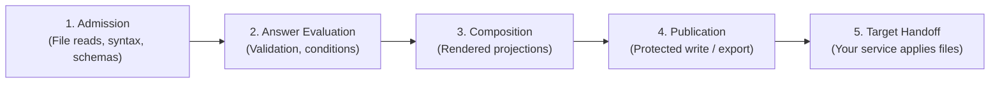
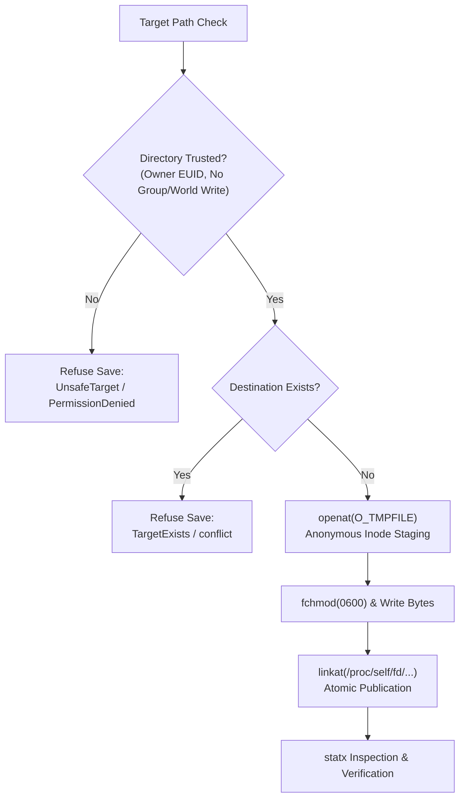
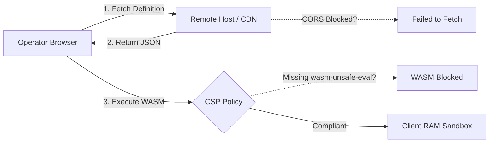

# Troubleshooting Guide

> **Audience:** Adopters | Contributors | Integrators | AI agents  
> **Status:** Implemented  
> **Owner:** Contributor Experience  
> **Last Verified:** 2026-10-27  
> **Source Anchors:** `src/Configurator.Cli/`, `src/Configurator.Artifacts/`, `src/Configurator.Terminal/`, `src/Configurator.Desktop/`, `src/Configurator.Browser/`, `src/Configurator.Core/`

This searchable guide provides diagnostic steps and recovery procedures for common issues across all Configurator execution surfaces: the Command-Line Interface (CLI), Terminal User Interface (TUI), Avalonia Desktop application, and Browser WebAssembly runtime.

---

## Existing-file import conflicts

An `answer-conflict` protects deliberate current answers or omission. If you
intend to adopt the imported value, reset that specific location before
retrying. Omit is not a reset: it suppresses initialization and is itself answer
intent. Inspect conflicts rather than blindly clearing unrelated answers.

## Diagnostic Mental Model

For authoring errors, run `definition check --source configurator.yaml --machine`.
Use the diagnostic code and optional public `source.schemaPath` plus start/end
line and column to find the admitted schema ancestor. Unknown member names and
values are not echoed. `definition lint` adds advisory warnings after admission;
it does not make unsupported syntax acceptable. To retrieve omitted entries use
`--detail diagnostics --limit 16`, then advance by the returned count with the
same `--expected-detail-digest`; restart at offset zero on a digest mismatch.
Use `definition schema --kind authoring --text` for the built-in editor schema.
For answer corrections, use typed property/row/map-entry coordinates only at the
reported input revision; map ordinals must not be treated as private key names.

Configurator separates configuration evaluation from physical artifact publication and target runtime execution. Errors occur at distinct pipeline stages:



When diagnosing an issue, first identify which stage failed:
- **Admission errors** indicate malformed JSON/YAML, broken schema constraints, or inaccessible files.
- **Answer evaluation errors** indicate missing required settings or invalid inputs.
- **Composition errors** indicate projection format mismatches or oversized outputs.
- **Publication errors** indicate filesystem permissions, conflicts, or unsupported OS boundaries.
- **Target handoff** is managed entirely by your deployment system (Docker, Podman, systemd, Kubernetes). Configurator never modifies live services.

---

## CLI Exit Codes & Error Diagnostics

The `islamu-configurator` CLI emits standardized POSIX exit codes and deterministic JSON machine envelopes when invoked with `--machine`. The table below outlines each code, its root cause, and immediate resolution.

| Exit Code | Category | Meaning | Recovery Strategy |
|---|---|---|---|
| `0` | `success` | Operation completed successfully | Host acceptance still required; apply generated files to target |
| `2` | `validation` | Declared field or projection constraint failed | Review field diagnostics, fix inputs, and re-run |
| `3` | `incomplete` | Required answers missing | Supply all mandatory answers before requesting complete output |
| `4` | `blocked` | Privacy, revision, or host boundary refused | Check platform compatibility or supply needed revision parameters |
| `64` | `usage` | Syntax error in CLI invocation flags | Correct argument spelling, remove unsupported flags or positional tokens |
| `65` | `data` | Malformed document or schema admission failure | Validate JSON/YAML against schema; ensure file size is under 4 MiB |
| `70` | `internal` | Unexpected engine invariant violation | Report bug with deterministic reproduction definition and answers |
| `74` | `io` | Filesystem read/write error or broken pipe | Check disk space, path existence, directory permissions, and stdout |
| `130` | `cancelled` | Operation terminated by SIGINT / Ctrl+C | Inspect target directory to identify any partially written prefix |

---

### Exit Code 0: Success (With Target Caveat)

**Cause:** The local command finished all planned processing and verified output invariants.

```json
{
  "schemaVersion": "islamu-configurator-command/v4",
  "status": "success",
  "exitCode": 0,
  "completion": "completed",
  "targetAcceptance": "unassessed"
}
```

> [!NOTE]
> `targetAcceptance: "unassessed"` is expected behavior. Configurator validates configuration semantics locally, but your target application (e.g. Nextcloud, Ghost, Postgres) retains sole authority over runtime acceptance.

**Step-by-Step Recovery / Next Steps:**
1. Inspect the published files at your specified destination directory.
2. Hand the generated `.env`, `.json`, or `.yaml` files to your deployment runner (`docker compose up -d`, `systemctl restart`, etc.).
3. Verify target application logs to ensure successful startup.

---

### Exit Code 2: Field Validation Failure

**Cause:** One or more answers fail validation constraints defined in the setup definition (e.g. regex pattern, min/max integer bounds, enum allowed values, or `uniqueBy` array constraints).

```json
{
  "status": "failed",
  "exitCode": 2,
  "diagnostics": [
    {
      "code": "field-invalid",
      "severity": "error",
      "path": "/server/port",
      "message": "Value must be between 1024 and 65535."
    }
  ]
}
```

**Step-by-Step Recovery:**
1. Run with `--detail diagnostics` to inspect all active constraint failures:
   ```bash
   islamu-configurator artifact validate --definition setup.json \
     --artifact config --input answers.json --detail diagnostics --machine
   ```
2. Locate the failing field path specified in the diagnostic (`/server/port`).
3. Update the value in your `answers.json` file to satisfy the constraint.
4. Re-run `artifact validate` or `artifact create`.

---

### Exit Code 3: Incomplete Answers

**Cause:** One or more required fields are active (their `activeWhen` condition evaluated to true) but no value was supplied in the answers workspace.

```json
{
  "status": "failed",
  "exitCode": 3,
  "readiness": {
    "state": "incomplete",
    "missingCount": 2,
    "blockedCount": 0
  }
}
```

**Step-by-Step Recovery:**
1. Inspect which fields are missing by checking the coverage detail:
   ```bash
   islamu-configurator artifact validate --definition setup.json \
     --artifact config --input answers.json --detail coverage --machine
   ```
2. For each missing field marked required, add an entry to your answers JSON object.
3. If generating an intentionally partial draft (e.g., deferring secrets), use draft preparation:
   ```bash
   islamu-configurator artifact create-draft --definition setup.json \
     --artifact config --input answers.json --output draft.env
   ```

---

### Exit Code 4: Blocked Operation / Host Boundary

**Cause:** Triggered when:
- Attempting a protected native save on an unsupported host (such as macOS or Windows).
- A definition revision conflict occurs.
- A private credential was requested via an unauthenticated or public stream.

```json
{
  "status": "failed",
  "exitCode": 4,
  "diagnostics": [
    {
      "code": "unsupported-protected-host",
      "severity": "error",
      "message": "Protected native writes require Linux with anonymous inode support."
    }
  ]
}
```

**Step-by-Step Recovery:**
1. **On macOS or Windows:** Native create-only `0600` protection is strictly Linux-only. Use the CLI inside Linux containers, WSL2, or a Linux virtual machine.
2. **On Linux:** Verify your host capabilities by executing the diagnostic command:
   ```bash
   islamu-configurator doctor --machine
   ```
   If doctor exits with `0`, your host kernel and libc support protected saves. If it exits with `4`, review kernel version and libc compatibility.

---

### Exit Code 64: Command Usage Error

**Cause:** An invalid command-line invocation was provided. Common mistakes include misspelled option names, missing required parameters, repeating singleton flags, or passing positional arguments after options.

```bash
# Incorrect (positional arguments mixed with flags)
islamu-configurator artifact create setup.json answers.json

# Correct (Spectre-typed flags)
islamu-configurator artifact create --definition setup.json \
  --artifact config --input answers.json --output .env
```

**Step-by-Step Recovery:**
1. Request command-specific syntax help:
   ```bash
   islamu-configurator artifact create --help
   ```
2. Ensure flags match exact case (`--definition`, NOT `--Definition`).
3. If passing stdin or stdout, supply the literal dash `-` as the option argument (`--output -`).

---

### Exit Code 65: Data Error (Schema / Parse Failure)

**Cause:** The definition document or answers file could not be parsed as valid JSON/YAML, exceeded size limits, or violated core schema requirements.

**Common Scenarios:**
- The definition file exceeds the 4 MiB size limit.
- JSON contains trailing commas or unquoted keys (strictly forbidden by `SetupDefinitionCodec`).
- Duplicate keys exist within the same JSON object.

**Step-by-Step Recovery:**
1. Validate JSON syntax using a standard command-line validator:
   ```bash
   jq . setup.json > /dev/null
   ```
2. Verify against the official schema:
   ```bash
   islamu-configurator definition check --definition setup.json --machine
   ```
3. Correct structural defects identified in the diagnostic message.

---

### Exit Code 70: Internal Error

**Cause:** An unhandled internal invariant failure occurred within `Configurator.Core`.

**Step-by-Step Recovery:**
1. Run with `--text` mode to view the diagnostic trace on `stderr`.
2. Ensure you are running a supported .NET release (minimum .NET 10.0.302 runtime).
3. If reproducible with sanitized sample data, file an issue in the upstream repository including your definition and non-sensitive inputs.

---

### Exit Code 74: I/O or Publication Failure

**Cause:** Physical filesystem interaction failed. This includes:
- Attempting to overwrite an existing file during a protected save.
- Insufficient directory permissions along the directory path.
- Incompatible filesystem type (e.g. NFS, CIFS/SMB) that does not support anonymous inode operations.
- Writing to a broken stdout pipe.

**Step-by-Step Recovery:**
See [Linux Protected Save & Filesystem Failures](#linux-protected-save--filesystem-failures) below for comprehensive filesystem diagnosis.

---

### Exit Code 130: Operation Cancelled (SIGINT)

**Cause:** The process was terminated via `Ctrl+C` or a `SIGINT` signal during file preparation or bundle writing.

> [!CAUTION]
> **No Rollback Guarantee:**
> Configurator never deletes already-written files upon cancellation. Any file whose write status was recorded as `written` remains on disk.

**Step-by-Step Recovery:**
1. Check your target directory to identify which bundle artifacts were committed before interruption.
2. Resolve any partial files or remove the output directory if a fresh run is desired.
3. Re-run the command to completion.

---

## Linux Protected Save & Filesystem Failures

Configurator implements an uncompromising security model for native file publication via `UnixProtectedArtifactWriter`. It enforces create-only, owner-only (`0600`) file permissions without temporary filename collisions.



### 1. "File exists" Conflict (`TargetExists` / Exit 74)

**Cause:** The destination file already exists on disk. Configurator's Linux writer uses `linkat` with atomic create-only semantics (equivalent to `O_EXCL`). It refuses to truncate, replace, or overwrite existing files.

**Diagnostic Indicators:**
- CLI machine receipt reports: `"writeStatus": "conflict"`, `"installation": "not-established"`.
- Text mode output: `Target file already exists; refusing to overwrite.`

**Step-by-Step Recovery:**
1. Inspect the existing file:
   ```bash
   ls -la /path/to/destination/.env
   ```
2. If the existing file is outdated and safe to replace, archive or remove it manually:
   ```bash
   mv /path/to/destination/.env /path/to/destination/.env.backup
   ```
3. Alternatively, specify a fresh output directory for the new run:
   ```bash
   mkdir -m 0700 /path/to/new-deployment
   islamu-configurator artifact bundle-create --definition setup.json \
     --input answers.json --output-dir /path/to/new-deployment
   ```

---

### 2. "Permission Denied" & Unsafe Directory Chains

**Cause:** Configurator verifies every directory segment from the filesystem root (`/`) down to the target folder using `IsTrustedDirectory`. Publication is refused if:
- Any directory in the path is group-writable (`g+w`) or world-writable (`o+w`), unless it is a non-final root-owned directory with the sticky bit set (like `/tmp`).
- The final destination directory is not owned by the executing user's effective UID (`geteuid()`).
- The destination directory has overly permissive mode bits (e.g. `0777` or `0775`).

> [!WARNING]
> **Saving Directly to `/tmp` Fails by Design:**
> The directory `/tmp` has permissions `1777` (world-writable). Because `/tmp` is world-writable, saving directly to `/tmp/.env` will be rejected as `UnsafeTarget`.

**Step-by-Step Recovery:**
1. Create a dedicated, private subfolder owned exclusively by your user:
   ```bash
   mkdir -m 0700 /tmp/my-config
   ```
2. Verify ownership and permissions:
   ```bash
   ls -ld /tmp/my-config
   # Expected output: drwx------ 2 youruser yourgroup 4096 ...
   ```
3. Direct Configurator outputs into that private subfolder:
   ```bash
   islamu-configurator artifact create --definition setup.json \
     --artifact config --input answers.json --output /tmp/my-config/.env
   ```

---

### 3. NFS, SMB/CIFS & Network Filesystem Failures

**Cause:** Configurator's Linux writer relies on low-level Linux kernel features:
- `openat(..., O_TMPFILE)` to create unlinked anonymous inodes.
- Atomic namespace linking via `/proc/self/fd/<descriptor>`.

Network filesystems (NFSv3/NFSv4, SMB/CIFS) and non-POSIX filesystems (FAT32, exFAT, NTFS-3G) do not support `O_TMPFILE` or descriptor linking, returning `EOPNOTSUPP` (Operation not supported) or `EINVAL`. Additionally, NFS root-squashing or UID mapping often breaks ownership checks.

**Diagnostic Indicators:**
- Exit code `74` with status `IoFailure`.
- Syscall errors: `Operation not supported` or `Invalid cross-device link`.

**Step-by-Step Recovery:**
1. Prepare artifacts on a native POSIX local filesystem (e.g. `ext4`, `xfs`, `btrfs`, `tmpfs`).
2. Point your output to a local temporary directory:
   ```bash
   mkdir -m 0700 "$HOME/.cache/config-staging"
   islamu-configurator artifact bundle-create --definition setup.json \
     --input answers.json --output-dir "$HOME/.cache/config-staging"
   ```
3. Copy or synchronize the prepared files to your network mount:
   ```bash
   rsync -av "$HOME/.cache/config-staging/" "/mnt/nfs-share/app-config/"
   rm -rf "$HOME/.cache/config-staging"
   ```

---

## Terminal TUI Issues

The interactive terminal client (`Configurator.Terminal`) is powered by Terminal.Gui v2 and requires an interactive ANSI terminal.

```text
┌─────────────────────────── ISLAMU Configurator TUI ───────────────────────────┐
│ [!] Terminal window too small: 78 cols x 24 rows                             │
│     Configurator Terminal requires at least 80 cols x 26 rows.               │
│     Please resize your terminal window or maximize your console.             │
└───────────────────────────────────────────────────────────────────────────────┘
```

### 1. Viewport Dimensions Under 80×26

**Cause:** The TUI requires an absolute minimum usable content viewport of **80 columns × 26 rows**. When factoring in the outer border frame, the required physical terminal dimension is at least **82 columns × 28 rows**. If the terminal window is smaller, the interface renders a single resize warning and suspends form controls to prevent text corruption.

**Step-by-Step Recovery:**
1. Check your current terminal dimensions:
   ```bash
   stty size
   # Outputs: <rows> <columns>, e.g.: 24 80
   ```
2. Maximize your terminal emulator or drag the window edge until dimensions exceed `82x28`.
3. If using `tmux` or `screen`, ensure split panes provide sufficient space, or zoom the current pane:
   - In `tmux`: press `Ctrl+B` then `Z` to toggle full-screen zoom on the active pane.
4. For optimal display of guidance text and complex object lists, use the recommended size of **110 columns × 36 rows**.

---

### 2. ANSI Color Artifacts & Broken Borders

**Cause:** Display corruption, escape sequences printed as literal text (e.g. `^[[0;32m`), or broken box-drawing characters (`──`) occur when the terminal emulator lacks UTF-8 locale support or correct `$TERM` capabilities.

**Step-by-Step Recovery:**
1. Verify UTF-8 locale settings:
   ```bash
   locale
   # Ensure LANG or LC_ALL ends in .UTF-8 (e.g. en_US.UTF-8)
   export LANG=en_US.UTF-8
   export LC_ALL=en_US.UTF-8
   ```
2. Configure a modern 256-color or truecolor `$TERM` identifier:
   ```bash
   export TERM=xterm-256color
   ```
3. Use a verified modern terminal emulator such as Alacritty, Kitty, WezTerm, GNOME Terminal, Windows Terminal, or iTerm2.

---

### 3. Keyboard Navigation & Input Focus

**Cause:** In complex nested containers, users may find focus locked or unclear how to commit edits.

**Step-by-Step Recovery:**
- **Navigation:** Press `Tab` to advance focus forward; press `Shift+Tab` to move focus backward.
- **Applying Drafts:** When typing into text fields, press **Apply field** or `Enter` to commit your draft before advancing. Cycling choices with `Space` acts on committed values.
- **Empty Objects (`{}`):** A required empty object cannot be populated by typing into children. Focus the container header and select **Supply container** to explicitly admit the empty object.
- **List Items:** Use **Add item** to append a row. To delete, highlight the row and select **Remove item** twice to confirm.

---

## Avalonia Desktop Issues

The desktop client (`Configurator.Desktop`) is built with Avalonia UI and provides a graphical configuration workspace.

### 1. Wayland vs X11 Display Backend

**Cause:** Avalonia automatically detects display servers via `UsePlatformDetect()`. On Linux systems running Wayland (especially with Sway, Hyprland, or proprietary NVIDIA graphics drivers), hardware acceleration bugs can cause window freezes, black screens, or launch crashes.

**Step-by-Step Recovery:**
1. Launch the application with Wayland disabled to force the stable X11 / XWayland backend:
   ```bash
   WAYLAND_DISPLAY="" ./islamu-configurator-desktop
   ```
2. If using an NVIDIA GPU on Wayland, force software rendering fallback:
   ```bash
   AVALONIA_RENDER_MODE=software ./islamu-configurator-desktop
   ```
3. Check application logs on `stderr` for graphics driver diagnostic warnings.

---

### 2. Missing System Font Libraries (`libfontconfig.so.1`)

**Cause:** Avalonia uses Skia for text shaping and rendering. On minimalist Linux installations or container environments, missing `fontconfig` or `freetype` libraries results in an immediate crash:
`System.DllNotFoundException: Unable to load shared library 'libfontconfig.so.1'`

**Step-by-Step Recovery:**
Install system font libraries using your distribution's package manager:

```bash
# Arch Linux
sudo pacman -S fontconfig freetype2 ttf-dejavu

# Debian / Ubuntu
sudo apt-get update && sudo apt-get install -y libfontconfig1 libfreetype6 fonts-dejavu-core

# Fedora / RHEL
sudo dnf install -y fontconfig freetype dejavu-sans-fonts

# Alpine Linux (musl)
apk add fontconfig freetype ttf-dejavu
```

---

### 3. High-DPI & Window Scaling Quirks

**Cause:** On 4K monitors or multi-monitor setups with fractional scaling (e.g. 125% or 150%), Avalonia windows may appear blurry or improperly scaled.

**Step-by-Step Recovery:**
Override the global scale factor via environment variable:
```bash
# Force 100% standard scaling
AVALONIA_GLOBAL_SCALE_FACTOR=1.0 ./islamu-configurator-desktop

# Force 200% high-density scaling
AVALONIA_GLOBAL_SCALE_FACTOR=2.0 ./islamu-configurator-desktop
```

---

## Browser WebAssembly Issues

The browser workspace (`Configurator.Browser`) runs entirely client-side using Blazor WebAssembly and MudBlazor.



### 1. CORS Errors Loading Definitions

**Cause:** When opening a remote definition via URL, the browser issues a cross-origin HTTP `GET` request. If the remote hosting server does not include permissive Cross-Origin Resource Sharing (CORS) headers, the browser blocks the download:
`Access to fetch at 'https://example.com/setup.json' from origin 'https://config.islamu.org' has been blocked by CORS policy.`

**Step-by-Step Recovery:**
1. **Host-Side Fix:** Configure the remote web server to return CORS headers for public definition files:
   ```http
   Access-Control-Allow-Origin: *
   Access-Control-Allow-Methods: GET, OPTIONS
   Access-Control-Allow-Headers: Content-Type
   ```
2. **Client-Side Workaround:** Download the definition file locally using `curl` or your browser, then use **Upload local definition** on the Home screen to load the file directly from disk.

---

### 2. Content Security Policy (CSP) Headers

**Cause:** Blazor WebAssembly compiles and runs WebAssembly binaries in client memory. If your static hosting server sends an overly restrictive `Content-Security-Policy` header, the browser blocks WebAssembly execution:
`Refused to compile or instantiate WebAssembly module because 'wasm-unsafe-eval' is not an allowed source of script.`

**Step-by-Step Recovery:**
Configure your web server (Nginx, Caddy, Cloudflare Pages) to emit the verified Configurator CSP header:

```http
Content-Security-Policy: default-src 'self'; script-src 'self' 'wasm-unsafe-eval'; style-src 'self' 'unsafe-inline'; img-src 'self' data: blob:; font-src 'self'; connect-src 'self' https:; worker-src 'self'; object-src 'none'; base-uri 'self'; form-action 'none';
```

> [!IMPORTANT]
> **Essential CSP Directives:**
> - `script-src 'self' 'wasm-unsafe-eval'`: Mandatory for .NET WebAssembly execution in modern browsers.
> - `connect-src 'self' https:`: Allows fetching definitions from public HTTPS origins.
> - `img-src 'self' data: blob:`: Allows rendering SVG application icons and inline graphics.

---

### 3. `.env` Downloading as `.txt` or `env.txt`

**Cause:** For security reasons, certain browsers (notably Google Chrome, Microsoft Edge, and Safari on macOS/iOS) do not permit web pages to trigger automatic downloads of dotfiles without file extensions. The browser's download manager automatically appends `.txt` or strips the leading period, resulting in `env.txt` or `.env.txt`.

**Step-by-Step Recovery:**
1. **Rename after download:**
   ```bash
   mv ~/Downloads/env.txt /path/to/deployment/.env
   # or
   mv ~/Downloads/.env.txt /path/to/deployment/.env
   ```
2. **Use the Clipboard:** In the Browser workspace Review screen, click the **Copy** button instead of **Download**, then paste the contents directly into your target `.env` file in your terminal or text editor.

---

### 4. Service Worker & Stale PWA Cache

**Cause:** Configurator Browser is a Progressive Web App (PWA). If you deploy an updated version of the application or definition catalogue, aggressive service worker caching may continue serving the previous version.

**Step-by-Step Recovery:**
1. Perform a hard cache refresh:
   - **Windows / Linux:** Press `Ctrl + F5` or `Ctrl + Shift + R`.
   - **macOS:** Press `Cmd + Shift + R`.
2. Clear the service worker in browser Developer Tools:
   - Press `F12` to open DevTools.
   - Navigate to the **Application** tab (Chrome/Edge) or **Storage** tab (Firefox).
   - Select **Service Workers** in the left sidebar and click **Unregister**.
   - Select **Storage** and click **Clear site data**.
   - Reload the page.

---

## Definition Import & Schema Mismatch Errors

Configurator enforces strict data admission through `SetupDefinitionCodec` and `DefinitionImport`. It does not guess missing data or silently drop unmapped keys.

### 1. Revision Mismatch (`revision-conflict`)

**Cause:** Occurs when:
- An existing answer snapshot or import file declares a `revision` number that does not match the revision declared in the active setup definition.
- A modified definition source is admitted into a registry or session using an already-registered family ID without incrementing the `revision` number.

**Step-by-Step Recovery:**
1. Check the revision in your definition source:
   ```json
   {
     "familyId": "69cdb122-41d2-4fab-9b82-7929a889c726",
     "revision": 2
   }
   ```
2. If revising a definition, increment the revision number using the CLI:
   ```bash
   islamu-configurator definition revise --definition configurator.yaml \
     --bump minor --output configurator.yaml
   ```
3. If importing an answer file generated for an older revision, migrate the answer snapshot to match the target definition revision.

---

### 2. Missing Revision Field (`identity-invalid`)

**Cause:** The definition document lacks the mandatory top-level `revision` property, or its value is less than 1.

```json
{
  "code": "identity-invalid",
  "message": "Definition document requires a positive integer revision."
}
```

**Step-by-Step Recovery:**
1. Open your definition source (`configurator.yaml` or `setup-definition.json`).
2. Ensure both `familyId` (a valid UUIDv4) and `revision` (an integer >= 1) are explicitly declared:
   ```yaml
   $schema: "urn:islamu:configurator:authoring:v1"
   familyId: "7f83b1a2-1111-4000-8000-000000000001"
   revision: 1
   ```
3. Re-run `definition check` to confirm schema validity.

---

### 3. Unmapped Existing-File Content

**Cause:** The existing `.env`, JSON or YAML file contains members outside the
selected artifact's current projection. `artifact compare` can report these
without adopting them; strict `prefill` refuses unaccounted content atomically.
`--answers` supplies an optional current workspace to prefill, not an import mode.

> [!IMPORTANT]
> **Strict Rejection Policy:**
> Configurator deliberately refuses imports with unknown keys. Silent omission of unmapped keys could cause operators to lose vital secrets, certificates, or custom configuration parameters without realizing it.

**Step-by-Step Recovery:**
1. Inspect value-free findings:
   ```bash
   islamu-configurator artifact compare --definition configurator.yaml \
     --artifact environment --input existing.env --machine --detail findings
   ```
   `unrecognized-input` findings identify source ordinals, never raw private key
   names or values. They are not current-workspace correction tokens. Follow
   `nextOffset` and the sanitized detail digest for further pages; do not advance
   by the requested limit. A stopped inventory exposes only a lower bound.
2. If the settings are obsolete, repair a separate copy of the file, retain the
   original unchanged, then compare the repaired copy. Exit 2 is a completed
   assessment requiring changes, not a parse failure; exit 3 means incomplete
   coverage without known blocking changes. Neither grants target acceptance.
3. If the settings are legitimate application options, update the setup definition to declare those fields and include them in the artifact projection:
   ```yaml
   configuration:
     type: object
     additionalProperties: false
     properties:
       CUSTOM_METRICS_TOKEN:
         type: string
         title: Custom metrics token
         x-configurator:
           sensitivity: secret
   outputs:
     .env:
       id: environment
       format: dotenv
       bindings:
         CUSTOM_METRICS_TOKEN:
           scope: root
           path: /CUSTOM_METRICS_TOKEN
   ```
   This is a source fragment: preserve the definition's v2 discriminator,
   identity, project, application versions and other fields. Public schema names
   are not a reason to print actual unknown names from an imported file.
4. Run `definition check --source configurator.yaml`, then compare again.
   If autofill is eligible, use `artifact prefill` with a new restricted answer
   destination. If it refuses, repair the separate copy rather than clearing
   unrelated workspace answers or silently dropping input.

---

## Getting Further Help

If your issue is not resolved by the steps in this guide:
- Run diagnostic checks: `islamu-configurator doctor --machine`
- Verify your definition syntax: `islamu-configurator definition check --definition <path>`
- Review [Native Output Guarantees](native-output.md) for filesystem protection details.
- Review [Standalone Packages](packaging.md) for platform support boundaries.
