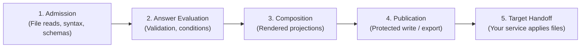
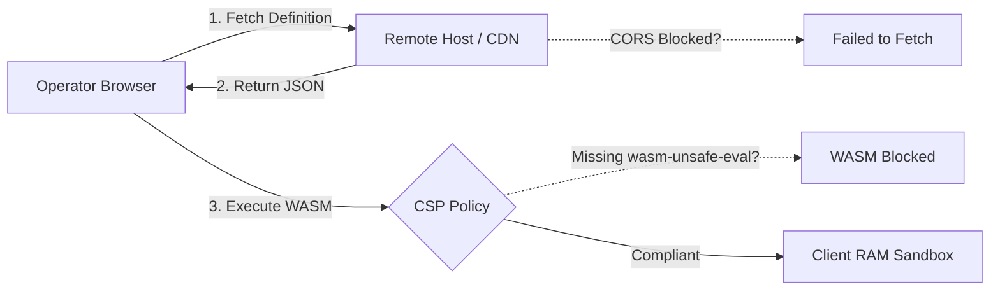

# Troubleshooting Guide

> **Audience:** Adopters | Contributors | Integrators | AI agents  
> **Status:** Source-grounded recovery guidance; host hints are not qualification
> **Owner:** Contributor Experience  
> **Last Verified:** 2026-10-30
> **Review basis:** Source review, not execution of every recovery template
> **Source Anchors:** `src/Configurator.Cli/`, `src/Configurator.Artifacts/`, `src/Configurator.Terminal/`, `src/Configurator.Desktop/`, `src/Configurator.Browser/`, `src/Configurator.Core/`

This searchable guide provides diagnostic steps and recovery procedures for common issues across all Configurator execution surfaces: the Command-Line Interface (CLI), Terminal User Interface (TUI), Avalonia Desktop application, and Browser WebAssembly runtime.

Commands use **Bash** unless labeled otherwise. Runnable CLI examples assume a
current packaged `islamu-configurator` on `PATH` and the checkout root as the
working directory. Source invocation and build prerequisites are in the
[CLI guide](cli.md#invocation-basics--confidentiality).
Blocks containing `setup.json`, `answers.json` or `/path/to/...` are **templates**:
substitute your admitted local definition, private v1 answers and local paths.
JSON/status blocks are **illustrative excerpts**, not full captured receipts.
Read-only checks can be rerun. Writes require trusted existing parent directories
and fresh destination filenames; inspect any written prefix before retrying.
Use maintained [synthetic fixtures](getting-started.md) when reporting a problem,
never private answers, paths, credentials or generated configuration.

---

## Existing-file import conflicts

An `answer-conflict` protects deliberate current answers or omission. If you
intend to adopt the imported value, reset that specific location before
retrying. Omit is not a reset: it suppresses initialization and is itself answer
intent. Inspect conflicts rather than blindly clearing unrelated answers.

## Diagnostic Mental Model

For authoring errors, run `definition check --source configurator.yaml --machine`.
Use the diagnostic code and optional public `source.schemaPath` plus start/end
line and column to find the admitted schema ancestor. Unknown member names and
values are not echoed. `definition lint` adds advisory warnings after admission;
it does not make unsupported syntax acceptable. To retrieve omitted entries use
`--detail diagnostics --limit 16`, then use the returned `nextOffset` with the
same `--expected-detail-digest`; restart at offset zero on a digest mismatch.
Use `definition schema --kind authoring --text` for the built-in editor schema.
For answer corrections, use typed property/row/map-entry coordinates only at the
reported input revision; map ordinals must not be treated as private key names.

Configurator separates configuration evaluation from physical artifact publication and target runtime execution. Errors occur at distinct pipeline stages:



When diagnosing an issue, first identify which stage failed:
- **Admission errors** indicate malformed JSON/YAML, broken schema constraints, or inaccessible files.
- **Answer evaluation errors** indicate missing required settings or invalid inputs.
- **Composition errors** indicate projection format mismatches or oversized outputs.
- **Publication errors** indicate filesystem permissions, conflicts, or unsupported OS boundaries.
- **Target handoff** is managed entirely by your deployment system (Docker, Podman, systemd, Kubernetes). Configurator never modifies live services.

---

## CLI Exit Codes & Error Diagnostics

The `islamu-configurator` CLI emits standardized POSIX exit codes and deterministic JSON machine envelopes when invoked with `--machine`. The table below outlines each code, its root cause, and immediate resolution.

| Exit Code | Category | Meaning | Recovery Strategy |
|---|---|---|---|
| `0` | `success` | Local operation completed successfully | Perform target validation and obtain permission before applying files |
| `2` | `validation` | Field/projection failure or comparison found required changes | Review diagnostics/findings and repair a separate copy |
| `3` | `incomplete` | Required answers missing | Supply all mandatory answers before requesting complete output |
| `4` | `blocked` | Privacy, revision, or host boundary refused | Check platform compatibility or supply needed revision parameters |
| `64` | `usage` | Syntax error in CLI invocation flags | Correct argument spelling, remove unsupported flags or positional tokens |
| `65` | `data` | Malformed/admission refusal, stale digest or detail-report failure | Check envelope/schema and detail continuation; streaming byte-limit failures can instead return 74 |
| `70` | `internal` | Unexpected engine invariant violation | Report a deterministic synthetic reproduction |
| `74` | `io` | Filesystem read/write error or broken pipe | Check disk space, path existence, directory permissions, and stdout |
| `130` | `cancelled` | Operation terminated by SIGINT / Ctrl+C | Inspect target directory to identify any partially written prefix |

---

### Exit Code 0: Success (With Target Caveat)

**Cause:** The local command succeeded within its own scope. Read-only commands
need not publish files; compare success is not workspace preparation.

```json
{
  "schemaVersion": "islamu-configurator-command/v4",
  "status": "success",
  "exitCode": 0,
  "completion": "completed",
  "targetAcceptance": "unassessed"
}
```

> [!NOTE]
> `targetAcceptance: "unassessed"` is expected. Configurator checks admitted
> definition constraints, not equivalence with target semantics. Successful
> composition can have `preparation: "ready"` while readiness remains incomplete
> for required host validation.

**Step-by-Step Recovery / Next Steps:**
1. Inspect the published files at your specified destination directory.
2. Obtain target semantic validation and permission before handing generated
   files to a deployment runner. Starting or restarting services changes the
   target and is outside Configurator.
3. Verify target application logs to ensure successful startup.

---

### Exit Code 2: Field Validation Failure

**Cause:** Answers fail admitted constraints such as numeric bounds, typed enums
or `uniqueBy`. Arbitrary regex patterns are not part of the bounded profile.
Bundle composition failures, including missing answers, also return exit 2.

```json
{
  "status": "validation",
  "exitCode": 2,
  "diagnostics": [
    {
      "code": "value-invalid",
      "severity": "error",
      "path": "/input",
      "correction": {
        "inputRevision": 0,
        "fieldId": "service.name",
        "segments": []
      }
    }
  ]
}
```

**Step-by-Step Recovery:**
1. Run with `--detail diagnostics` to inspect all active constraint failures:
   ```bash
   islamu-configurator artifact validate --definition setup.json \
     --artifact config --input answers.json --detail diagnostics --machine
   ```
2. Locate the declared field using its safe diagnostic metadata. A name such as
   `service.name` is a literal key, not a nested `service` object. Honor typed
   correction coordinates only at the reported input revision.
3. Update the value in your `answers.json` file to satisfy the constraint.
4. Re-run `artifact validate` or `artifact create`.

---

### Exit Code 3: Incomplete Answers

**Cause:** Single-artifact validation found missing active required values.
Applicability is declared by `x-configurator.applicableWhen`, not `activeWhen`;
requiredness comes from admitted object presence relationships. Bundle
composition failures use exit 2 rather than the single-artifact missing-only 3.

```json
{
  "status": "incomplete",
  "exitCode": 3,
  "readiness": {
    "state": "incomplete",
    "missingCount": 2,
    "blockedCount": 0
  }
}
```

**Step-by-Step Recovery:**
1. Inspect which fields are missing by checking the coverage detail:
   ```bash
   islamu-configurator artifact validate --definition setup.json \
     --artifact config --input answers.json --detail coverage --machine
   ```
2. Add entries under `values` in the private v1 envelope, preserving exact names
   and the `omitted` array. Standard `default` does not insert answers.
   `initialValue` applies only to eligible missing values; omission suppresses
   initialization, and reset restores eligibility. False, zero and empty values
   remain present subject to constraints; null requires nullable admission.
   Do not create an absent optional container merely for initialized children.
3. The CLI has no `artifact create-draft` command. For intentional missing-secret
   deferral, use the Browser's explicit draft workflow. Drafts stay incomplete
   and restricted; ordinary missing/invalid values and unresolved secret
   dependencies can still block them. They are not public shareable examples.

---

### Exit Code 4: Blocked Operation / Host Boundary

**Cause:** Triggered when:
- Attempting a protected native save on an unsupported host (such as macOS or Windows).
- An operation tries to bypass import revision binding.
- Restricted output was requested on stdout.
- The selected existing-file inverse is unsupported.

```json
{
  "status": "blocked",
  "exitCode": 4,
  "diagnostics": [
    {
      "code": "protected-writer-unavailable",
      "severity": "error",
      "path": "/arguments"
    }
  ]
}
```

**Step-by-Step Recovery:**
1. **On macOS or Windows:** Use read-only validation, deliberate Browser export,
   or a qualified Linux environment. A container/VM alone does not prove its
   mounted output filesystem supports protected publication.
2. **On Linux:** Verify your host capabilities by executing the diagnostic command:
   ```bash
   islamu-configurator doctor --machine
   ```
   Exit `0` establishes writer availability, not your destination filesystem's
   capabilities or target acceptance. Exit `4` reports unavailable native
   protection. Inspect actual save receipts separately.

---

### Exit Code 64: Command Usage Error

**Cause:** An invalid command-line invocation was provided. Common mistakes include misspelled option names, missing required parameters, repeating singleton flags, or passing positional arguments after options.

```bash
# Incorrect (positional arguments mixed with flags)
islamu-configurator artifact create setup.json answers.json

# Correct (Spectre-typed flags)
islamu-configurator artifact create --definition setup.json \
  --artifact config --input answers.json --output .env
```

**Step-by-Step Recovery:**
1. Request command-specific syntax help:
   ```bash
   islamu-configurator artifact create --help
   ```
2. Ensure flags match exact case (`--definition`, NOT `--Definition`).
3. Stdin requires explicit `--input -` and shell redirection from a local file
   or pipe; interactive stdin is refused. `--output -` is only for public
   catalogue text, never restricted output or a machine-mode artifact stream.

---

### Exit Code 65: Data Error (Schema / Parse Failure)

**Cause:** The definition document or answers file could not be parsed as valid JSON/YAML, exceeded size limits, or violated core schema requirements.

**Common Scenarios:**
- The document violates admitted grammar/budgets. Acquisition exceeding the
  4 MiB file bound can instead fail before parsing with I/O exit 74.
- JSON contains trailing commas or unquoted keys (strictly forbidden by `SetupDefinitionCodec`).
- Duplicate keys exist within the same JSON object.

**Step-by-Step Recovery:**
1. Optionally check JSON syntax with `jq` if already installed (this does not
   check the bounded definition contract or replace duplicate-key admission):
   ```bash
   jq . setup.json > /dev/null
   ```
2. Verify against the official schema:
   ```bash
   islamu-configurator definition check --source configurator.yaml --machine
   ```
   This checks compact authoring source, not expanded runtime JSON. To admit
   runtime JSON, select it with an artifact read-only command such as
   `artifact validate --definition setup.json --artifact config --input answers.json --machine`.
3. Correct defects using diagnostic codes and public source coordinates, not a
   prose message. Input streaming limits can return I/O exit 74 before parsing.

---

### Exit Code 70: Internal Error

**Cause:** An unhandled internal invariant failure occurred within `Configurator.Core`.

**Step-by-Step Recovery:**
1. Retain value-free receipt codes and process exit; text mode does not promise
   a raw exception trace.
2. Source builds require SDK 10.0.302; standalone packages carry their runtime.
   SDK and runtime version numbers are not interchangeable.
3. If reproducible with sanitized sample data, file an issue in the upstream repository including your definition and non-sensitive inputs.

---

### Exit Code 74: I/O or Publication Failure

**Cause:** Physical filesystem interaction failed. This includes:
- Attempting to overwrite an existing file during a protected save.
- Insufficient directory permissions along the directory path.
- Incompatible filesystem type (e.g. NFS, CIFS/SMB) that does not support anonymous inode operations.
- Writing to a broken stdout pipe.

**Step-by-Step Recovery:**
See [Linux Protected Save & Filesystem Failures](#linux-protected-save--filesystem-failures) below for comprehensive filesystem diagnosis.

---

### Exit Code 130: Operation Cancelled (SIGINT)

**Cause:** The process was terminated via `Ctrl+C` or a `SIGINT` signal during file preparation or bundle writing.

> [!CAUTION]
> **No Rollback Guarantee:**
> Configurator does not roll back established writes on cancellation. A
> `written` fact records installation, not continued existence or integrity;
> inspect it even if later verification or receipt delivery failed.

**Step-by-Step Recovery:**
1. Check your target directory to identify which bundle artifacts were committed before interruption.
2. Keep established files for private inspection; unknown does not mean unwritten.
3. Re-run into a fresh private directory. Do not assume cancellation rolled back
   writes or that a failed receipt delivery means the operation had no effects.

---

## Linux Protected Save & Filesystem Failures

`UnixProtectedArtifactWriter` implements descriptor-relative, create-only,
owner-only (`0600`) publication without named temporary files. Its checks are
specific native boundaries, not a general security certification.


### 1. "File exists" Conflict (`TargetExists`)

**Cause:** The destination file already exists on disk. Configurator's Linux writer uses `linkat` with atomic create-only semantics (equivalent to `O_EXCL`). It refuses to truncate, replace, or overwrite existing files.

**Diagnostic Indicators:**
- CLI machine receipt reports: `"writeStatus": "conflict"`, `"installation": "not-established"`.
- Single-file publication failure returns exit 74; a normal bundle preflight
  conflict can return blocked exit 4. Inspect the artifact facts in either case.
- Text mode emits value-safe status rather than promising that exact prose.

**Step-by-Step Recovery:**
1. Inspect the existing file:
   ```bash
   ls -la /path/to/destination/.env
   ```
2. If you deliberately archive an old file, use a fresh backup name. This Bash
   template changes the filesystem; ordinary `mv` can overwrite a backup and
   is not Configurator protected publication:
   ```bash
   mv /path/to/destination/.env /path/to/destination/.env.backup
   ```
3. Alternatively, use this runnable synthetic-fixture example from the checkout
   root. `mktemp` creates a fresh private directory on every rerun:
   ```bash
   destination=$(mktemp -d "$HOME/configurator-recovery.XXXXXXXX")
   islamu-configurator artifact bundle-create \
     --definition examples/minimal-self-hosted/setup-definition.json \
     --artifact environment --artifact configuration --artifact configuration-yaml \
     --input examples/minimal-self-hosted/answers/complete.json \
     --output "$destination" --machine
   ```

---

### 2. "Permission Denied" & Unsafe Directory Chains

**Cause:** Configurator verifies every directory segment from the filesystem root (`/`) down to the target folder using `IsTrustedDirectory`. Publication is refused if:
- Any directory in the path is group-writable (`g+w`) or world-writable (`o+w`), unless it is a non-final root-owned directory with the sticky bit set (like `/tmp`).
- A directory is owned by neither root nor the executing effective UID.
- The final directory is group/world writable (for example `0777` or `0775`);
  the sticky-directory ancestor exception does not apply to the final directory.

An owner-controlled `0700` destination is the recommended operator setup.
Read/execute permissions alone do not imply a refusal; the native checks are
ownership, write safety, descriptor identity and protected file operations.

> [!WARNING]
> **Saving Directly to `/tmp` Fails by Design:**
> The directory `/tmp` has permissions `1777` (world-writable). Because `/tmp` is world-writable, saving directly to `/tmp/.env` will be rejected as `UnsafeTarget`.

**Step-by-Step Recovery:**
1. Create a dedicated, private subfolder owned exclusively by your user:
   ```bash
   mkdir -m 0700 /tmp/my-config
   ```
2. Verify ownership and permissions:
   ```bash
   ls -ld /tmp/my-config
   # Expected output: drwx------ 2 youruser yourgroup 4096 ...
   ```
3. Direct Configurator outputs into that private subfolder:
   ```bash
   islamu-configurator artifact create --definition setup.json \
     --artifact config --input answers.json --output /tmp/my-config/.env
   ```

---

### 3. NFS, SMB/CIFS & Network Filesystem Failures

**Cause:** Configurator's Linux writer relies on low-level Linux kernel features:
- `openat(..., O_TMPFILE)` to create unlinked anonymous inodes.
- Atomic namespace linking via `/proc/self/fd/<descriptor>`.

Remote or translated filesystems can lack these operations or safe ownership
semantics. Do not infer support or a fixed errno from the mount type alone;
Configurator checks operations rather than a named-filesystem allowlist.
NFS root-squashing or UID translation can also fail ownership checks.

**Diagnostic Indicators:**
- Inspect exit category and per-artifact write/installation/verification facts;
  unsafe-target refusals and low-level I/O failures have distinct outcomes.
- Raw syscall errors and private mount paths are not promised machine output.

**Step-by-Step Recovery:**
1. Use a local destination supporting all required native operations; a name such
   as ext4 or tmpfs is not itself qualification evidence.
2. Point your output to a local temporary directory:
   ```bash
   destination=$(mktemp -d "$HOME/configurator-staging.XXXXXXXX")
   islamu-configurator artifact bundle-create \
     --definition examples/minimal-self-hosted/setup-definition.json \
     --artifact environment --artifact configuration --artifact configuration-yaml \
     --input examples/minimal-self-hosted/answers/complete.json \
     --output "$destination" --machine
   ```
3. If transferring to another mount, use your separately reviewed deployment
   procedure. Copying/synchronizing is outside Configurator's protected-save
   guarantee and may overwrite files or change permissions. Retain the original
   output until destination custody and target validation have been checked.

---

## Terminal TUI Issues

The interactive terminal client (`Configurator.Terminal`) is powered by Terminal.Gui v2 and requires an interactive ANSI terminal.

The warning below is illustrative, not a captured screen:

```text
┌─────────────────────────── ISLAMU Configurator TUI ───────────────────────────┐
│ [!] Terminal window too small: 78 cols x 24 rows                             │
│     Configurator Terminal requires at least 80 cols x 26 rows.               │
│     Please resize your terminal window or maximize your console.             │
└───────────────────────────────────────────────────────────────────────────────┘
```

### 1. Viewport Dimensions Under 80×26

**Cause:** The TUI requires an absolute minimum usable content viewport of **80 columns × 26 rows**. When factoring in the outer border frame, the required physical terminal dimension is at least **82 columns × 28 rows**. If the terminal window is smaller, the interface renders a single resize warning and suspends form controls to prevent text corruption.

**Step-by-Step Recovery:**
1. Check your current terminal dimensions:
   ```bash
   stty size
   # Outputs: <rows> <columns>, e.g.: 24 80
   ```
2. Maximize your terminal emulator or drag the window edge until dimensions exceed `82x28`.
3. If using `tmux` or `screen`, ensure split panes provide sufficient space, or zoom the current pane:
   - In `tmux`: press `Ctrl+B` then `Z` to toggle full-screen zoom on the active pane.
4. For optimal display of guidance text and complex object lists, use the recommended size of **110 columns × 36 rows**.

---

### 2. ANSI Color Artifacts & Broken Borders

**Cause:** Display corruption, escape sequences printed as literal text (e.g. `^[[0;32m`), or broken box-drawing characters (`──`) occur when the terminal emulator lacks UTF-8 locale support or correct `$TERM` capabilities.

**Step-by-Step Recovery:**
1. Verify UTF-8 locale settings:
   ```bash
   locale
   # Ensure LANG or LC_ALL ends in .UTF-8 (e.g. en_US.UTF-8)
   export LANG=en_US.UTF-8
   export LC_ALL=en_US.UTF-8
   ```
2. Configure a modern 256-color or truecolor `$TERM` identifier:
   ```bash
   export TERM=xterm-256color
   ```
3. Use a terminal with UTF-8 and suitable color support. The examples are host
   configuration hints, not a qualification claim for any terminal emulator.

---

### 3. Keyboard Navigation & Input Focus

**Cause:** In complex nested containers, users may find focus locked or unclear how to commit edits.

**Step-by-Step Recovery:**
- **Navigation:** Press `Tab` to advance focus forward; press `Shift+Tab` to move focus backward.
- **Applying Drafts:** When typing into text fields, press **Apply field** or `Enter` to commit your draft before advancing. Cycling choices with `Space` acts on committed values.
- **Empty Objects (`{}`):** A required empty object cannot be populated by typing into children. Focus the container header and select **Supply container** to explicitly admit the empty object.
- **List Items:** Use **Add item** to append a row. To delete, highlight the row and select **Remove item** twice to confirm.

---

## Avalonia Desktop Issues

The desktop client (`Configurator.Desktop`) is built with Avalonia UI and provides a graphical configuration workspace.

### 1. Wayland vs X11 Display Backend

**Cause:** Avalonia automatically detects display servers via `UsePlatformDetect()`. On Linux systems running Wayland (especially with Sway, Hyprland, or proprietary NVIDIA graphics drivers), hardware acceleration bugs can cause window freezes, black screens, or launch crashes.

**Step-by-Step Recovery:**
1. Confirm that an X11/XWayland display is available. This Bash launch template
   suppresses the Wayland display variable for one process; it does not create
   an X server or certify a driver:
   ```bash
   WAYLAND_DISPLAY="" ./islamu-configurator-desktop
   ```
2. The current entry point uses Avalonia `UsePlatformDetect()` and does not
   define a Configurator software-rendering switch. Do not assume an arbitrary
   environment variable is recognized.
3. Retain a synthetic launch reproduction and value-free diagnostics. Record
   display-server and driver context without including private definition paths.

---

### 2. Missing System Font Libraries (`libfontconfig.so.1`)

**Cause:** Avalonia uses Skia for text shaping and rendering. On minimalist Linux installations or container environments, missing `fontconfig` or `freetype` libraries results in an immediate crash:
`System.DllNotFoundException: Unable to load shared library 'libfontconfig.so.1'`

**Step-by-Step Recovery:**
The following are **distribution-specific administration examples**, not
Configurator commands or tested installation receipts. Select only the command
for your host; it installs system packages, needs administrator authority
(Alpine's example assumes a root shell), may access the network and can update
package state on reruns. Confirm names against your distribution before use:

```bash
# Arch Linux
sudo pacman -S fontconfig freetype2 ttf-dejavu

# Debian / Ubuntu
sudo apt-get update && sudo apt-get install -y libfontconfig1 libfreetype6 fonts-dejavu-core

# Fedora / RHEL
sudo dnf install -y fontconfig freetype dejavu-sans-fonts

# Alpine Linux (musl)
apk add fontconfig freetype ttf-dejavu
```

---

### 3. High-DPI & Window Scaling Quirks

**Cause:** On 4K monitors or multi-monitor setups with fractional scaling (e.g. 125% or 150%), Avalonia windows may appear blurry or improperly scaled.

**Step-by-Step Recovery:**
Check desktop-session scaling and the application's actual display backend.
The following are **environment troubleshooting templates**, not Configurator
CLI flags or verified cross-host behavior. They affect only the launched process
if the selected Avalonia backend honors the variable:
```bash
# Force 100% standard scaling
AVALONIA_GLOBAL_SCALE_FACTOR=1.0 ./islamu-configurator-desktop

# Force 200% high-density scaling
AVALONIA_GLOBAL_SCALE_FACTOR=2.0 ./islamu-configurator-desktop
```

---

## Browser WebAssembly Issues

The browser workspace (`Configurator.Browser`) runs entirely client-side using Blazor WebAssembly and MudBlazor.



### 1. CORS Errors Loading Definitions

**Cause:** When opening a remote definition via URL, the browser issues a cross-origin HTTP `GET` request. If the remote hosting server does not include permissive Cross-Origin Resource Sharing (CORS) headers, the browser blocks the download:
`Access to fetch at 'https://publisher.example/setup.json' from origin 'https://configurator.example' has been blocked by CORS policy.`

These are placeholder origins, not an official Configurator deployment.

**Step-by-Step Recovery:**
1. **Host-Side Fix:** Configure the remote web server to return CORS headers for public definition files:
   ```http
   Access-Control-Allow-Origin: *
   Access-Control-Allow-Methods: GET, OPTIONS
   Access-Control-Allow-Headers: Content-Type
   ```
2. **Client-Side Workaround:** Download the definition file locally using `curl` or your browser, then use **Upload local definition** on the Home screen to load the file directly from disk.

---

### 2. Content Security Policy (CSP) Headers

**Cause:** Blazor WebAssembly compiles and runs WebAssembly binaries in client memory. If your static hosting server sends an overly restrictive `Content-Security-Policy` header, the browser blocks WebAssembly execution:
`Refused to compile or instantiate WebAssembly module because 'wasm-unsafe-eval' is not an allowed source of script.`

**Step-by-Step Recovery:**
Review your static host's policy against the browser's blocked directive and
the [hosting guide](browser.md#self-hosting--deployment). The following is an
**illustrative HTTP header**, not a verified deployment recipe or a shell command:

```http
Content-Security-Policy: default-src 'self'; script-src 'self' 'wasm-unsafe-eval'; style-src 'self' 'unsafe-inline'; img-src 'self' data: blob:; font-src 'self'; connect-src 'self' https:; worker-src 'self'; object-src 'none'; base-uri 'self'; form-action 'none';
```

> [!IMPORTANT]
> **Essential CSP Directives:**
> - `script-src 'self' 'wasm-unsafe-eval'`: Mandatory for .NET WebAssembly execution in modern browsers.
> - `connect-src 'self' https:`: Allows fetching definitions from public HTTPS origins.
> - `img-src 'self' data: blob:`: Allows rendering SVG application icons and inline graphics.

---

### 3. `.env` Downloading as `.txt` or `env.txt`

**Cause:** A browser/download manager or local save policy may rename a dotfile,
append an extension, or choose a duplicate filename. Configurator does not control
that naming policy or enforce native owner-only/create-only protection.

**Step-by-Step Recovery:**
1. **Inspect before renaming:** These are Bash move templates; `mv` can replace
   an existing destination. Choose an absent destination and verify permissions
   privately before handing the file to a target:
   ```bash
   mv ~/Downloads/env.txt /path/to/deployment/.env
   # or
   mv ~/Downloads/.env.txt /path/to/deployment/.env
   ```
2. **Use the Clipboard:** In the Browser workspace Review screen, click the **Copy** button instead of **Download**, then paste the contents directly into your target `.env` file in your terminal or text editor.

---

### 4. Service Worker & Stale PWA Cache

**Cause:** Configurator Browser is a Progressive Web App (PWA). If you deploy an updated version of the application or definition catalogue, aggressive service worker caching may continue serving the previous version.

**Step-by-Step Recovery:**
Finish or deliberately discard the current workspace before reloading,
unregistering a worker or clearing site data. Answers are transient and will
not be restored; exported files and clipboard contents are not retracted.
The steps below change browser/site state and are not safe answer backup steps.

1. Perform a hard cache refresh:
   - **Windows / Linux:** Press `Ctrl + F5` or `Ctrl + Shift + R`.
   - **macOS:** Press `Cmd + Shift + R`.
2. Clear the service worker in browser Developer Tools:
   - Press `F12` to open DevTools.
   - Navigate to the **Application** tab (Chrome/Edge) or **Storage** tab (Firefox).
   - Select **Service Workers** in the left sidebar and click **Unregister**.
   - Select **Storage** and click **Clear site data**.
   - Reload the page.

---

## Definition Import & Schema Mismatch Errors

Configurator enforces strict data admission through `SetupDefinitionCodec` and `DefinitionImport`. It does not guess missing data or silently drop unmapped keys.

### 1. Revision Mismatch (`revision-conflict`)

**Cause:** Occurs when:
- Different canonical content is admitted under the same family and definition
  revision, including an identity previously removed from the registry.
- An import-semantic artifact conflicts with the explicit expected target
  revision. That target revision hash is distinct from definition revision.

Private answer v1 has no top-level definition `revision`: it contains
`answerContractVersion`, `values` and `omitted`. Local `--input-revision` fences
corrections; it is not a target hash or an identity migration.

**Step-by-Step Recovery:**
1. Inspect the appropriate identity location. This is a **runtime v2 fragment**,
   using the maintained neutral family, not a full admissible document:
   ```json
   {
     "familyId": "9b6a7b3e-45bf-4485-8fa1-d7888938c09b",
     "revision": 1
   }
   ```
2. For changed authoring source, use a separate candidate and the prior runtime.
   This is a **Bash template**: supply your own source and matching prior
   family/revision anchor; `candidates/` must exist and the candidate must not:
   ```bash
   islamu-configurator definition revise --source configurator.yaml \
     --against dist/revisions/1.json \
     --output candidates/configurator.next.yaml --machine
   ```
   The command increments the integer revision only when canonical content
   changed and does not overwrite source. Review/adopt that candidate before
   building its runtime. For an unchanged source it reports no write.
3. Review answer compatibility against the selected definition. Do not repair
   a target revision conflict by relabeling unrelated definition identity or
   silently translating a retired contract.

---

### 2. Missing or Invalid Definition Identity

**Cause:** Identity is missing or invalid. Runtime requires root `familyId` and
positive integer `revision`; authoring requires them under `identity`.

Use the actual value-free admission code and optional public source location;
do not expect a prose `message` or one universal code for every identity defect.

**Step-by-Step Recovery:**
1. Open your definition source (`configurator.yaml` or `setup-definition.json`).
2. Keep compact authoring identity nested under `identity`. This is an
   **authoring v2 fragment** from the maintained neutral example, not a full
   source and not a family to reuse for a new application:
   ```yaml
   $schema: urn:islamu:configurator:authoring:v2
   identity:
     familyId: "9b6a7b3e-45bf-4485-8fa1-d7888938c09b"
     revision: 1
   ```
3. Expanded runtime instead uses `schemaVersion: 2`, `profile: bounded-v2` and
   root `familyId`/`revision`, with the other required runtime members.
   Allocate a new family with native `definition init` or `init --fork-from`;
   never invent or borrow a GUID to fix admission. Re-run
   `definition check --source configurator.yaml --machine` for compact source.

---

### 3. Unmapped Existing-File Content

**Cause:** The existing `.env`, JSON or YAML file contains members outside the
selected artifact's current projection. `artifact compare` can report these
without adopting them; strict `prefill` refuses unaccounted content atomically.
`--answers` supplies an optional current workspace to prefill, not an import mode.

> [!IMPORTANT]
> **Strict Rejection Policy:**
> Configurator deliberately refuses imports with unknown keys. Silent omission of unmapped keys could cause operators to lose vital secrets, certificates, or custom configuration parameters without realizing it.

**Step-by-Step Recovery:**
1. Inspect value-free findings:
   ```bash
   islamu-configurator artifact compare \
     --definition examples/minimal-self-hosted/setup-definition.json \
     --artifact environment \
     --input examples/minimal-self-hosted/expected/environment.env \
     --machine --detail findings
   ```
   This runnable synthetic example establishes the workflow; substitute a
   private local file for an actual investigation, without publishing its bytes.
   `unrecognized-input` findings identify source ordinals, never raw private key
   names or values. They are not current-workspace correction tokens. Follow
   `nextOffset` and the sanitized detail digest for further pages; do not advance
   by the requested limit. A stopped inventory exposes only a lower bound.
2. If the settings are obsolete, repair a separate copy of the file, retain the
   original unchanged, then compare the repaired copy. Exit 2 is a completed
   assessment requiring changes, not a parse failure; exit 3 means incomplete
   coverage without known blocking changes. Neither grants target acceptance.
3. If the settings are legitimate application options, update the setup definition to declare those fields and include them in the artifact projection:
   ```yaml
   configuration:
     type: object
     additionalProperties: false
     properties:
       CUSTOM_METRICS_TOKEN:
         type: string
         title: Custom metrics token
         x-configurator:
           sensitivity: secret
   outputs:
     .env:
       id: environment
       format: dotenv
       bindings:
         CUSTOM_METRICS_TOKEN:
           scope: root
           path: /CUSTOM_METRICS_TOKEN
   ```
   This is a source fragment: preserve the definition's v2 discriminator,
   identity, project, application versions and other fields. Public schema names
   are not a reason to print actual unknown names from an imported file.
4. Run `definition check --source configurator.yaml`, then compare again.
   If autofill is eligible, use `artifact prefill` with a new restricted answer
   destination. If it refuses, repair the separate copy rather than clearing
   unrelated workspace answers or silently dropping input.

---

## Getting Further Help

If your issue is not resolved by the steps in this guide:
- Run diagnostic checks: `islamu-configurator doctor --machine`
- Verify compact authoring syntax:
  `islamu-configurator definition check --source configurator.yaml --machine`
- Review [Native Output Guarantees](native-output.md) for filesystem protection details.
- Review [Standalone Packages](packaging.md) for platform support boundaries.
